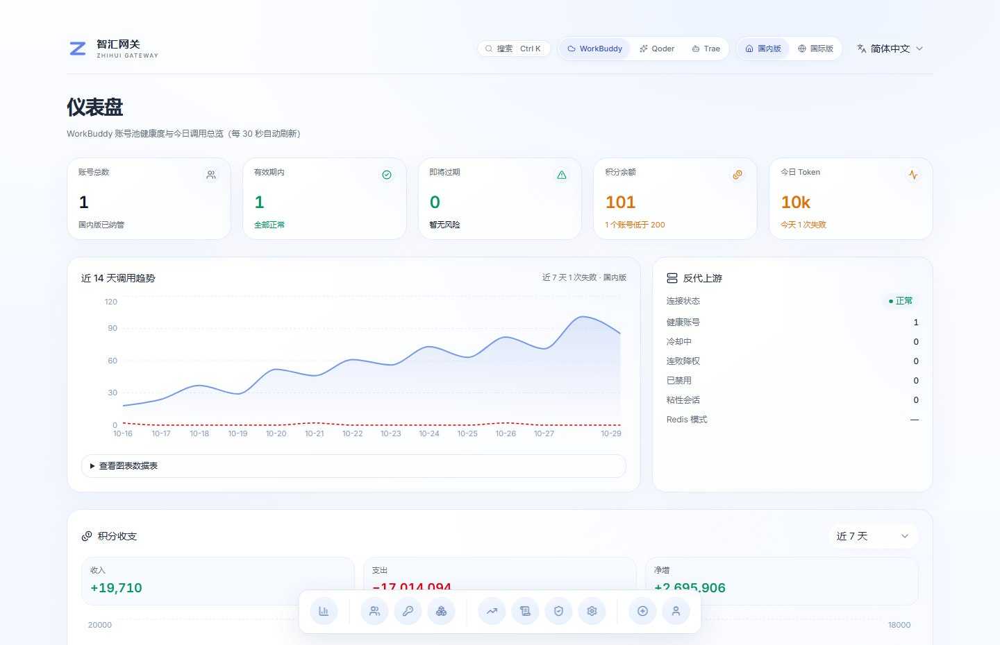
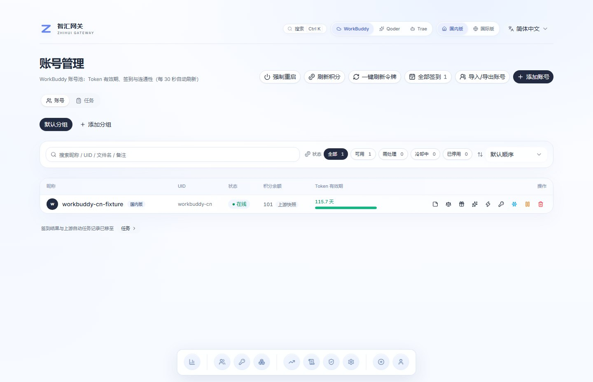
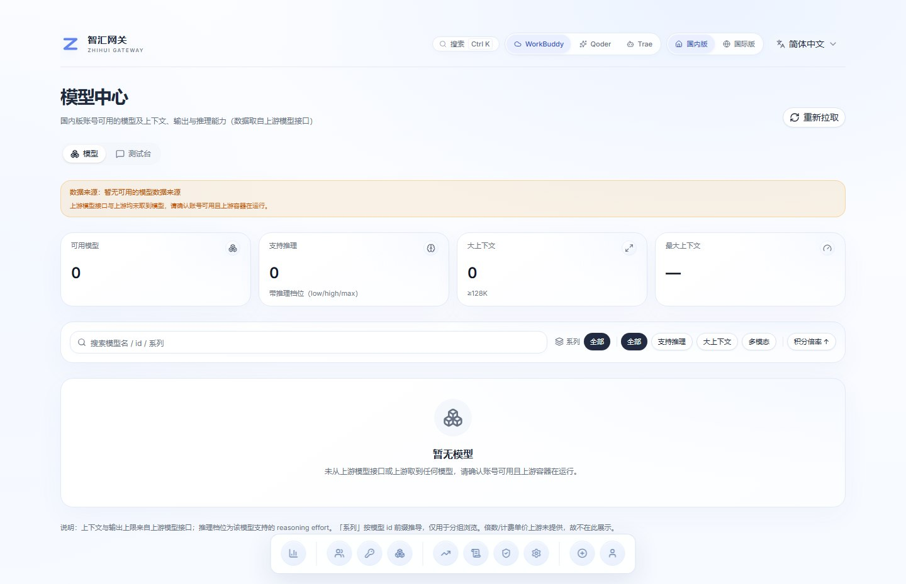
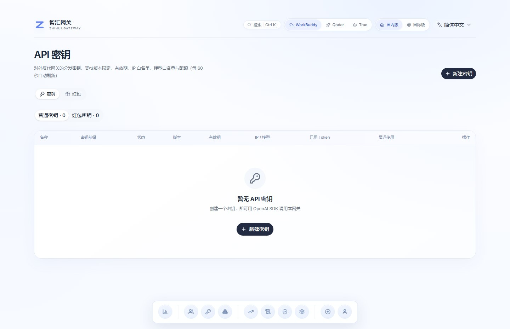
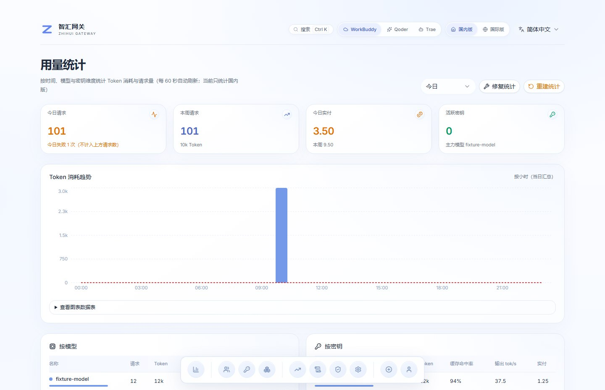
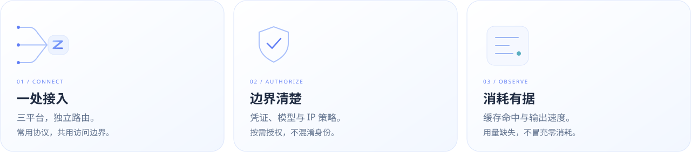

<div align="center">

<a href="https://zhihui.kaogong.art/">
  <picture>
    <source media="(max-width: 640px)" srcset="docs/images/readme/cover-mobile-v0.0.10.svg" />
    
  </picture>
</a>

<br />

**One workspace, three clear paths.**

Accounts, models, keys and usage stay together while platform authorization, boundaries and records remain explicit.

**English** · [简体中文](README.md)

<a href="https://zhihui.kaogong.art/"></a>
<a href="CHANGELOG.md"></a>
<a href="#development-and-deployment"></a>

<br /><br />

[This release](#1212--provider-rejection-diagnostics-and-ledger-observability) · [Workspace](#clear-and-usable) · [Routes](#one-entry-separate-routes) · [Boundaries](#state-support-and-limits-clearly) · [Development](#development-and-deployment)

</div>

<br />

## 1.2.12 · Provider rejection diagnostics and ledger observability

**Current product version: `v1.2.12`.** This release classifies explicit provider quota and plan rejections for clearer ledger diagnostics while preserving conservative reconciliation boundaries.

- **Provider rejection classification:** explicit quota, plan and related rate-limit responses now appear as identifiable pending-review evidence instead of generic unknown failures.
- **Conservative ledger evidence:** records without sufficient evidence stay unresolved; the gateway never guesses zero usage or releases user budget from a rejection alone.
- **Online handoff:** v1.2.12 passed signed-closure, candidate-health and Manager generation handoff verification in production.

**Release boundary:** the GitHub Release is visible only after Ubuntu checks, artifact hashes and the draft release have been reviewed. A source release does not claim that the domestic production server has already switched.[Full changelog](CHANGELOG.md) · [GitHub Release](https://github.com/daniei-chen/zhihui-gateway/releases/tag/v1.2.12)

> [!NOTE]
> Test counts belong to a specific build. Release acceptance uses the Ubuntu gates, artifact digests and a separate production runtime check; synthetic fixtures do not represent every client or provider.

<br />

## Clear and usable

A calm workspace keeps the account pool, models, keys and usage in one place.

<a href="https://zhihui.kaogong.art/">
  <picture>
    <source media="(max-width: 640px)" srcset="site/home/preview/dashboard-mobile.jpg" />
    
  </picture>
</a>

<p align="center"><sub>Console rendering with synthetic data; it is not a production ledger.</sub></p>

- **One workspace:** WorkBuddy, Qoder and Trae share the control surface while keeping their routes separate.
- **Bounded authorization:** ordinary administrators see redacted information and add authorized accounts; super administrators manage keys, quotas, roles and system settings.
- **Truthful usage:** missing provider evidence stays unknown instead of becoming a fabricated zero.
- **Separate user space:** each user manages bound accounts, check-in batches, keys and request history within their own scope.
- **Limited steward:** the steward reasons from bounded evidence and never receives shell, credential or ledger-edit authority.

<details>
<summary><b>More workspace panels</b> — accounts, models, keys and usage</summary>

<br />

| Account pool · identity and state | Models · sources and capabilities |
| :---: | :---: |
|  |  |
| **Keys · authorize when needed** | **Usage · verify every charge** |
|  |  |

These are synthetic console previews, not a provider-availability claim.
[Preview source and digest](site/home/preview/manifest.json) · [README visual asset manifest](docs/images/readme/manifest.json)

</details>

<br />

<picture>
  <source media="(max-width: 640px)" srcset="docs/images/readme/capabilities-mobile.svg" />
  
</picture>

<br />

## One entry, separate routes

Changing the console view does not silently change a client's base URL.

<picture>
  <source media="(max-width: 640px)" srcset="docs/images/readme/routing-mobile.svg" />
  
</picture>

| Platform | Client Base URL | Note |
| :--- | :--- | :--- |
| WorkBuddy | `https://your-domain/v1` | Chat, Responses and Messages adapters |
| Qoder | `https://your-domain/qoder/v1` | Subject to the engine and account authorization |
| Trae | `https://your-domain/trae/v1` | Subject to the engine and account authorization |

| Method | Path | Note |
| :--- | :--- | :--- |
| GET | `/v1/models` | WorkBuddy model catalog |
| POST | `/v1/chat/completions` | WorkBuddy chat |
| POST | `/v1/responses` | Responses-compatible entry point |
| POST | `/v1/messages` | Anthropic Messages-compatible entry point |
| GET | `/qoder/v1/models` | Qoder model catalog |
| POST | `/qoder/v1/chat/completions` | Qoder chat |
| POST | `/trae/v1/chat/completions` | Trae chat |

<details>
<summary><b>Minimal call example</b> — use a model and gateway key you already authorized</summary>

```bash
curl https://your-domain/v1/chat/completions \
  -H "Authorization: Bearer $ZHIHUI_API_KEY" \
  -H "Content-Type: application/json" \
  -d '{
    "model": "YOUR_AUTHORIZED_MODEL",
    "messages": [{"role": "user", "content": "Hello"}],
    "max_tokens": 128
  }'
```

Confirm the actual model ID, platform and region permissions in the model page first. A gateway key is not provider authorization; never put real keys in a repository, screenshot or ticket.

</details>

[Routing and permissions](server/routers/gateway.py) · [Budget reservations](server/budget.py) · [Immutable ledger](server/ledger.py)

<br />

## State support and limits clearly

| Responses capability | Current contract |
| :--- | :--- |
| Full explicit history, ordinary tool turns, SSE and images | Supported and regression-tested |
| `previous_response_id` / `conversation` | No server-side history; returns an explicit 400 before forwarding |
| `background=true` | Background tasks are not supported; returns an explicit 400 |
| `parallel_tool_calls=false` / function `strict=true` | The provider cannot guarantee it; returns an explicit 400 instead of silently ignoring it |
| Custom tool grammar | Descriptive guidance only; strict enforcement is not claimed |

> [!IMPORTANT]
> **Failure is not zero cost, and cancellation is not proof that a provider stopped.** When processing state is uncertain, the ledger keeps unknown. Code rollback does not roll back newly created usage, authorization or session revocation records.

<details>
<summary><b>Reliability and recovery boundary</b></summary>

- The main ledger uses WAL/FULL, while physical durability still depends on the operating system and storage.
- Paired ledger snapshots take short write locks and perform integrity checks in an isolated copy.
- Recovery writes to a new isolated directory, disables calls, revokes old sessions and archives credentials before re-enabling anything.
- Production changes use a controlled drain and switch; the source release itself does not claim zero downtime.

</details>

<br />

## Development and deployment

**Python 3.12 · Node.js 22+ · Next.js 16 · React 19**

```bash
git clone https://github.com/daniei-chen/zhihui-gateway.git
cd zhihui-gateway
```

| Goal | Start here |
| :--- | :--- |
| Run, modify or contribute | [Development guide](docs/DEVELOPMENT.md) · [Console source](web/) · [Gateway service](server/) |
| Understand versions and rollback | [Product release contract](docs/PRODUCT-RELEASE.md) · [1.2.12 changelog](CHANGELOG.md) |
| Inspect homepage and visual implementation | [Homepage source](site/home/index.html) · [Integration guide](site/home-source/INTEGRATION.md) |
| Trace implementation and open work | [Full changelog](CHANGELOG.md) · [Historical audit boundary](docs/AUDIT-0.0.3.md) |

Local development is not a one-command installation of all three engines. Provider engines, account authorization, authentication and persistence need separate review.

```text
fixed source → isolated build and tests → hashes, signatures and receipt → controlled release → runtime verification
```

**Do not treat a GitHub source archive as a production installer.** Controlled instances use the trusted publisher and do not overwrite the runtime directory with `git pull && restart` or restore old business data during code rollback.

<br />

## Thanks and license

Zhihui continues to evolve on top of existing components. Thanks to WorkBuddy Manager contributors, workbuddy2api, Qoder, Trae and the interface foundations that informed the project.

The product is [MIT](LICENSE). Component licenses and third-party notices are in [LICENSE](LICENSE) and [UPSTREAM-NOTICES.md]; provider terms and account authorization remain separate.

The cover, capability cards and routing diagram are self-contained SVG assets without remote fonts, scripts or images. Historical homepage assets retain their documented license and scope.

<div align="center">
<br />
<a href="https://zhihui.kaogong.art/"></a>
<p><sub>Zhihui · less noise, more control.</sub></p>
</div>


