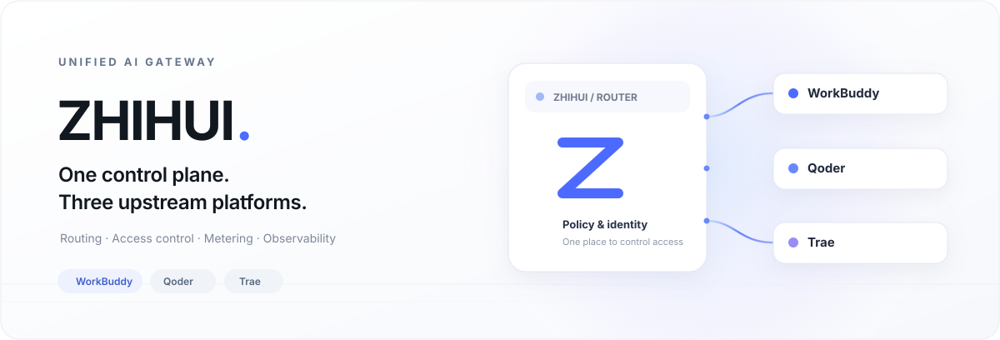

<div align="center">



# 智汇 · ZHIHUI Gateway

**多源汇入，一核管理。让每次 AI 调用都有迹可循。**

统一管理 **WorkBuddy / Qoder / Trae** 三套平台的账号池、访问凭证、模型与调用记录。<br />
面向自托管环境的 AI 网关与控制台，强调**边界清晰、计量可核、变更可追**。

<p>
  <a href="https://zhihui.kaogong.art/">项目网站</a> ·
  <a href="#-快速开始">快速开始</a> ·
  <a href="#-系统架构">系统架构</a> ·
  <a href="manager/deploy/README.md">部署指南</a> ·
  <a href="CHANGELOG.md">更新记录</a>
</p>

<p>
  
  
  
  
  
</p>

</div>

> [!IMPORTANT]
> **这是自托管的网关与管理项目，不是公开售卖 API 的平台。** 使用前请确保对相关账号、模型服务与客户端拥有合法授权，并遵守各上游服务的使用条款。文档描述的是仓库中的设计与实现，**不代表任意部署环境均已启用或经过线上验证**。

---

## ✦ 为什么做智汇

AI 网关不难写出“转发成功”的第一版，难的是稳定运行之后的每一笔账、每一个账号、每一次故障和每一次更新。

**智汇关心的不只是让请求通过，更是让系统的行为能够解释、能够核对、能够回退。**

| 关心什么 | 如果忽视它 | 智汇在代码层面的设计 |
|:--|:--|:--|
| **计量可信** | 上游不返回用量，账面却显示零支出 | 预算预留、结算与 `unknown` 待核对状态 |
| **权限边界** | 一把密钥混用，无法追查调用来源 | 密钥 × IP × 模型限制，按凭证独立生效 |
| **路由隔离** | 平台或账号池混用，统计与调用错位 | 平台路由前缀、独立账号池与作用域管理 |
| **发布完整性** | 产物被意外改动仍被当作正常版本 | Ed25519 签名与文件哈希校验机制 |
| **回退能力** | 回滚应用却不得不回滚生产数据 | 扩容式 Schema 迁移与旧版兼容检查 |

<div align="center">

<sub>仓库内现有控制台截图；账号昵称、UID 与来源 IP 已模糊处理。</sub>
</div>

## ◇ 核心能力

<table>
<tr>
<td width="50%" valign="top">

### 01 · 统一控制台

- WorkBuddy、Qoder、Trae 平台入口
- 多账号池与分组管理
- 平台、版本作用域切换
- 模型目录、任务与聊天测试台
- 桌面和移动端页面

</td>
<td width="50%" valign="top">

### 02 · 精细访问控制

- 下游 API Key 与独立额度
- IP 白名单 / 黑名单、CIDR 规则
- 模型白名单与平台绑定
- 管理员 / 查看者角色区分
- 管理操作审计

</td>
</tr>
<tr>
<td valign="top">

### 03 · 可观测的调用

- 请求状态、模型及使用量
- 按天、模型、密钥维度统计
- 首字延迟、Token 与缓存字段
- 请求标识与尝试事件追踪
- 数据缺失、失败及未知态区分

</td>
<td valign="top">

### 04 · 面向运维的工程基础

- 预算预留与用量对账
- 进程与任务租约
- 发布校验与版本管理
- 备份、迁移、回滚相关机制
- 隔离运行的测试工具链

</td>
</tr>
</table>

### 控制台预览

<table>
<tr>
<td width="50%"></td>
<td width="50%"></td>
</tr>
<tr>
<td align="center"><sub>账号池 · 状态、分组与有效期</sub></td>
<td align="center"><sub>调用日志 · 计量、延迟与错误信息</sub></td>
</tr>
<tr>
<td colspan="2"></td>
</tr>
<tr>
<td colspan="2" align="center"><sub>模型目录 · 模型系列、上下文与来源信息</sub></td>
</tr>
</table>

---

## ↗ 三个平台，清晰的调用路径

不同平台拥有不同的数据面前缀。**管理视图的切换不应被误解为改变真实请求的路由。**

| 平台 | 入口前缀 | 相关引擎 |
|:--|:--|:--|
| WorkBuddy | `/v1/*` | `workbuddy2api` |
| Qoder | `/qoder/v1/*` | `qoder2` |
| Trae | `/trae/v1/*` | `aiwork-server` |


> **协议与模型支持范围取决于具体适配器、上游版本和实际授权状态。** 请勿把存在兼容路由理解为所有模型、工具调用与流式功能均已完整验证。

## ◎ 账本：不知道，就明确地说不知道

当一次请求发出后，上游可能没有返回可靠的 `usage`。

此时最危险的处理是把缺失值写成 **0** —— 请求可能已经实际消耗额度，只是系统尚未获得计量结果。

智汇采用预算预留与后续结算设计。计量缺失时保留 `unknown`，等待后续核对，而不是静默抹掉差异。


**核心代码：**
- [`budget.py`](manager/server/budget.py) — 预算预留、结算与未知状态
- [`ledger.py`](manager/server/ledger.py) — 账本事件与调整记录
- [`budgetowner.py`](manager/server/budgetowner.py) — 预算归属与并发围栏

## ⛨ 安全边界：不是只有一个管理员密码

下游调用凭证和管理面凭证是**两种不同的东西**：

| 凭证 | 面向对象 | 用途 |
|:--|:--|:--|
| **下游 API Key** | 获授权的应用与客户端 | 访问对应模型接口，受额度、平台、IP 与模型规则限制 |
| **管理面会话** | 浏览器管理员或查看者 | 按角色访问管理功能；写操作需服务端授权 |
| **管理面 API Token** | 只读自动化与集成 | 访问允许的管理读接口，不能当作管理员写入凭证 |

具体见 [管理面 API Token 文档](docs/api-tokens.md) 与 [安全审查](docs/SECURITY-AUDIT.md)。

> [!CAUTION]
> 不要把上游账号授权文件、数据库、真实 API Key、会话 Cookie、签名私钥或生产环境配置提交到公开仓库。页面上的“已保护”状态不能代替服务端权限校验。

## ⌁ 发布、完整性与回退

发布与数据库迁移同样是网关可用性的一部分。


- **文件完整性**：发布流程使用签名与文件哈希验证；应区分“代码中存在校验”与“当前部署确已启用校验”。
- **数据库迁移**：采用扩容优先的 Schema 策略，并提供旧版本兼容检查；回退能力取决于具体版本差异与验证结果。
- **任务执行**：通过租约等机制控制并发任务归属；生产故障恢复需结合实际部署条件评估。

进一步阅读：[发布签名](docs/release-signing.md) · [部署与更新](manager/deploy/README.md) · [更新记录](CHANGELOG.md)。

---

## ⎈ 系统架构


| 层次 | 主要职责 | 对应位置 |
|:--|:--|:--|
| Web UI | 管理面板、登录、账号、模型、日志与统计 | `src/three-platform/web/` |
| Manager | 管理 API、鉴权、账本、数据库与反向代理 | `manager/server/` |
| 平台适配 | WorkBuddy / Qoder / Trae 的引擎适配与控制面兼容 | `manager/server/qtgcore/` |
| 部署维护 | 安装、升级、签名、恢复及运行环境说明 | `manager/deploy/`, `ops/` |
| 测试体系 | 单元、契约、浏览器与隔离运行辅助 | `manager/server/tests/`, `tests/` |

前端基于 **Next.js 静态导出**，由 FastAPI 托管构建产物；开发模式可使用 Next.js 开发服务。持久化采用 SQLite，具体数据所有权与多进程关系以实际版本为准。

> [!NOTE]
> Manager 与 QTG 的统一控制面仍有历史兼容和收敛议题，不宜将多处同名 API 简单视为单一权威实现。架构演进背景可参考 [统一控制面盘点](design/H08-U0-control-plane.md)。

---

## ⚡ 快速开始

以下是**本地开发与最小管理服务启动示例**，不等同于完整三平台生产部署。

### 环境

- Python 3.11+
- Node.js（前端开发使用，具体兼容版本以项目锁文件和构建环境为准）
- 实际账号池与代理能力需对应上游服务

### 1. 获取代码

```bash
git clone https://github.com/daniei-chen/zhihui-gateway.git
cd zhihui-gateway
```

### 2. 启动最小管理服务

```bash
cd manager
python -m venv venv
venv/bin/pip install -r server/requirements.txt

WB_ADMIN_PASSWORD='change-to-a-strong-password' \
WB_DATA_DIR=./data \
venv/bin/python -m uvicorn server.main:app --host 127.0.0.1 --port 7864
```

这一步不代表所有上游引擎已经就绪。请在非生产环境操作，不要直接复制示例密码到真实部署中。

### 3. 启动前端开发服务

另开一个终端：

```bash
cd zhihui-gateway/src/three-platform/web
npm ci
npm run dev
```

前端开发服务默认使用 `http://localhost:3000`，开发代理目标可参考 [`next.config.ts`](src/three-platform/web/next.config.ts)。

> [!TIP]
> **生产部署请优先阅读 [完整部署指南](manager/deploy/README.md)**。上游源码、运行配置、镜像版本、账号目录和发布校验均需要与目标环境匹配。不要把本地示例直接当成生产安装清单。

### 4. 测试（仅隔离环境）

```bash
cd manager
python -B -X utf8 ../tests/zhihui_harness/run_tests.py --target manager-assets --keep
```

项目使用隔离测试运行器。**不要直接在生产服务器上运行测试或对账脚本**，也不要将无隔离的全量 `pytest` 当作推荐入口。Windows 环境的额外注意事项见原有测试和部署文档。

---

## 📂 项目地图

```text
zhihui-gateway/
├── manager/
│   ├── server/              # FastAPI、权限、账本、网关与平台适配
│   └── deploy/              # 安装、更新、发布与回退
├── src/three-platform/web/  # Next.js / React 控制台
├── docs/                    # 专题说明与真实产品截图
├── design/                  # 架构决策、控制面及安全设计
├── ops/                     # 运维、监控和安全配置资料
├── tests/                   # 隔离测试、浏览器测试和工程验收
├── tools/                   # 审计与维护辅助工具
└── CHANGELOG.md             # 版本变更记录
```

面向开发者的进一步入口：

- [网关代码及职责](manager/server/)
- [部署与更新指南](manager/deploy/README.md)
- [账号出口线路说明](docs/account-proxy-routes.md)
- [管理面 API Token](docs/api-tokens.md)
- [安全审查](docs/SECURITY-AUDIT.md)
- [发布与签名机制](docs/release-signing.md)
- [版本变更](CHANGELOG.md)

## ◌ 已知边界

真实的工程文档应当同时说明**已经实现的机制**与**尚未证明的能力**。

- **签名门禁**：可检测受保护产物的变化，但不能防止拥有签名私钥或足够系统权限的人重新签署产物。
- **异地备份**：仓库记录的某些备份目录仍与生产位于同一机器；不能据此宣称已有独立异地灾备。
- **调用账号归因**：部分首字延迟与实际调用账号信息依赖上游容器日志及部署条件，缺少日志源时不能补造。
- **真实流量覆盖**：历史记录中 WorkBuddy 线上流量更充分；Qoder 与 Trae 的完整真实流量验证不能仅靠代码与模拟测试替代。
- **控制面收敛**：Manager 与 QTG 的部分职责仍需逐项核实，不能把“同名接口”自动当作“同一数据来源”。

具体状态可能随版本变化；请结合部署版本、现有测试和运维证据核对。

## ♡ 致谢与许可

本项目基于 [Sliverkiss/workbuddy2api](https://github.com/Sliverkiss/workbuddy2api) 提供的账号池与 OpenAI 兼容代理底座扩展控制面及管理能力。上游代码及版权归原作者，按其 MIT 许可证条款使用；随发布包分发上游源码时应保留相应版权与许可文件。

另参考：[workbuddy-sdk](https://github.com/sanguine886/workbuddy-sdk) · [cdk](https://github.com/linux-do/cdk) · [Antigravity-Manager](https://github.com/lbjlaq/Antigravity-Manager)。

本仓库许可见 [LICENSE](LICENSE)。

---

<div align="center">

**ZHIHUI · 多源汇入，一核管理。**

<sub>Open-source control plane for a self-hosted AI gateway · Designed for clarity, accountability and safe iteration.</sub>

<br /><br />

<a href="https://zhihui.kaogong.art/">Website</a> · <a href="#-快速开始">Get Started</a> · <a href="CHANGELOG.md">Changelog</a> · <a href="LICENSE">License</a>

</div>
