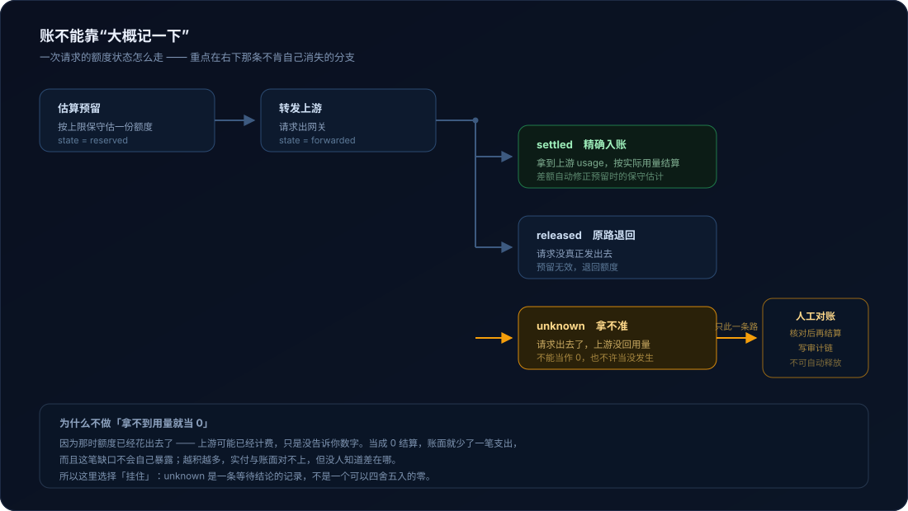
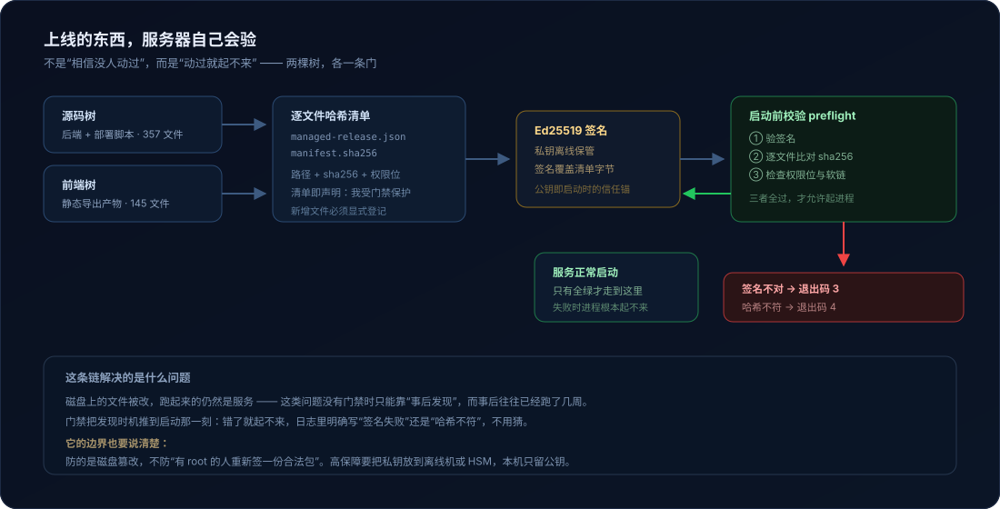
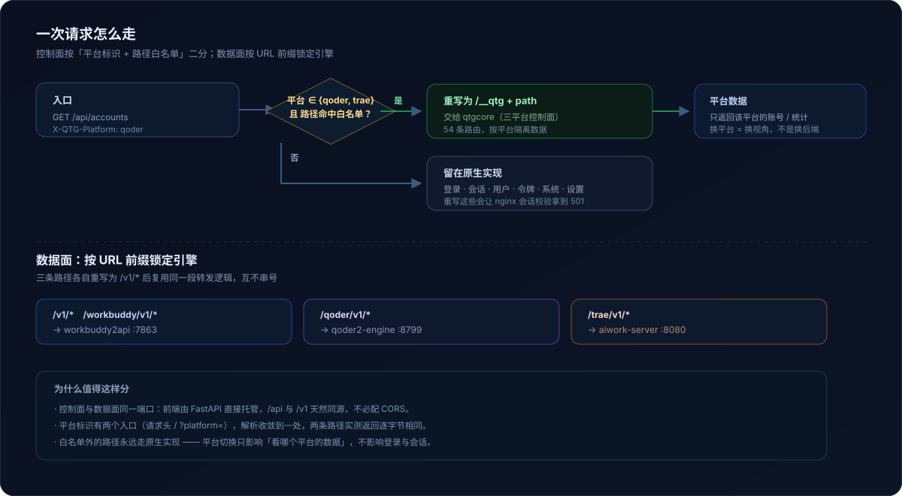
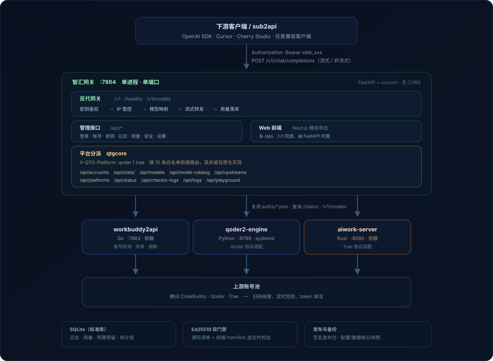

# 智汇网关

**三平台合一。账要能对上，上线的东西不能被改。**

把 WorkBuddy / Qoder / Trae 三套账号池收进一个控制面：一块面板管账号、密钥、白名单、
日志与用量，一个 `/v1` 入口对外提供 OpenAI 兼容接口。前端是静态导出，由 FastAPI 直接托管，
单进程单端口，不配 CORS。


<p align="right"><sub>真实运行界面；账号昵称、UID 与来源 IP 已模糊</sub></p>

---

## 它替你看着四样东西

面板功能可以列一百条，但真正容易出事的是这四件。下面每一节都写了「为什么这么做」和
「代码在哪」，不写「本功能支持 xxx」。

| | 出问题时会怎样 | 这里的做法 |
|---|---|---|
| **账** | 上游没回用量，这笔就少记一笔；缺口越积越多，实付与账面对不上，却查不出差在哪 | 挂成 `unknown` 等对账，**绝不自动归零** |
| **发布** | 磁盘上的文件被改，服务照常跑几周，直到有人偶然发现 | 启动前验签名 + 逐文件哈希，不符就**起不来** |
| **回退** | 迁移完想退回旧版，被告知「恢复一下快照吧」，而快照已经落后几个小时 | schema 只做 expand，**旧进程能在新库上跑** |
| **边界** | 一个密钥给所有人共用，出事只能承认「不知道是谁」 | 密钥 × IP × 模型三层，逐密钥生效 |

---

## 01 · 账不能靠「大概记一下」



一次请求进来先保守预留额度，转发后按是否拿到上游用量分三条路走。前两条没什么特别，
**关键是右下那条**：请求确实发出去了，上游却没回 usage —— 这时候额度可能已经花掉，
只是你不知道数字。

> **设计笔记**
>
> 拿不到用量时，最省事的做法是「当 0 结算」。但这笔支出可能真实发生了：账面少记一笔，
> 缺口不会自己暴露，越积越多，最后实付与账面对不上，而没人知道差在哪。
>
> 所以这里选择「挂住」：`unknown` 是一条等待结论的记录，不是一个可以四舍五入的零。
> 它只能经人工核对推进到终态，且核对过程本身写入审计链。

代码：`manager/server/budget.py`（预留 / 结算 / unknown 语义）、`manager/server/ledger.py`（账本与调整事件）、
`manager/server/budgetowner.py`（预留归属与围栏，防止重启时抢别人的预留）

---

## 02 · 上线的东西，服务器自己会验



两棵树各有一条门：源码树 357 个文件，前端静态产物 145 个文件。每次启动先验 Ed25519 签名，
再逐文件比对 sha256，任一不符直接拒绝启动，日志里写明是签名失败（退出码 3）还是哈希不符（退出码 4）。

> **设计笔记**
>
> 这里有个容易忽略的细节：**清单存在，就等于产物声明「我受门禁保护」**。所以「清单缺失」
> 不能当成「无需校验」静默放行 —— 那会变成绕过门禁的最短路径。当前实现是放行但打印 WARN，
> 让运维侧看得见。
>
> 另一个坑：新增文件默认不会被写进清单。加了模块却忘记登记，就等于多了一个不受保护的入口。

代码：`manager/deploy/source_preflight.py`、`manager/deploy/web_preflight.py`、
`manager/deploy/sign-release-ed25519.py`

---

## 03 · 回退不该要求恢复快照

扩容式的 schema 变更（只加列、不改旧列语义）+ 旧读者兼容认证：迁移之后的库，
**旧版本进程仍能正常读写**，回退时替换代码即可，不需要退数据库。

| 常规做法 | 这里的做法 |
|---|---|
| 迁移前强制备份，回退靠恢复快照 | 迁移后旧进程仍可用，回退只需换回代码 |
| 快照到回滚之间的数据丢失 | 不回退数据，没有这段丢失 |

代码：`manager/server/migrations.py`（expand 优先，收缩步骤默认 deferred）、
`manager/server/schema_compat.py`（旧读者兼容认证）、`manager/server/schemaver.py`（迁移指纹）

---

## 04 · 边界要能落到「是谁」

三层限制，逐密钥生效，不是全局一刀切：

- **密钥**：只在创建响应里返回一次明文，库存哈希；带版本（国内版 / 国际版）、额度、平台绑定
- **IP**：全局白 / 黑名单与 CIDR 规则，叠加每密钥的 IP 上限与白名单，带访问审计
- **模型**：每密钥的模型白名单，未列出的模型直接拒绝

> 一个密钥发给十个下游，出问题时你只能知道「这批人里有人超了」。逐密钥才是能追到人的最小单位。

代码：`manager/server/qtgcore/authz.py`（规则与平台判定）、`manager/server/qtgcore/identity.py`
（凭证分类与身份断言）、`manager/server/observability.py`（准入与并发闸）

---

## 三个平台，一个入口



平台标识有两个入口（`X-QTG-Platform` 请求头 / `?platform=` 查询参数），解析收敛到一处，
两条路径返回逐字节相同的结果。平台切换只改变「看哪个平台的数据」，不影响登录与会话本身。

数据面按 URL 前缀锁定引擎：`/v1/*` → workbuddy2api、`/qoder/v1/*` → qoder2、
`/trae/v1/*` → aiwork-server，各自重写后复用同一段转发逻辑，互不串号。

## 面板

<table>
<tr>
<td width="50%"><br /><sub>账号管理 · Token 有效期按剩余时间分档</sub></td>
<td width="50%"><br /><sub>请求日志 · 首字延迟、Token 计量、缓存命中</sub></td>
</tr>
<tr>
<td><br /><sub>模型中心 · 上下文、推理档位、系列分组</sub></td>
<td><br /><b>其余页面</b><br /><br />
任务记录 · 签到结果与上游原始日志<br />
API 密钥 · 额度 / IP / 模型白名单<br />
用量统计 · 按天 / 模型 / 密钥<br />
聊天测试台 · 不建密钥直接试调<br />
安全与 IP 管控 · 白黑名单与审计<br />
设置 · 上游配置可视化<br />
移动端 · 侧栏抽屉 + 卡片化列表</td>
</tr>
</table>

## 架构



<details>
<summary>纯文本版本（便于粘贴到终端或邮件）</summary>

```
   下游客户端 / sub2api（OpenAI SDK）
              │  Authorization: Bearer wbk_xxx
              ▼
   ┌──────────────────────────────────────────────┐
   │  智汇网关                            :7864   │
   │  ┌────────────────────────────────────────┐  │
   │  │ 反代网关  /v1  /healthz                │  │
   │  │  密钥鉴权 → IP 管控 → 模型映射          │  │
   │  │  → 流式转发 → 日志与用量落库(SQLite)    │  │
   │  ├────────────────────────────────────────┤  │
   │  │ 管理接口  /api/*                       │  │
   │  ├────────────────────────────────────────┤  │
   │  │ Web 前端（Next.js 静态导出）            │  │
   │  └────────────────────────────────────────┘  │
   └───────────────┬──────────────────────────────┘
                   ▼
   ┌──────────────────────────────────────────────┐
   │  workbuddy2api（Go，不改动）          :7863  │
   │  账号轮询 · 并发调度 · 熔断 · 令牌刷新          │
   └───────────────┬──────────────────────────────┘
                   ▼
        腾讯 CodeBuddy / copilot.tencent.com
```

</details>

---

## 跑起来

仓库里代码在 `manager/` 和 `src/three-platform/web/` 两个子目录，下面命令都从仓库根开始。

**后端（最小路径）**

```bash
cd manager
python -m venv venv && venv/bin/pip install -r server/requirements.txt
WB_ADMIN_PASSWORD=改个好密码 \
WB_DATA_DIR=./data \
venv/bin/python -m uvicorn server.main:app --host 127.0.0.1 --port 7864
```

首次启动会自动生成 `users.json` 与随机签名密钥；未设 `WB_ADMIN_PASSWORD` 时会在日志里
打印一次随机管理员密码，登录后请立即修改。

**前端**

```bash
cd src/three-platform/web
npm install
npm run dev        # http://localhost:3000，/api 与 /v1 反代到 :7864
```

**测试**

```bash
cd manager
python -B -X utf8 ../tests/zhihui_harness/run_tests.py --target manager-assets --keep
```

> 测试入口是隔离运行器（临时根 + 网络 block + 假 provider），**不要直接 `pytest` 全量**。
> Windows 下先设 `PYTHONUTF8=1`、`PYTHONDONTWRITEBYTECODE=1`。

## 目录契约

几个改动时最该先看的文件：

| 路径 | 管什么 |
|---|---|
| `manager/server/budget.py` | 预算预留 / 结算 / `unknown` 语义 |
| `manager/server/ledger.py` | 账本事件与调整记录 |
| `manager/server/migrations.py` | schema 版本化，expand 优先 |
| `manager/server/schema_compat.py` | 旧读者兼容认证（回退安全） |
| `manager/server/instancelease.py` | 实例租约，单写者交接 |
| `manager/server/qtgcore/capabilities.py` | 平台能力表与三层成功判定 |
| `manager/deploy/source_preflight.py` | 启动门禁（源码） |
| `manager/deploy/web_preflight.py` | 启动门禁（前端产物） |
| `tools/audit_control_plane.py` | 控制面路由 / 权限盘点 |
| `tools/metering_reconcile.py` | 计量对账 |

## 已知边界

这些是**没解决**的，列出来避免误解：

- **门禁防磁盘篡改，不防有 root 的人重新签**。高保障要把私钥放离线机或 HSM。
- **备份不是真异地**：远端目录与生产同机，真正的异地需要对象存储或独立远端凭据。
- **首字延迟依赖容器日志**：上游不在本机或未挂 `docker.sock` 时，「实际调用账号」这一列取不到值。
- **Qoder / Trae 数据面缺少持续真实流量**：控制面与协议适配是通的，但线上调用量主要来自 WorkBuddy。

## 来源

上游 [**Sliverkiss/workbuddy2api**](https://github.com/Sliverkiss/workbuddy2api)（MIT）——
账号池与 OpenAI 兼容代理的底座。本项目为它补上控制面与可视化，**没有修改它一行代码**；
其源码随本项目的发布包一起分发，版权归原作者。

其它参考与工具见 [docs/SECURITY-AUDIT.md](docs/SECURITY-AUDIT.md)：
[`sanguine886/workbuddy-sdk`](https://github.com/sanguine886/workbuddy-sdk)（Go 客户端库）、
[`linux-do/cdk`](https://github.com/linux-do/cdk)、
[`lbjlaq/Antigravity-Manager`](https://github.com/lbjlaq/Antigravity-Manager)。

## 许可证

见 [LICENSE](LICENSE)。上游 workbuddy2api 遵循其自身 MIT 许可。

---

<p align="right">
<sub>
Python 3.11+ · FastAPI · SQLite（标准库） · Next.js 15 · React 19 · Tailwind v4　|　
<a href="CHANGELOG.md">更新日志</a> ·
<a href="docs/SECURITY-AUDIT.md">安全审查</a> ·
<a href="docs/release-signing.md">发版与签名</a> ·
<a href="docs/api-tokens.md">管理面 Token</a>
</sub>
</p>