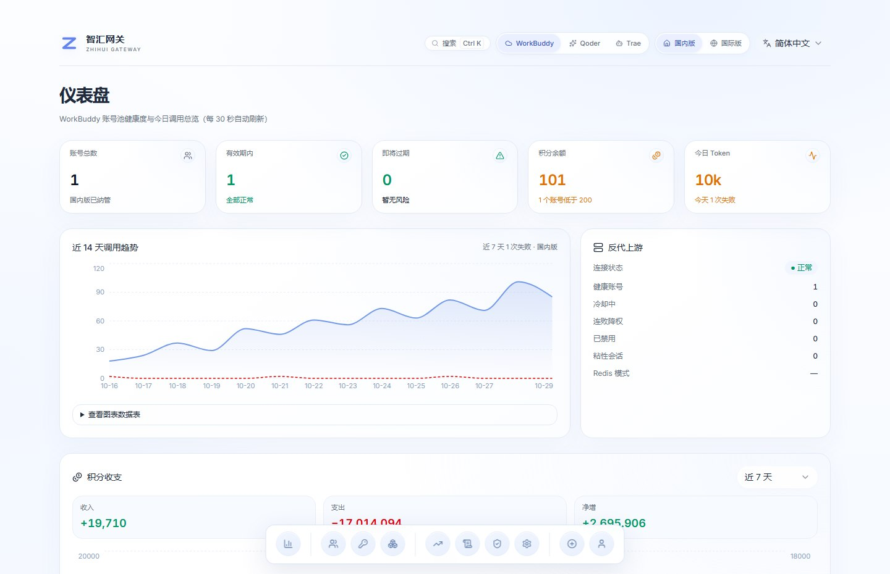
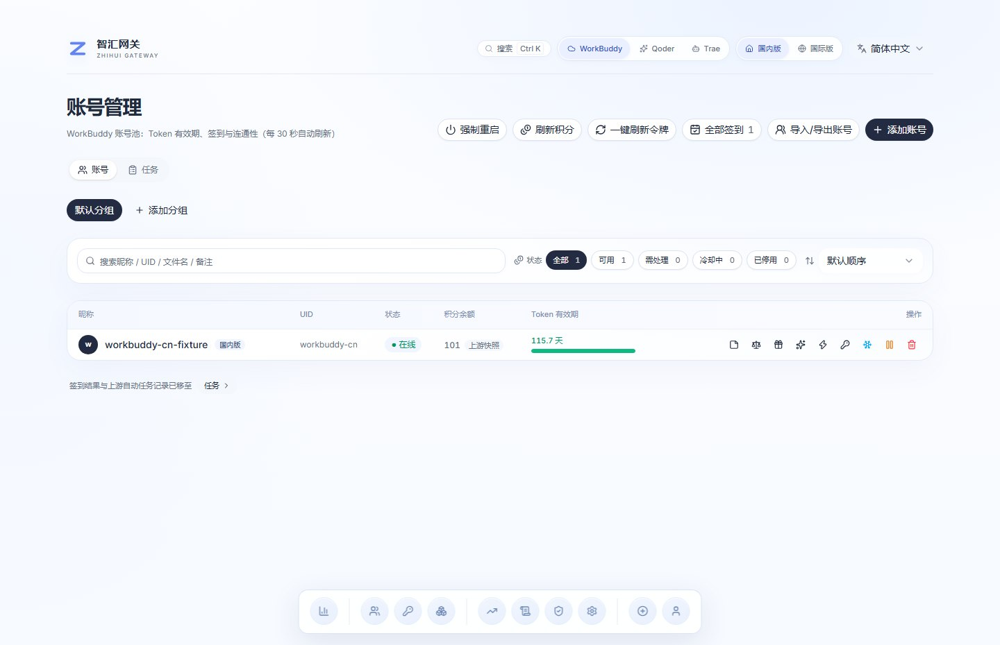
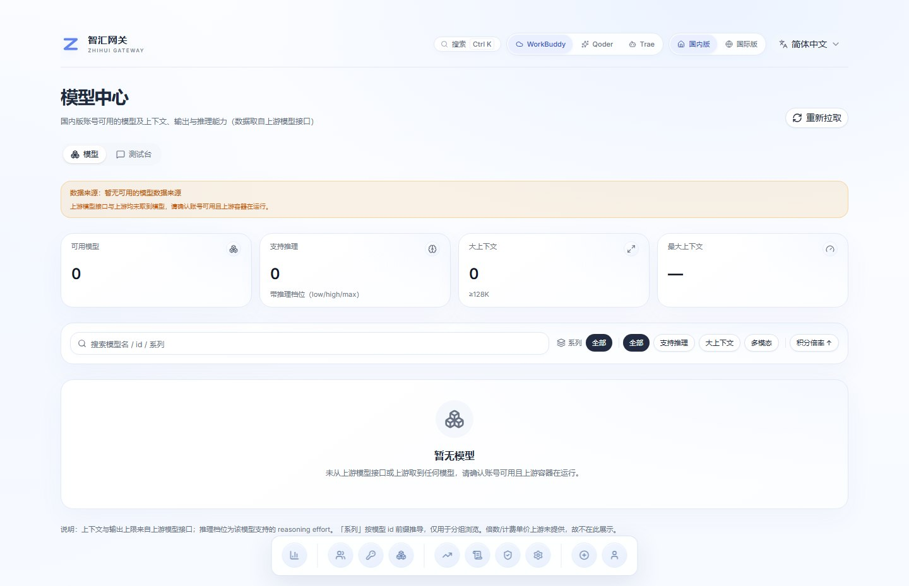
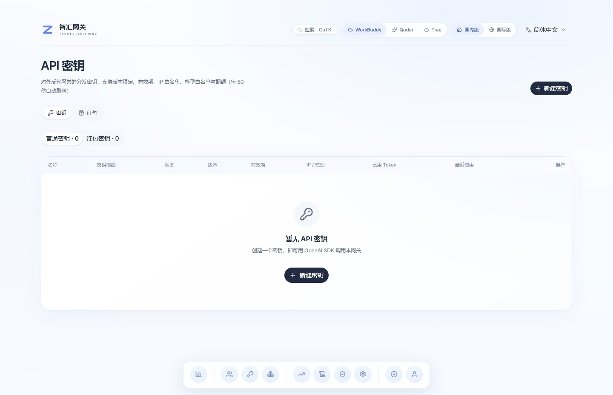
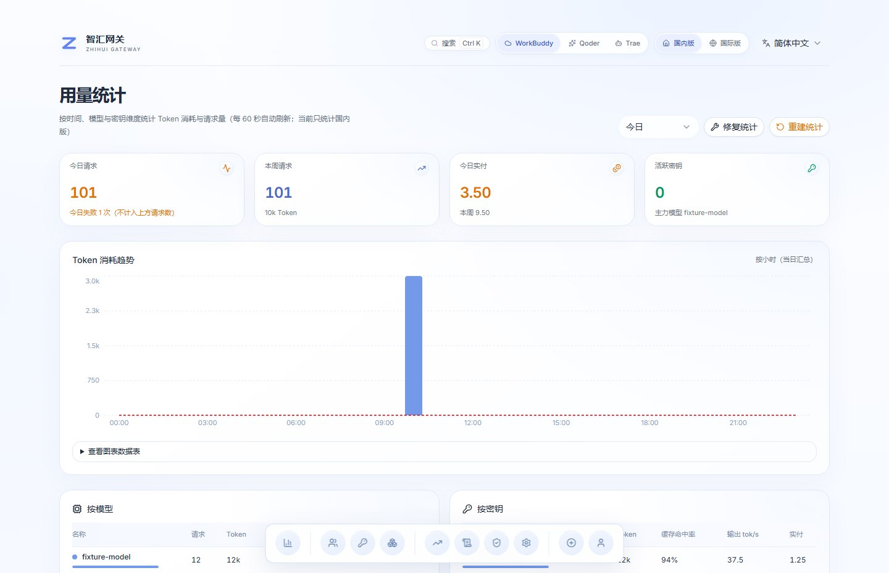
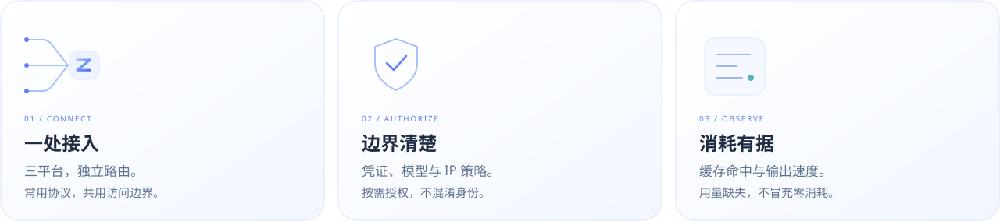

<div align="center">

<a href="https://zhihui.kaogong.art/">
  <picture>
    <source media="(max-width: 640px)" srcset="docs/images/readme/cover-mobile-v0.0.10.svg" />
  
  </picture>
</a>

<br />

**一个工作台，两条清晰的路径。**

账号、模型、密钥与用量在一起；平台的授权、边界与记录不混在一起。

**中文** · [English](README.en.md)

<a href="https://zhihui.kaogong.art/"></a>
<a href="CHANGELOG.md"></a>
<a href="#开发与部署"></a>

<br /><br />

[本次更新](#142--积分可见与平台收敛) · [工作台](#看得清也用得顺) · [接入](#统一入口各有其路) · [能力边界](#把支持与不支持都讲清楚) · [开发与部署](#开发与部署)

</div>

<br />

## 1.4.2 · 积分可见与平台收敛

**本次版本：`v1.4.2`**。网关现在只承载 **WorkBuddy** 与 **Trae** 两个平台，并开始按小时记录平台积分余额——余额偏低会提前告警。

- **平台收敛为两个。** 豆包工作下线。它仍可被识别（存量密钥不会因此报错），但不再是可用平台。
- **余额看得见了。** 此前只有「这个平台只有一个账号」这类冗余度告警，没有任何余额告警；而余额耗尽会让平台直接不可用，且无人知情。现在余额低于阈值就会提示，低于 5% 时标记为「即将耗尽」。
- **为什么先记录、不扣费。** 有的平台按积分结算，但上游不返回单次请求消耗多少积分——连续几次请求后余额一动不动，说明这类结算是批量发生的。先把余额按小时存下来，等攒够「用量」与「余额减少」的对照，换算关系就能反推出来。
- **修掉一个会让统计失真的字段。** 直连平台的记录此前会带上另一个平台的账号名，按账号统计时会失真。现在如实留空，表示平台级单账号。
- **平台属性集中到一处。** 新增平台不再需要在十几个地方分别改判断——加一行描述即可，其余各处自动跟随。

**发布边界如实列出。** 本版不改变任何计费行为：不扣额度、不算费用，只多一份余额快照；换算关系仍需数据积累后确定。[完整更新日志](CHANGELOG.md) · [GitHub Release ↗](https://github.com/daniei-chen/zhihui-gateway/releases/tag/v1.4.2)

<br />

## 1.4.0 · 平台精简与打通专版（历史版本）

**本次版本：`v1.4.0`**。网关从此只承载 **WorkBuddy** 与 **Trae** 两个平台：Trae 全面接入统一鉴权、限流、预算与账本，Qoder 正式下线。

- **我们很遗憾，Qoder 目前不再提供免费积分每日领取。我们在智汇网关中已移除 Qoder，目前正在积极寻找其他免费额度反向代理，敬请期待。**
- **Qoder 不再「暂时不可用」**：`/qoder/v1/*` 现在直接返回 410 并说明原因。以前这里回的是 502「上游暂时不可用，请等 5 秒后重试」—— 那是在告诉调用方「等等就好」，与事实相反，只会让人反复重试一个永远不会回来的平台。
- **Trae 的账号看得见**：账号视图经 `trae2api-hub` 的脱敏接口读取，返回状态、剩余天数、是否绑定设备与积分；**令牌与设备私钥一个字节都不外传**。
- **续期归属讲清楚**：refresh token 是轮换式的，只允许一个持有者。网关侧不再代刷，接口如实返回 `triggered: false` —— 两边各自刷新会把对方的令牌作废，这不是假设，已经发生过一次。
- **超时按实测收敛**：Trae 近 3 天实测延迟平均 1.2 秒、最大 3.7 秒，超时从默认 300 秒收到 120 秒；WorkBuddy 保持 300 秒，因为它确实有超长首字节（最长 186 秒）。
- **告警不再骗人**：被上游拒绝（例如 prompt 过长）的请求按设计留在待核对，不再被当成「预留未归还」长期报警；账号池只统计在营平台。
- **备份真的能恢复**：修好了发布清单与磁盘不一致、门户库悬空映射这两处断链，备份重新做到 `restore_check=ok`。

**发布边界如实列出。** 本版不声称「绝对无漏洞、零缺陷」；Trae 目前只有一个账号，是单点，需要再加账号才能真正消除。控制台的整树重建没有在本轮做，平台白名单与版本号已同步到源码与构建产物。[完整更新日志](CHANGELOG.md) · [GitHub Release ↗](https://github.com/daniei-chen/zhihui-gateway/releases/tag/v1.4.0)

<br />

## 1.2.25 · rootless 上游与请求体门禁（历史版本）

**本次版本：`v1.2.25`**。这一版在修复 413 请求体门禁的基础上，把 Qoder 生产数据面切到签名 broker 验证后的 `1.9.9` rootless unit，并把 rootless 启动器、systemd 隔离合同和线上审计证据纳入源码。

- **请求体边界一致**：relay 入口使用 128 MB 边缘上限、60 秒请求体超时、限流/并发保护和统一错误页；Manager 自身继续执行 64 MB 转发上限。
- **流式行为保留**：relay 仍关闭请求体缓冲、禁止失败重试，已接受的流不会被重复发送。
- **真实大请求已回归**：国内服务器 4 MiB 请求已穿过 Nginx 和 relay 到达鉴权层，返回 401 而不是 413；修复后观测窗口新增 413 为 0。
- **Qoder 数据面已降权**：生产 `1.9.9` 在 `127.0.0.1:8799` 运行，实际 UID/GID 为 `10001:10001`，`CapEff=0`、`NoNewPrivileges=1`、seccomp 2；签名 broker 仍负责 release 校验、原子激活和失败回滚。
- **数据库与运行时已复核**：SQLite 完整性检查通过，Manager、relay、Qoder 和 Trae 的边界证据写入[线上审计报告](docs/PRODUCTION-AUDIT-2026-11-14.md)。

**发布边界如实列出。** 这次完成的是网关请求体修复和 Qoder rootless 数据面切换；离机灾备仍未配置，历史 503/502 仍需单独做上游可用性复盘。[完整更新日志](CHANGELOG.md) · [上游复核](docs/UPSTREAM-REVIEW-2026-11-14.md) · [线上审计](docs/PRODUCTION-AUDIT-2026-11-14.md) · [GitHub Release ↗](https://github.com/daniei-chen/zhihui-gateway/releases/tag/v1.2.25)

<br />

## 1.2.23 · 路由交接权限与 rootless 验收（历史版本）

**本次版本：`v1.2.23`**。这一版收紧 Qoder/Trae 本机路由交接：只允许受信父目录，root 写入的路由文件固定为 `root:10001`、`0640`，并完成 Qoder Hub v1.9.9 的私有 rootless 启动与重启恢复验收；不把候选引擎误报成生产升级。

- **路由权限可验证**：原子替换后同步文件和目录，rootless 数据面可读，其他本机用户不可读写。
- **候选启动更接近生产**：Qoder 1.9.9 在只读 release、外置状态与外置日志下以 `10001:10001`、零 capability、`NoNewPrivileges=1`、seccomp 2 运行。
- **升级边界明确**：生产仍保持 Qoder 1.9.8；持久化 unit、真实路由切换/回退及认证数据面还要由受控发布器完成后才提升。

**发布边界如实列出。** 本版 Qoder rootless canary 未接入公网流量，源码版本不能替代国内服务器的独立受控验收。[完整更新日志](CHANGELOG.md) · [上游复核](docs/UPSTREAM-REVIEW-2026-11-14.md) · [GitHub Release ↗](https://github.com/daniei-chen/zhihui-gateway/releases/tag/v1.2.23)

<br />

## 1.2.22 · Relay 启动与切流合同修复（历史版本）

**本次版本：`v1.2.22`**。这一版修正推理 relay 在固定数字 UID 宿主上的 systemd 启动合同：先由受信入口完成一次性身份交接，再让实际应用以 `10001:10001`、零有效 capability 和 `NoNewPrivileges` 运行；不改变现网 Manager 的用户、额度或账本状态。

- **relay 能真正启动**：不再假设宿主存在名为 `10001` 的 passwd 用户，避免 systemd `217/USER`。
- **切流边界可核验**：保留 route epoch 单调、流请求不重放、仅允许 loopback backend 和推理白名单。
- **验证更接近生产**：增加 unit 合同回归，并在国内服务器私有端口完成真实 relay 身份与切换 canary。

**发布边界如实列出。** 当前服务器没有启用 relay systemd unit，本版私有 canary 未接入公网流量；源码版本不能替代国内服务器运行版本的独立验收。[完整更新日志](CHANGELOG.md) · [上游复核](docs/UPSTREAM-REVIEW-2026-11-14.md) · [GitHub Release ↗](https://github.com/daniei-chen/zhihui-gateway/releases/tag/v1.2.22)

<br />

## 1.2.21 · 权限交接、启动可靠性与供应链锁定（历史版本）

**上一版本：`v1.2.21`**。这一版在 v1.2.20 的运维恢复和供应链锁定基础上，修复 root 维护流程与 UID 10001 应用之间的敏感数据权限交接，避免 `users.json` 漂移导致登录 500；不自动改动额度、扣费或账本状态。

- **权限交接可靠**：受信启动器在降权前收敛数据目录、`users.json` 和初始密码文件的属主与权限；不安全路径或无法修复时先阻断启动，避免服务带着隐蔽的 500 运行。
- **运维恢复更稳**：housekeeping 获取备份生产锁时最多等待 180 秒，锁长期不释放仍失败关闭，不绕过备份生产者。
- **供应链可复核**：release workflow 在解压前核对 upstream-src 的固定 SHA256 与字节数，浮动或被替换的资产直接阻断。
- **上游状态透明**：记录当前观察到的 WorkBuddy Manager、Qoder Hub、TraeWorkAssistant 提交；上游新版本不会被误写成生产已升级。
- **证据边界不变**：供应商拒绝只改善诊断分类，不被推断为零计费，也不会触发自动结清。

**发布边界如实列出。** GitHub Release 需等待 Ubuntu CI、产物摘要和草稿 Release 核对；本次源码版本不能替代国内服务器当前运行版本的独立验收。[完整更新日志](CHANGELOG.md) · [上游复核](docs/UPSTREAM-REVIEW-2026-11-14.md) · [GitHub Release ↗](https://github.com/daniei-chen/zhihui-gateway/releases/tag/v1.2.21)

> [!NOTE]
> 测试数量必须对应具体构建。发布前以 GitHub Ubuntu 门禁、构建产物摘要和服务器运行核验为验收口径；合成夹具不冒充所有客户端版本或供应商推理基准。

<br />

## 看得清，也用得顺

冰蓝、留白、轻量交互。从账号池到调用记录，一处掌握。

<a href="https://zhihui.kaogong.art/">
  <picture>
    <source media="(max-width: 640px)" srcset="site/home/preview/dashboard-mobile.jpg" />
    
  </picture>
</a>

<p align="center"><sub>实际控制台构建渲染 · 合成数据 · 非当前生产状态截图</sub></p>

- **管理不割裂。** WorkBuddy 与 Trae 共用工作台，保留平台切换、明暗主题、浮动 Dock 与五语界面。
- **授权有边界。** 普通管理员可浏览脱敏信息、添加授权账号；超级管理员维护密钥额度、用户权限与系统设置。
- **用量不猜测。** 查看缓存命中、输出速度和请求记录；缺少可靠用量时显示未知，不包装成零消耗。
- **用户有自己的空间。** 独立工作台管理绑定账号、签到批次、密钥与请求记录；财务策略以已批准配置和可核验证据为准。
- **管家只做该做的事。** 基于有限脱敏证据研判，规则告警与 AI 补充分开；不授予 shell、凭据读取或自动改账权限。

<details>
<summary><b>展开更多工作面板</b> — 账号池、模型、密钥与用量</summary>

<br />

| 账号池 · 身份与状态 | 模型 · 来源与能力 |
| :---: | :---: |
|  |  |
| **密钥 · 按需授权** | **用量 · 核对每次消耗** |
|  |  |

这些是历史控制台构建的合成预览，不是另画的概念面板，也不证明供应商可用性。
[预览来源与摘要](site/home/preview/manifest.json) · [README 视觉素材清单](docs/images/readme/manifest.json)

</details>

<br />

<picture>
  <source media="(max-width: 640px)" srcset="docs/images/readme/capabilities-mobile.svg" />
  
</picture>

<br />

## 统一入口，各有其路

切换控制台视图，不会悄悄改变客户端的访问地址。

<picture>
  <source media="(max-width: 640px)" srcset="docs/images/readme/routing-mobile.svg" />
  
</picture>

| 平台 | 客户端 Base URL | 提醒 |
| :--- | :--- | :--- |
| WorkBuddy | `https://你的域名/v1` | Chat、Responses、Messages 适配 |
| Qoder | `https://你的域名/qoder/v1` | 以该引擎能力和账号授权为准 |
| Trae | `https://你的域名/trae/v1` | 以该引擎能力和账号授权为准 |

| Method | Path | 说明 |
| :--- | :--- | :--- |
| GET | `/v1/models` | WorkBuddy 模型目录 |
| POST | `/v1/chat/completions` | WorkBuddy 对话调用 |
| POST | `/v1/responses` | Responses 兼容入口 |
| POST | `/v1/messages` | Anthropic Messages 兼容入口 |
| GET | `/qoder/v1/models` | Qoder 模型目录 |
| POST | `/qoder/v1/chat/completions` | Qoder 对话调用 |
| POST | `/trae/v1/chat/completions` | Trae 对话调用 |

<details>
<summary><b>一个最小调用示例</b> — 使用自己已授权的模型和网关密钥</summary>

```bash
curl https://你的域名/v1/chat/completions \
  -H "Authorization: Bearer $ZHIHUI_API_KEY" \
  -H "Content-Type: application/json" \
  -d '{
    "model": "YOUR_AUTHORIZED_MODEL",
    "messages": [{"role": "user", "content": "你好"}],
    "max_tokens": 128
  }'
```

先在模型页确认实际模型 ID、平台与地区权限。网关密钥不是供应商账号授权；不要将真实密钥写入仓库、截图或工单。

</details>

[路由与权限](server/routers/gateway.py) · [预算预留](server/budget.py) · [不可变账本](server/ledger.py)

<br />

## 把支持与不支持都讲清楚

| Responses 能力 | 当前合同 |
| :--- | :--- |
| 显式完整历史、普通工具回合、SSE、图片 | 支持并回归验证 |
| `previous_response_id` / `conversation` | 不支持服务端历史；转发前明确 400 |
| `background=true` | 不支持后台任务；明确 400 |
| `parallel_tool_calls=false` / 函数 `strict=true` | 上游不能保证；明确 400，不静默忽略 |
| 自定义工具 grammar | 仅描述性提示，不宣称严格执行 |

> [!IMPORTANT]
> **失败不等于零费用，取消不等于供应商停止。** 处理状态不明时保留 unknown；发送与响应头事件不是供应商账单。版本回退只回退代码，不回退刚产生的消费、授权或会话撤销记录。

<details>
<summary><b>展开可靠性与恢复边界</b></summary>

- 主账本采用 WAL/FULL，但物理持久性仍依赖操作系统与存储；进程崩溃恢复测试不是生产断电试验。
- 双账本快照以 main→wallet 顺序短暂获取写锁。完整性与业务一致性检查、隔离恢复在复制后进行。
- 恢复只写新隔离目录，禁用调用、撤销旧会话、封存凭据，不将旧余额直接启用。
- 内部密钥已轮换；代码回滚保留新密钥，不重新启用已经撤销的旧凭据。
- 现网采用排空后受控切换，有短维护窗口，不宣称零停机。历史 unknown、弱口令告警和其余审计项独立跟进。

</details>

<br />

## 开发与部署

**Python 3.12 · Node.js 22+ · Next.js 16 · React 19**

```bash
git clone https://github.com/daniei-chen/zhihui-gateway.git
cd zhihui-gateway
```

| 你的目标 | 从这里开始 |
| :--- | :--- |
| 本地运行、改版或贡献 | [开发指南](docs/DEVELOPMENT.md) · [受控部署](deploy/README.md) · [控制台源码](web/) · [网关服务](server/) |
| 理解版本、签名与回滚 | [发布与签名边界](docs/release-signing.md) · [1.2.22 变更](CHANGELOG.md) |
| 查看首页与视觉实现 | [首页源码](site/home/index.html) · [集成与复现](site/home-source/INTEGRATION.md) |
| 追溯实现及剩余工作 | [完整更新日志](CHANGELOG.md) · [安全审查报告](docs/SECURITY-AUDIT.md) |
| 用户文档 | [使用](docs/usage.md) · [功能](docs/features.md) · [截图](docs/screenshots.md) · [开发](docs/DEVELOPMENT.md) · [安全说明](docs/security-notes.md) · [API Token](docs/api-tokens.md) · [账号出口](docs/account-proxy-routes.md) · [审计报告](docs/SECURITY-AUDIT.md) · [发布签名](docs/release-signing.md) |

本地开发不是一键安装完整双平台服务。引擎、账号授权、认证与持久化需要单独配置，静态导出也不包含后端。

```text
固定来源 → 构建与隔离测试 → 哈希、签名与回执 → 受控发布 → 运行核验
```

**不要把 GitHub 自动源码包当作生产安装包。** 现有受控实例仅使用受信发布器，不直接覆盖运行目录，不执行 `git pull && restart`，也不为回退代码恢复旧业务数据库。公开 tag 的提交记录与现网签名清单分别留证，不互相冒充。

<br />

## 致谢与许可

智汇在既有组件上持续演进。感谢 WorkBuddy Manager contributors、workbuddy2api、Qoder / Trae 相关项目与 [linux-do/cdk](https://github.com/linux-do/cdk) 的界面基础。

产品源码采用 [MIT](LICENSE)。组件版权与第三方声明见 [许可证](LICENSE)、[来源声明](UPSTREAM-NOTICES.md)；模型与账号授权遵循各自服务条款，不绕过供应商授权限制。

封面、能力卡片与路由图为可编辑、自包含 SVG，没有外部字体、脚本或远程图片依赖。历史首页扫描素材及衍生海报遵循原 CC BY-SA 4.0，相关许可与原创替换范围见[首页集成说明](site/home-source/INTEGRATION.md)。

<div align="center">
<br />
<a href="https://zhihui.kaogong.art/"></a>
<p><sub>智汇 ZHIHUI · 少一点喧闹，多一点可控。</sub></p>
</div>
