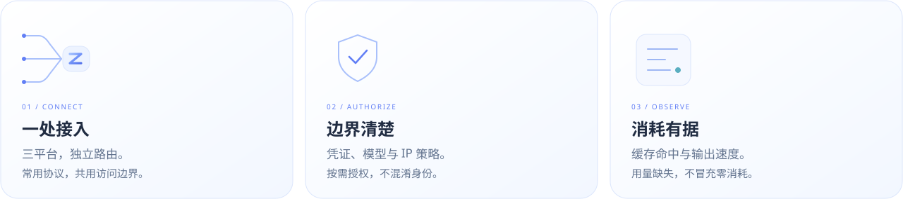
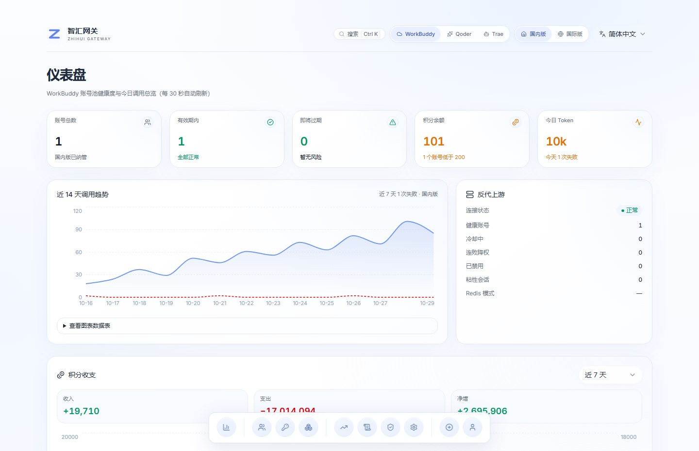
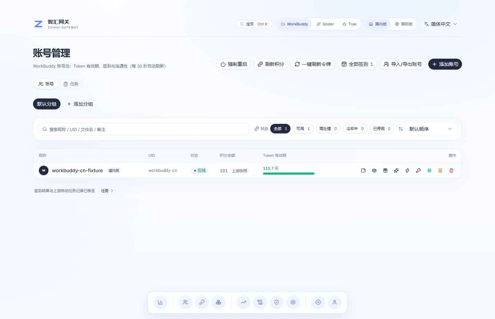
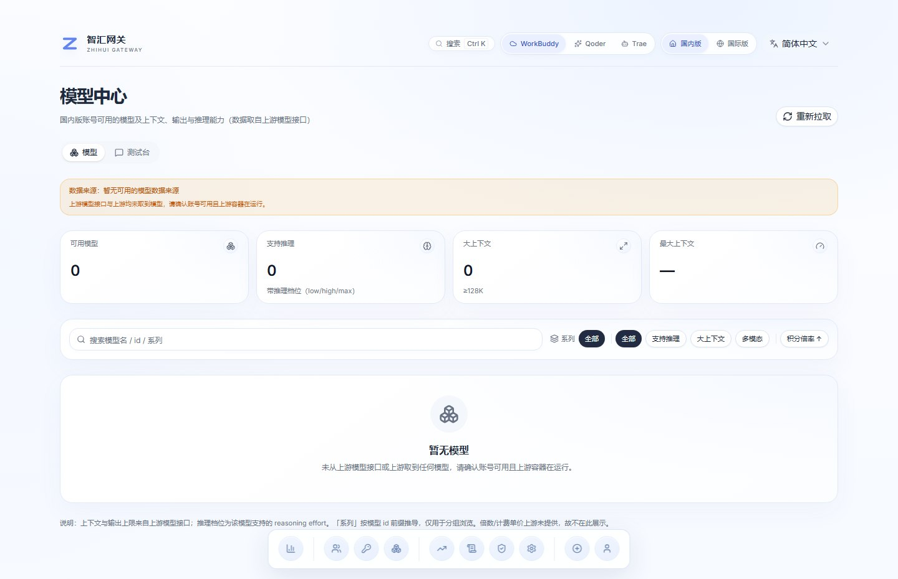
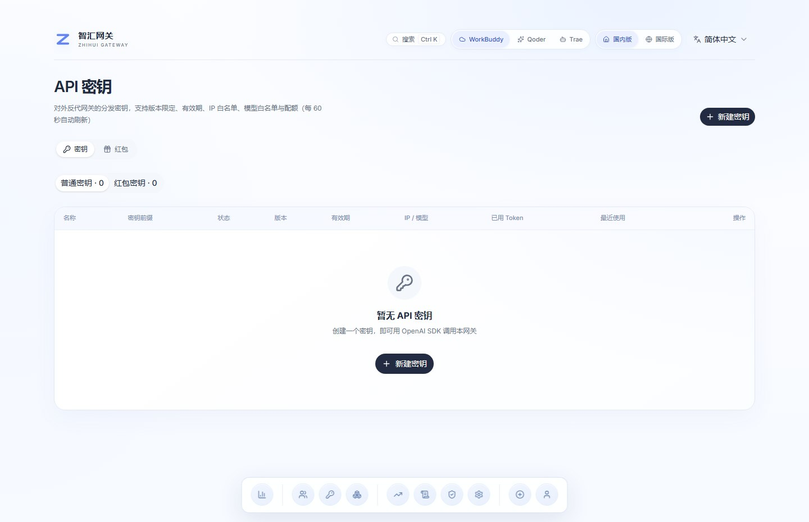
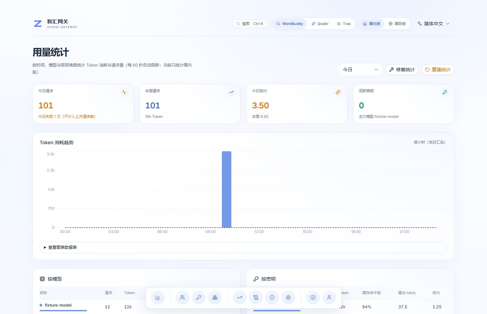

<div align="center">

<a href="https://zhihui.kaogong.art/">
  <picture>
    <source media="(max-width: 640px)" srcset="docs/images/readme/cover-mobile.svg" />
    
  </picture>
</a>

<br />

<a href="https://zhihui.kaogong.art/"></a>
<a href="https://github.com/daniei-chen/zhihui-gateway/releases/tag/v0.0.2"></a>
<a href="#开发与部署"></a>

<br /><br />

**WorkBuddy · Qoder · Trae**

把复杂留给网关，把清晰还给你。<br />
三种入口，同一个智汇。<br />
保留每个平台自己的路由、授权与记录。

<br />

<picture>
  <source media="(max-width: 640px)" srcset="docs/images/readme/capabilities-mobile.svg" />
  
</picture>

</div>

<br />

## 一套语言，从首页到控制台

冰蓝、留白、轻盈的光路。首页、登录页与工作台，共享同一枚 Z。

> [!IMPORTANT]
> 2026-10-30 当前构建 `v0.0.2+roles.20261030.1`：WorkBuddy、Qoder、Trae。普通管理员可浏览完整控制台，仅允许添加账号；首页与原版登录页保持不变。Codex / ChatGPT 网关留待独立产品，不在本次提供入口。页面动画不代表真实流量，生产发布与验收边界见[本次发布记录](docs/RELEASE-20261030-ROLES.md)。

[本轮集成与验收边界](docs/FOUR-GATEWAY-INTEGRATION.md) · [可编辑首页与复现](site/home-source/INTEGRATION.md)

<a href="https://zhihui.kaogong.art/">
  <picture>
    <source media="(max-width: 640px)" srcset="site/home/preview/dashboard-mobile.jpg" />
    
  </picture>
</a>

<p align="center"><sub>粒子随指针轻动，平台与光路联动，账本落下回执。<a href="https://zhihui.kaogong.art/">访问现有网站 ↗</a></sub></p>

新版首页保留居中首屏、蓝色粒子、光路与主入口；页面动画是独立演示，不读取账号信息。

登录保留熟悉的原版卡片、Z 标识、轻动效与表单交互，不采用新的三维登录设计；布局、文案与交互均保留原版。

### 看起来更轻，用起来不减

账号池、模型、访问 Key、用量与日志，一处掌握。保留浮动 Dock、明暗主题、平台切换与五语界面。

权限分清，不把视野关小：普通管理员可浏览全部控制台页面与脱敏数据，只能添加授权账号；超级管理员负责账号维护、密钥额度、用户权限与系统设置。

<picture>
  <source media="(max-width: 640px)" srcset="site/home/preview/dashboard-mobile.jpg" />
  
</picture>

<p align="center"><sub>真实控制台构建渲染 · 合成数据 · 不读取生产账号与调用</sub></p>

<details>
<summary><b>再看四个工作面板</b> — 账号池 / 模型 / 访问密钥 / 用量</summary>

<br />

| 账号池 · 身份与状态 | 模型 · 来源与能力 |
| :---: | :---: |
|  |  |
| **访问密钥 · 按需授权** | **用量 · 核对每次消耗** |
|  |  |

预览不是另画的概念面板，来源见 [构建与图片清单](site/home/preview/manifest.json)。
界面截图不证明供应商可用性或真实业务写操作已经全量验收。

</details>

<br />

## 统一入口，各有其路

管理在一起，来源分得清。切换控制台视图，不会悄悄改变客户端的访问地址。

<picture>
  <source media="(max-width: 640px)" srcset="docs/images/readme/routing-mobile.svg" />
  
</picture>

一次失败不代表没有消耗；上游缺少 `usage` 时保留未知状态，不把它美化成零。
[路由与权限](manager/server/routers/gateway.py) · [预算预留](manager/server/budget.py) · [账本事件](manager/server/ledger.py)

<br />

## 开发与部署

| 你想做什么 | 从这里开始 |
| :--- | :--- |
| 看网站与交互 | [产品首页 ↗](https://zhihui.kaogong.art/) · [首页源码](site/home/index.html) |
| 本地运行或改版 | [开发指南](docs/DEVELOPMENT.md) · [控制台源码](src/three-platform/web/) · [Manager](manager/server/) |
| 了解升级和回退 | [版本与发布合同](docs/PRODUCT-RELEASE.md) · [0.0.2 发布说明](https://github.com/daniei-chen/zhihui-gateway/releases/tag/v0.0.2) |
| 看清已做与待做 | [本版审计边界](docs/AUDIT-0.0.2.md) · [更新日志](CHANGELOG.md) |

<details>
<summary><b>本地开发速览</b> — Python 3.12 / Node.js 22+ / Next.js 16</summary>

```bash
git clone https://github.com/daniei-chen/zhihui-gateway.git
cd zhihui-gateway
```

后端最小控制面、前端启动、静态构建与首页预览，按 [开发指南](docs/DEVELOPMENT.md) 分别运行。
这不是一键安装完整三平台环境：引擎与账号仍需单独配置并获得授权。

</details>

### 一份仓库，一条自己的版本线

智汇产品版本为 **`0.0.2`**。软件源码与升级来源固定为 [本仓库](https://github.com/daniei-chen/zhihui-gateway)，不是模型供应商地址。

**固定提交 → 构建与隔离测试 → 哈希、签名与回执 → 受控发布 → 运行核验。**

不直接把 `main` 覆盖到运行目录；回退代码，也不回退刚刚产生的账本、授权与撤销记录。
[查看完整发布链路](docs/PRODUCT-RELEASE.md)

> [!NOTE]
> 面向自托管与已获授权的使用，不绕过供应商渠道校验。`0.0.2` 不是“所有审计项已关闭”的认证；真实供应商长尾、离机灾备与长期 SLO 等边界见 [审计说明](docs/AUDIT-0.0.2.md)。

<br />

## 致谢与许可

智汇在既有组件上持续演进。感谢 WorkBuddy Manager contributors、workbuddy2api、Qoder / Trae 相关项目与 [linux-do/cdk](https://github.com/linux-do/cdk) 的界面基础。

产品源码采用 [MIT](LICENSE)，组件版权与第三方声明见 [Manager LICENSE](manager/LICENSE)。模型与账号授权遵循各自服务条款。

新版首页的三维扫描及衍生海报适用 CC BY-SA 4.0，Three.js、Draco 保留各自许可；任务与骑行动画已替换为本仓库原创 HTML/CSS/SVG，不再发布参考站插画。来源与复现边界见 [首页集成说明](site/home-source/INTEGRATION.md)。

<div align="center">
<br />
<a href="https://zhihui.kaogong.art/"></a>
<p><sub>智汇 ZHIHUI · 少一点喧闹，多一点可控。</sub></p>
</div>
