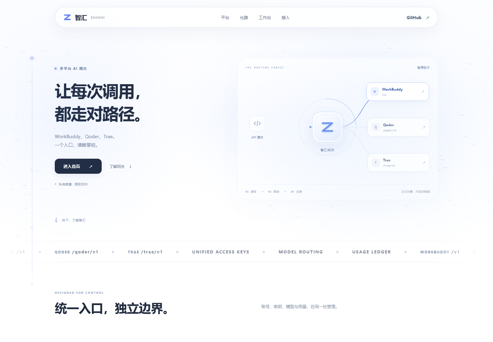
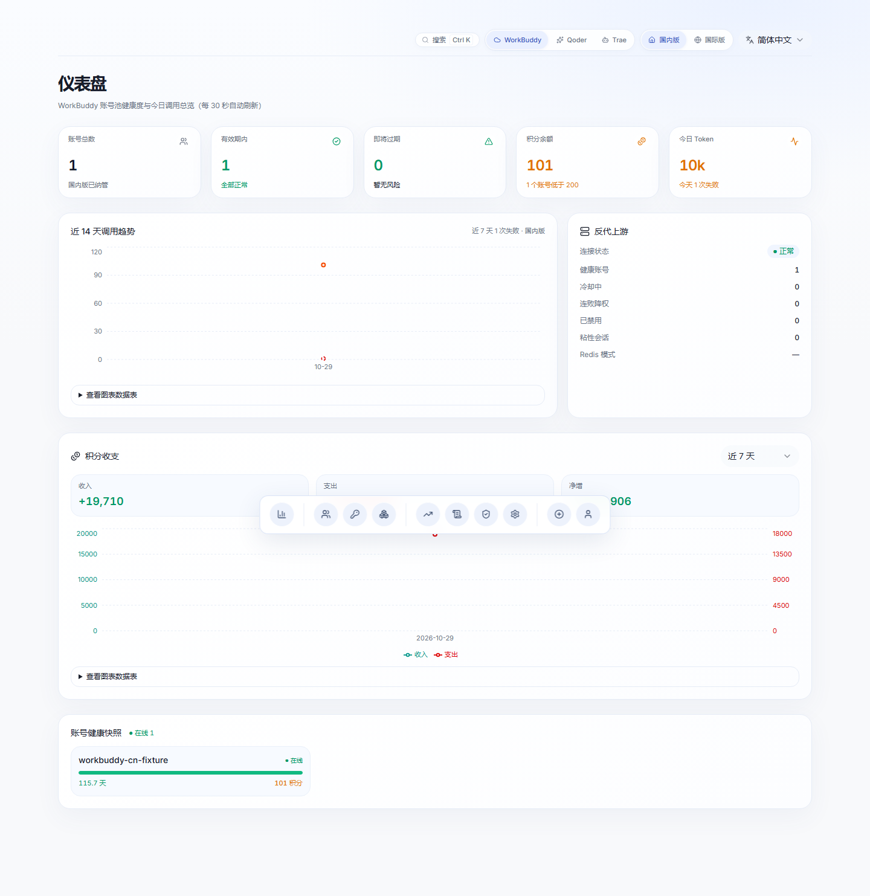

<div align="center">

<a href="https://zhihui.kaogong.art/"></a>

<p><sub>Z H I H U I　 /　 SELF-HOSTED AI GATEWAY　 /　 0.0.2</sub></p>

# 让每次调用，都走对路径。

**把复杂留给网关，把清晰还给你。**

WorkBuddy · Qoder · Trae<br />
三种来源，一套控制语言。路由、凭证、用量与调用记录，在同一个地方看清。

<a href="https://zhihui.kaogong.art/">走进智汇 ↗</a>　 /　 <a href="#从这里开始">从这里开始</a>　 /　 <a href="docs/PRODUCT-RELEASE.md">版本与升级</a>　 /　 <a href="CHANGELOG.md">更新日志</a>

<br />

<a href="https://zhihui.kaogong.art/"></a>

<sub>不是另一张概念稿。这就是网站首页的源码渲染；<a href="site/home/index.html">页面源码</a>也在这个仓库。</sub>

</div>

<br />

## 01 / 少一点界面，多一点把握

首页负责讲清楚智汇，登录页负责安静地进入，控制台负责把事情做好。
三者共享同一枚 Z、同一组留白与圆角、同一种克制的蓝。

首页不再把功能写成大幅标语。左侧是一句清晰的介绍和“进入首页”入口，右侧是可切换的蓝色光路。
选择一个平台，光路与接入代码随之联动；鼠标经过时，微粒与柔蓝光晕轻轻响应。
手机、触屏和减少动态效果设置都有静态退化，不用动画换取可用性。图示只解释产品，不伪装实时业务数据。

控制台不是删功能后的“极简版”。它保留平台切换、账号池、模型目录、访问 Key、
用量、日志、任务与设置，也保留浮动 Dock、悬停放大、拖动位置记忆与明暗主题。
**简单的是表达，不是能力。**



<sub>新版代码的真实浏览器渲染，使用合成数据；不是生产账号、实时指标或供应商可用性证明。</sub>

| 看见 | 管住 | 核对 | 演进 |
| --- | --- | --- | --- |
| 平台、模型与运行状态 | 身份、Key、模型与 IP 边界 | 调用记录、用量与未知项 | 固定源码、受控发布与回退 |

## 02 / 统一入口，不混淆来源

```text
                         你的客户端
                             │
                     授权 Key · 平台前缀
                             ▼
                  ┌──────────────────────┐
                  │   智汇 ZHIHUI        │
                  │   路由 / 权限 / 账本  │
                  └──────────┬───────────┘
                     ┌───────┼───────┐
                     ▼       ▼       ▼
                 WorkBuddy  Qoder   Trae
```

| 平台 | 模型调用入口 | 引擎 |
| --- | --- | --- |
| WorkBuddy | `/v1/*` | workbuddy2api |
| Qoder | `/qoder/v1/*` | qoder2 |
| Trae | `/trae/v1/*` | aiwork-server |

切换控制台的平台视图，不会替你改写客户端的 Base URL。
协议、模型和账号能力以对应引擎的实际版本与授权为准。

**也分清两种“上游”：** 模型服务的上游是平台引擎；智汇软件的源码与升级上游，
固定为 [这个仓库](https://github.com/daniei-chen/zhihui-gateway)。它们不是同一个设置。

## 03 / 不把未知写成零

一次请求失败，不代表上游没有处理；没有返回 `usage`，也不代表没有消耗。

```text
请求进入 → 额度预留 → 平台调用 → 可靠用量 → 结算
                           └→ 用量缺失 → unknown / 待核对
```

智汇保留未知状态及有记录的调整路径，不为让数字好看而把缺失用量归零。
上游渠道校验拒绝、网络错误、网关错误应分别识别，不自动把一次渠道拒绝等同于账号失效。

相关实现：[预算预留](manager/server/budget.py) · [账本事件](manager/server/ledger.py) · [回执重放](manager/server/ledgerreplay.py)。

## 04 / 一份仓库，一条产品版本线

**本版：`0.0.2`。** 源码、首页、登录页、控制台与品牌素材都在这里；产品版本来自
[`VERSION`](VERSION)，组件身份见 [`product-release.json`](manager/server/product-release.json)。
继承的 Manager 审计版本只作基线保存，不再冒充智汇产品版本。

```text
固定仓库提交 → 构建 → 隔离测试 → 哈希 / 签名 / 测试回执 → 可信发布器 → 运行核验
```

受控安装不会执行 `git pull && restart`，也不会把任意 `main` 提交直接覆盖到运行目录。
源码获取与版本检测只从本仓库出发；网页旧式覆盖更新在受控部署上保持关闭。
**回退的是代码，不是用户刚刚产生的账本、授权与撤销记录。**

具体合同见 [版本、来源与安全升级](docs/PRODUCT-RELEASE.md)，已做与待做见 [0.0.2 审计边界](docs/AUDIT-0.0.2.md)。

## 从这里开始

这是**本地开发的最小控制面**，不是一条命令装好完整三平台生产环境。
建议 Python 3.12、Node.js 22+；前端使用 Next.js 16、React 19 与 Tailwind CSS 4。

```bash
git clone https://github.com/daniei-chen/zhihui-gateway.git
cd zhihui-gateway
```

启动后端（Linux x86_64、Python 3.12，本地 loopback；哈希锁定的依赖不覆盖 macOS / Windows）：

```bash
cd manager
python3.12 -m venv venv
venv/bin/pip install --require-hashes -r server/requirements.hashes.txt

WB_DATA_DIR=./data WB_BACKGROUND_JOBS=0 \
venv/bin/python -m uvicorn server.main:app --host 127.0.0.1 --port 7864
```

首次管理员随机密码仅在启动日志输出；本地确认身份后及时修改，勿将日志公开。
三个平台的完整能力仍需分别配置已授权的引擎和账号；此步骤不会自动获得模型授权。

另开终端启动前端：

```bash
cd src/three-platform/web
npm ci
npm run dev
```

访问 `http://localhost:3000`。静态导出使用 `npm run build:export`；
生产反代、身份桥与固定引擎的配置需要单独审查，不要把本地开发当作生产安装器。

<details>
<summary><b>打开仓库地图</b> — 想看设计、代码，还是部署边界？</summary>

| 位置 | 内容 |
| --- | --- |
| [`site/`](site/) | 与真实网站一致的首页、登录页和 favicon |
| [`brand/`](brand/) | 共用的蓝色 Z 矢量标识 |
| [`src/three-platform/web/`](src/three-platform/web/) | 新版控制台源码与浏览器夹具 |
| [`manager/server/`](manager/server/) | FastAPI、权限、代理、账本和平台适配 |
| [`manager/deploy/`](manager/deploy/) | 继承组件的部署/验签代码；不等于已安装的生产信任锚 |
| [`tools/repository_source.py`](tools/repository_source.py) | 固定仓库、固定提交的只取源码工具 |
| [`docs/PRODUCT-RELEASE.md`](docs/PRODUCT-RELEASE.md) | 产品版本、升级来源、发布与回退合同 |
| [`design/`](design/) · [`ops/`](ops/) | 架构设计、运维配置与历史边界记录 |

</details>

## 有边界，才值得信任

- 面向自托管与已获授权的使用，不是公开售卖模型权限的承诺，不绕过供应商官方渠道校验。
- 管理会话、管理 API Token 与下游模型 Key 是不同凭证，权限不可互换。
- 不上传生产账号、数据库、密钥、会话、原始审计证据或私有截图；公开仓库不代替私有备份。
- `0.0.2` 不等于“审计全部完成”。未验证的真实推理、离机灾备、特权边界和长期 SLO 仍需独立证据。
- 前端为经过验证的重建源码；不会把新的 Git 提交伪装成复现了历史原始提交。

## 致谢与许可

智汇在既有组件上持续演进。感谢 WorkBuddy Manager contributors、workbuddy2api、
Qoder / Trae 相关项目及 [linux-do/cdk](https://github.com/linux-do/cdk) 的界面基础。
产品源码采用 [MIT](LICENSE)，组件版权与第三方声明见 [Manager LICENSE](manager/LICENSE)。
模型与账号授权仍遵循各自服务条款；此仓库不授予供应商服务的使用权。

<div align="center"><br /><sub>智汇 ZHIHUI　 /　 少一点喧闹，多一点可控。</sub></div>
