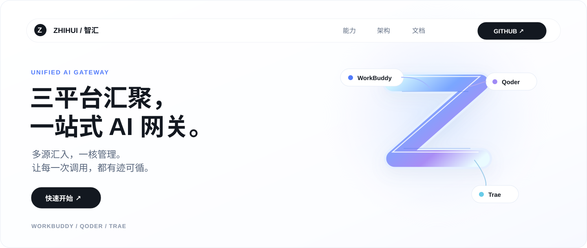
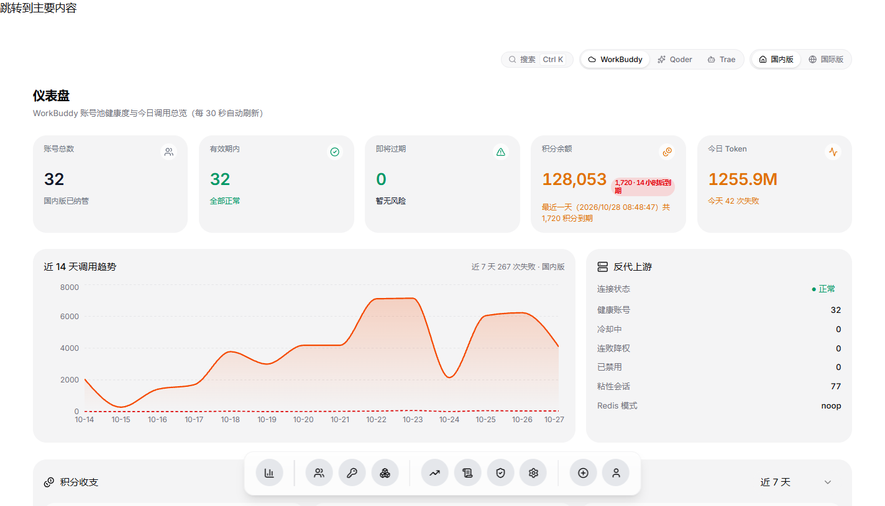
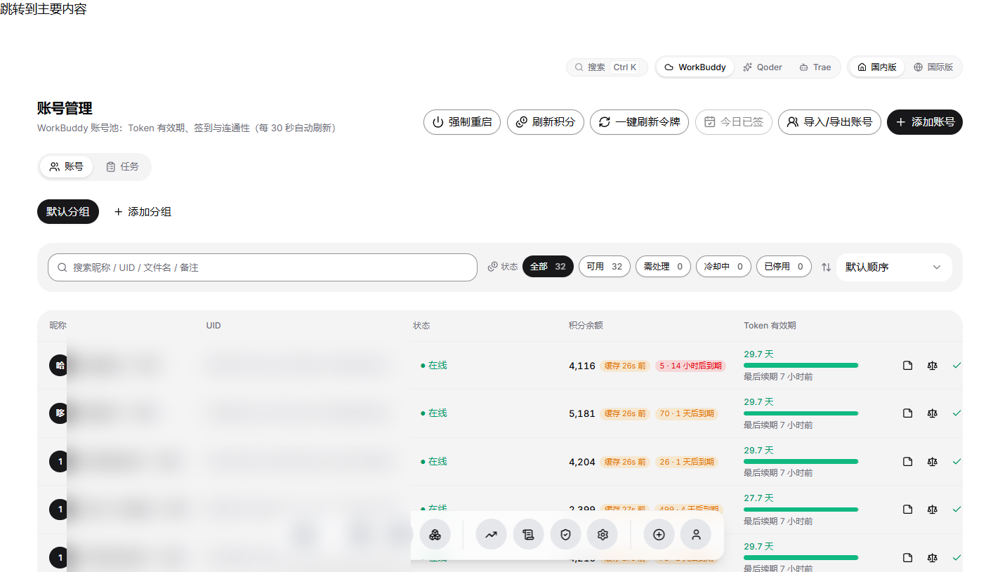
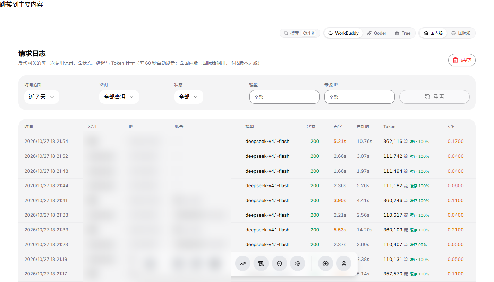
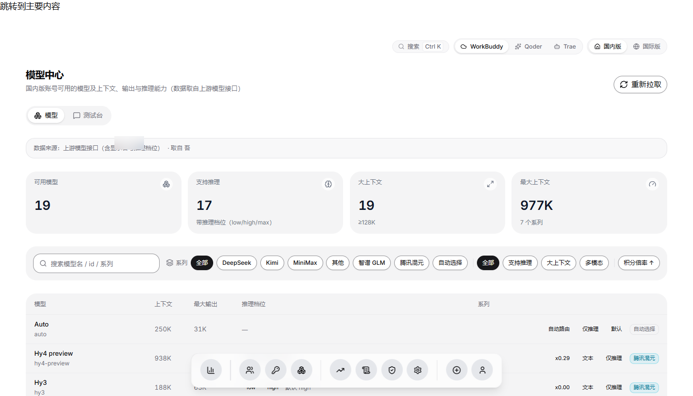
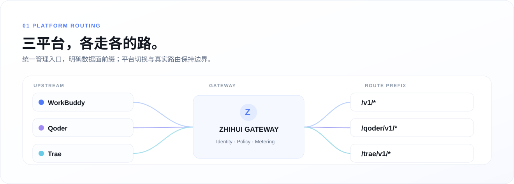
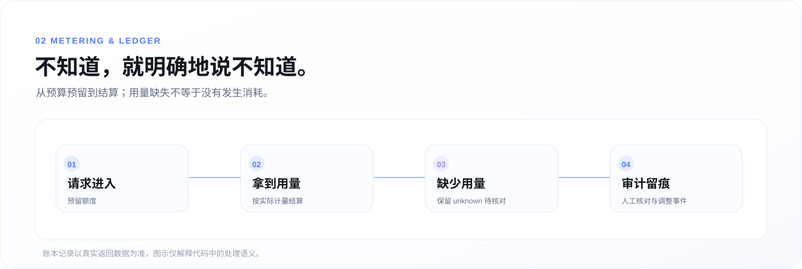
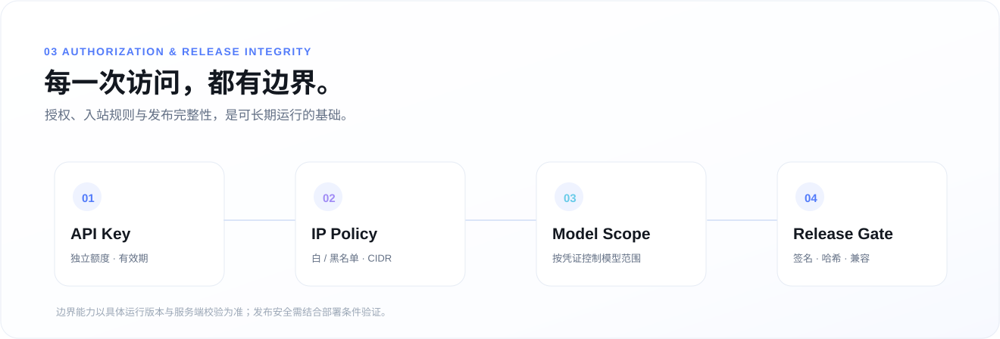

<div align="center">



<br />

# 智汇 · ZHIHUI Gateway

**多源汇入，一核管理。让每一次 AI 调用，都有迹可循。**

自托管的 AI 网关与统一控制台。<br />
集中管理 **WorkBuddy · Qoder · Trae** 平台账号池、访问凭证、模型目录、用量账本与调用日志。

<br />

<a href="https://zhihui.kaogong.art/">官方网站</a>　·　<a href="#快速开始">快速开始</a>　·　<a href="#三平台路由">平台路由</a>　·　<a href="manager/deploy/README.md">部署文档</a>　·　<a href="CHANGELOG.md">更新日志</a>

<br />


<br /><br />

</div>

> [!NOTE]
> 本项目面向自托管与已获授权的使用场景，并非公开售卖 API 的商业服务。不同上游的模型、协议能力与账号状态取决于实际版本、授权和服务可用性；代码中的设计机制不等于任一生产环境已经全部验证。

<br />

## 设计理念

<div align="center">

### 能转发请求，只是开始。能解释结果，才是可靠。

一次调用从身份校验、账号选择到流式响应与用量结算，每一步都有可能遇到未知状态。智汇希望把这些复杂性留在网关内部，把**清晰的控制、可核对的记录与可追踪的行为**交给使用者。

</div>

<table>
<tr>
<td width="25%" align="center"><b>01 · 路由</b><br/><sub>平台分离<br/>路径明确</sub></td>
<td width="25%" align="center"><b>02 · 权限</b><br/><sub>Key / IP / 模型<br/>独立约束</sub></td>
<td width="25%" align="center"><b>03 · 账本</b><br/><sub>预留 / 结算<br/>未知不归零</sub></td>
<td width="25%" align="center"><b>04 · 发布</b><br/><sub>签名 / 哈希<br/>兼容回退</sub></td>
</tr>
</table>

<br />

## 控制台一览

**一个控制面，管理不同平台的日常工作。** 仓库已有账号池、模型目录、访问 Key、用量统计、调用日志、任务记录、安全管控与系统设置等页面。

<div align="center">

<sub>真实运行界面截图（仓库原有素材）；敏感的账号昵称、UID 与来源 IP 已模糊。</sub>
</div>

<br />

<table>
<tr>
<td width="50%" valign="top">

<br/><b>账号池</b><br/><sub>分组、状态、有效期、积分信息与账号维护。</sub>
</td>
<td width="50%" valign="top">

<br/><b>调用日志</b><br/><sub>请求状态、用量、首字延迟、缓存与错误线索。</sub>
</td>
</tr>
<tr>
<td colspan="2" align="center">

<br/><b>模型目录</b><br/><sub>模型系列、上下文、来源及实际可获取的模型信息。</sub>
</td>
</tr>
</table>

> 以上四张均沿用原版 README 的真实产品截图，并非新设计稿或虚构运行数据。界面会随实际版本和部署环境变化。

<br />

<a id="三平台路由"></a>
## 三平台路由



统一的管理界面不意味着三个平台共用同一个引擎。项目根据数据面 URL 前缀分派请求，并保留平台之间的作用域边界：

| 来源 | 数据面入口 | 对应引擎 |
| :--- | :--- | :--- |
| **WorkBuddy** | `/v1/*` | `workbuddy2api` |
| **Qoder** | `/qoder/v1/*` | `qoder2` |
| **Trae** | `/trae/v1/*` | `aiwork-server` |

控制面也支持平台维度的数据视图与相关路由适配；**切换控制台的平台，不代表已经改变下游调用 URL**。

详见 [三平台路由设计](design/qtg/route-table.json) 与 [平台相关服务代码](manager/server/qtgcore/)。

<br />

## 可核对的计量账本



上游可能已经处理了请求，却没有返回完整的用量信息。

**“不知道用了多少”不等于“没有消耗”。** 智汇在代码层面使用预留与结算逻辑；当缺少可靠的 `usage` 时保留 `unknown` 状态，等待后续核对，而不是直接把这笔支出归零。

| 状态 | 处理原则 |
| :--- | :--- |
| 已取得可靠用量 | 按实际返回数据结算 |
| 调用发生但用量缺失 | 保留待核对的不确定状态 |
| 额度调整或补偿 | 通过有记录的调整路径处理 |

涉及代码：[预算预留](manager/server/budget.py) · [账本事件](manager/server/ledger.py) · [预留归属](manager/server/budgetowner.py)。

<br />

## 安全与发布保障



<table>
<tr>
<td width="50%" valign="top">
<b>访问控制</b><br/><br/>
• 下游 API Key、独立额度与有效期<br/>
• IP 白名单、黑名单及 CIDR 规则<br/>
• 按密钥约束平台与模型<br/>
• 管理员 / 查看者权限区分
</td>
<td width="50%" valign="top">
<b>发布与数据保护</b><br/><br/>
• Ed25519 签名与逐文件哈希机制<br/>
• 扩容优先的数据库迁移策略<br/>
• 旧版本兼容性与回退相关检查<br/>
• 管理行为、计量与任务审计
</td>
</tr>
</table>

**凭证边界要分清：** 管理面会话与管理 API Token 用于管理接口；下游 API Key 用于模型代理调用。服务端写操作有额外的管理员会话限制，不能把只读管理 Token 当作写入凭证。

进一步阅读：[管理 Token 说明](docs/api-tokens.md) · [安全审查](docs/SECURITY-AUDIT.md) · [发布与签名](docs/release-signing.md)。

> [!IMPORTANT]
> 仓库中有完整性校验与兼容性相关机制，但是否在某个生产部署中启用、是否通过特定故障场景验证，仍应以该部署的实际证据为准。

<br />

## 系统架构

### 清晰的控制面，与可扩展的平台适配

```text
             下游客户端 / 开发工具
                       │
           对应平台前缀及授权 Key
                       ▼
       ┌─────────────────────────────┐
       │ ZHIHUI · Manager / Gateway  │
       │ Key 校验 · IP/模型限制       │
       │ API 路由 · 统计与用量账本    │
       │ FastAPI · SQLite            │
       └──────────────┬──────────────┘
                      │
           ┌──────────┼──────────┐
           ▼          ▼          ▼
      WorkBuddy      Qoder      Trae
      workbuddy2api  qoder2     aiwork-server
```

| 组成 | 技术与职责 | 源码 |
| :--- | :--- | :--- |
| **Web 控制台** | Next.js 15、React 19、Tailwind CSS 4；静态导出 | [`src/three-platform/web/`](src/three-platform/web/) |
| **Manager** | FastAPI、身份认证、管理接口、账本与代理 | [`manager/server/`](manager/server/) |
| **平台适配层** | 三平台适配、路由与控制面兼容 | [`manager/server/qtgcore/`](manager/server/qtgcore/) |
| **运行与部署** | 安装、更新、签名、回退与运维配置 | [`manager/deploy/`](manager/deploy/) · [`ops/`](ops/) |
| **工程验证** | 单元测试、契约测试与隔离测试工具 | [`manager/server/tests/`](manager/server/tests/) · [`tests/`](tests/) |

前端构建产物由 FastAPI 托管，开发模式可独立启动 Next.js。Manager 与 QTG 的控制面收敛仍有历史兼容事项；不要仅凭相同 API 路径推断数据来源相同，详见 [统一控制面盘点](design/H08-U0-control-plane.md)。

<br />

<a id="快速开始"></a>
## 快速开始

<sub>下面是本地开发和最小管理服务启动方式，不代表完整三平台生产部署。完整流程请参阅 <a href="manager/deploy/README.md">部署指南</a>。</sub>

**01 · 获取代码**

```bash
git clone https://github.com/daniei-chen/zhihui-gateway.git
cd zhihui-gateway
```

**02 · 启动管理服务**

需要 Python 3.11+。以下命令适用于 Linux / macOS 的本地开发环境：

```bash
cd manager
python -m venv venv
venv/bin/pip install -r server/requirements.txt

WB_ADMIN_PASSWORD='change-to-your-own-strong-password' \
WB_DATA_DIR=./data \
venv/bin/python -m uvicorn server.main:app --host 127.0.0.1 --port 7864
```

**03 · 启动 Web 前端**

另开终端，从仓库根目录进入前端：

```bash
cd src/three-platform/web
npm ci
npm run dev
```

开发前端默认访问 `http://localhost:3000`，后端反向代理配置见 [`next.config.ts`](src/three-platform/web/next.config.ts)。完整三平台功能仍需要相应上游引擎、账号与授权配置，不能只靠启动管理进程获得。

**04 · 隔离环境测试**

```bash
cd manager
python -B -X utf8 ../tests/zhihui_harness/run_tests.py --target manager-assets --keep
```

> [!CAUTION]
> 不要直接在生产服务器上运行示例部署、测试、计量对账、更新或回滚命令。项目测试应遵循已有隔离运行器要求，不建议直接执行无隔离的全量 `pytest`。

<br />

## 工程资料

| 想了解什么 | 对应资料 |
| :--- | :--- |
| 完整安装、上游镜像、更新方式 | [部署指南](manager/deploy/README.md) |
| 核心模块与开发变更 | [Manager 源码](manager/server/) |
| 密钥边界、管理 API Token | [Token 文档](docs/api-tokens.md) |
| 账号独立出口线路 | [代理线路说明](docs/account-proxy-routes.md) |
| 代码安全与风险 | [安全审查](docs/SECURITY-AUDIT.md) |
| 发布签名与校验 | [签名文档](docs/release-signing.md) |
| 设计与架构决策 | [Design 目录](design/) |
| 更新历史 | [CHANGELOG](CHANGELOG.md) |

<details>
<summary><b>项目目录速览</b></summary>

```text
zhihui-gateway/
├── manager/
│   ├── server/                # FastAPI / 账本 / 路由 / 鉴权
│   └── deploy/                # 安装 / 更新 / 发布
├── src/three-platform/web/    # Next.js 控制台
├── docs/                      # 专题说明、真实截图
├── design/                    # 决策与架构设计
├── ops/                       # 运维与安全配置
├── tests/                     # 隔离测试与浏览器测试
├── tools/                     # 审计、计量等辅助工具
└── CHANGELOG.md
```

</details>

<br />

## 已知边界

README 应当同样解释系统**不能保证什么**，而不是只展示功能：

- **发布门禁**：签名与哈希机制防范受保护产物被意外或未授权修改，但不能防范拥有足够权限者重新签名。
- **备份位置**：部分历史备份路径与生产系统同机，不能因此宣称已实现真正异地灾备。
- **数据归因**：首字延迟与实际调用账号等部分字段依赖上游日志源和部署条件，缺失时不能补造。
- **真实流量覆盖**：历史记录中 WorkBuddy 真实流量更充分，Qoder / Trae 的实际协议覆盖仍需根据环境验证。
- **控制面演进**：Manager / QTG 同名接口可能涉及不同数据来源，统一控制面仍需谨慎推进。

这些边界可能随版本变化，请结合实际代码、测试证据和部署情况判断。

<br />

## 致谢与许可

智汇的 WorkBuddy 账号池与兼容代理基础来自 [Sliverkiss/workbuddy2api](https://github.com/Sliverkiss/workbuddy2api)（MIT）。本项目在其基础上建设管理控制面、账本和可观测界面；上游版权归原作者，随发布包提供时应保留对应许可证与版权声明。

其他参考项目：[workbuddy-sdk](https://github.com/sanguine886/workbuddy-sdk) · [cdk](https://github.com/linux-do/cdk) · [Antigravity-Manager](https://github.com/lbjlaq/Antigravity-Manager)。

本仓库许可证见 [LICENSE](LICENSE)。

---

<div align="center">

### ZHIHUI / 智汇

**简单的入口，清晰的边界，可信的记录。**

<sub>Self-hosted AI Gateway · Routing / Metering / Access / Observability</sub>

<br /><br />

<a href="https://zhihui.kaogong.art/">Website</a>　·　<a href="manager/deploy/README.md">Documentation</a>　·　<a href="CHANGELOG.md">Changelog</a>　·　<a href="LICENSE">License</a>

</div>
