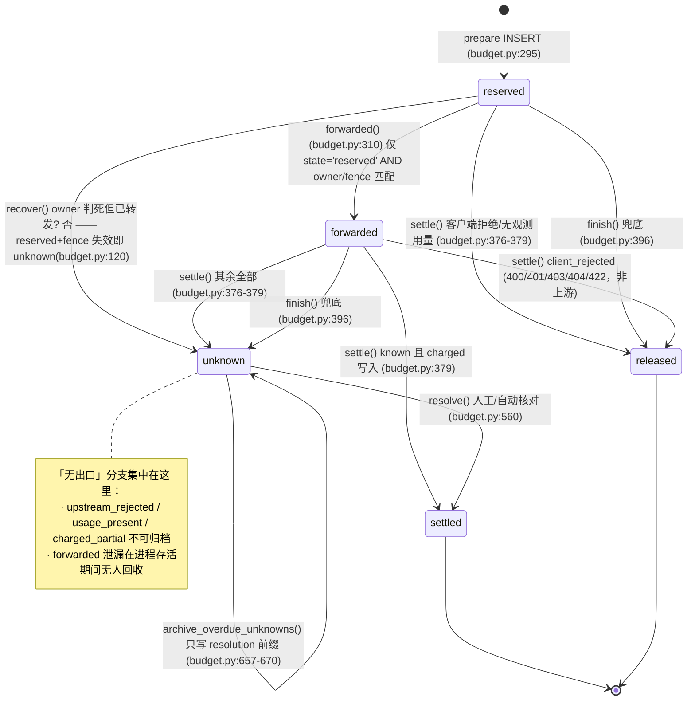

# D 节：预算、结算、账本、密钥状态机（DAN-23 热点）

- **仓库**：`daniei-chen/zhihui-gateway`，main @ `ec87de9`（Merge PR #58, DAN-23），VERSION 1.6.28
- **审计时间**：2026-11-28 00:42–01:20（Asia/Shanghai），设备 `PC-20260816OWHB`
- **方法**：只读。`grep -n` / `sed -n` 定点读码；5 个独立探针直连真实模块复现状态机行为，脚本已随交付放在 `probes/`（`probe_replay_dan23.py`、`probe_d3.py`、`probe_d12.py`、`probe_lim.py`、`probe_reset.py`，均**写在仓库外**、跑在临时库上）；pytest 只用现成 venv，`WB_DATA_DIR=/tmp/wb-audit-d`，不写仓库。
- **复现方式**：任意探针 `cd /tmp && WB_DATA_DIR=/tmp/wb-x D:/AI/capy/work/venvs/zhihui-gateway/Scripts/python.exe <probes/xxx.py>`（脚本内路径为仓库绝对路径，换机器需改一行）。
- **未改动任何仓库文件**，未 commit / push / PR。
- **结论条数**：16 条（P1 × 6、P2 × 6、P3 × 4）；D-09 已撤回，不计入。其中 D-01～D-13 由本人独立复现，D-14～D-17 由子代理取证后经我复核代码并重跑探针确认。

---

## 0. 必跑命令与结果

```
cd <repo>
WB_DATA_DIR=/tmp/wb-audit-d D:/AI/capy/work/venvs/zhihui-gateway/Scripts/python.exe \
  -m pytest server/tests/test_dan23_disconnect_convergence.py \
             server/tests/test_unknown_archive.py \
             server/tests/test_late_usage_race.py -q
```

```
...............................                                          [100%]
31 passed, 2 warnings in 23.59s
```

子代理并行跑的另外两组（同为 `WB_DATA_DIR` 临时目录，全绿）：

```
test_concurrency_and_atomicity + test_ledger_replay + test_budget_kill_closure → 44 passed, 2 skipped
test_credits_ledger + test_request_budgets                                        → 35 passed
```

两个只读校验（同样通过）：

```
D:/.../python.exe deploy/protected-customizations.py --check   → 受保护文件一致（7 项）  exit=0
D:/.../python.exe tools/check_reviewed_hashes.py               → 247 条全部对得上（版本 1.6.28）  exit=0
```

> 也就是说：**下面这些缺陷全部是现有测试绿灯之下的行为**，没有一条会让 CI 变红。

---

## 1. `budget_reservations` 状态机（含出口分析）

实际写库的 state 只有 5 个：`reserved` / `forwarded` / `settled` / `released` / `unknown`。
「已归档待核对」**不是 state**，而是 `resolution` 字符串前缀（`budget.py:645` `ARCHIVE_RESOLUTION_PREFIX`），
即 `state='unknown'` 的一个子集标记 —— 这点在排障时极易看错。



第二套推进逻辑（回执重放，崩溃后补账）：`ledgerreplay._settle` → `settled/released/unknown`
（`ledgerreplay.py:344-350`），**与上面不是同一套判据**，差异见 D-01。

### 出口矩阵（谁会把 unknown 弄出去）

| unknown 分类（`budget.py:588-596`） | 自动结清 | 7 天归档 | 结果 |
|---|---|---|---|
| 完整零用量回执 | ✅ `reconcile_evidenced_unknowns` | — | 有出口 |
| `client_cancelled` / `no_request_log` / `unexplained` | ❌ | ✅ | 有出口（7 天后） |
| `upstream_rejected` | ❌（无完整回执） | ❌（不在 `EVIDENCELESS_CLASSES`） | **无自动出口**（D-04） |
| `usage_present` | ❌ | ❌ | **无自动出口** |
| `charged_partial`（回执重放产出） | ❌ | ❌ | **无自动出口**（D-01） |

---

## 2. 条目

### D-01 · P1 · 回执重放路径不认 `client_cancelled`，DAN-23 的契约在崩溃恢复后失效，并产出「永不归档」的 unknown

- **file:line**：`server/ledgerreplay.py:341`（`known = facts.get('terminal_state') == 'completed' and complete`）
  对照 `server/budget.py:342`（DAN-23：`state.terminal_state in ('completed', 'client_cancelled')`）
- **现象（实测，非推断）**：探针在临时库上对同一份「完整 usage + 终态」的 spool 回执调用 `ledgerreplay._settle()`：

  ```
  completed         -> state=settled   charged_tokens=22 charged_credit=0.123456
  client_cancelled  -> state=unknown   charged_tokens=22 charged_credit=0.123456   ← 与 DAN-23 相反
  ```

  进一步把该行推到 30 天再跑归档：

  ```
  replayed client_cancelled row: {'state': 'unknown', 'charged_tokens': 22, 'resolution': None}
    _classify(no request_log) -> charged_partial
    archive_overdue_unknowns -> 0   (0 = 该行永远留在 unknown)
  ```
- **为什么是问题**：`charged_tokens=22 > 0` 使 `_classify` 归为 `charged_partial`（`budget.py:589-596`），
  而 `charged_partial` 不在 `EVIDENCELESS_CLASSES`（`budget.py:643`），`archive_overdue_unknowns` 直接 `continue`（`budget.py:689-690`）。
  于是对**设了 credit 配额的密钥**，`prepare()` 的 `unknown_count` 恒 ≥1 → 永久 429 `credit_quota_unconfirmed`（`budget.py:239-240`，
  测试 `test_v004_admission_correctness.py:136-140` 就是钉这条闸）。这正是 DAN-23 声称修掉的「一次按 Esc 让密钥长期不可用」，
  只不过触发条件从「正常结算路径」换成了「结算事务失败 → 落 spool → 重放」——而这条路径**只在数据库写失败时**才会走，所以线上不会被日常流量暴露，也不会被 DAN-23 的三条测试覆盖。
- **怎么验**：
  1. 上面的探针（`%TEMP%/probe_replay_dan23.py`）可直接复现两行差异；
  2. `python -m pytest server/tests/test_dan23_disconnect_convergence.py -q` 全绿，说明现有测试只覆盖 `budget.settle` 一侧；
  3. 修法：`ledgerreplay.py:341` 与 `budget.py:342` 抽成同一个判据函数，两处共用；同时给 `charged_partial` 补一条出口（人工 resolve 之外的时间窗）。
- **影响面**：只有「结算事务失败 + credit 配额密钥 + 流式断连」三条件同时成立才会中，概率低但后果是**密钥终态不可用**，且无告警（`budget_unknown` 会亮，但归档后 `needs_human` 也不含它 —— 见 D-05 的反向问题）。

### D-02 · P1 · `forwarded`/`reserved` 泄漏在进程存活期间没有任何回收出口；`lease_until` 是只写不读的死字段

- **file:line**：
  - `server/budget.py:124-127` `heartbeat()` 每 10 秒 `UPDATE ... SET lease_until=?`（唯一写入者）
  - 全仓 `grep -rn lease_until server/ --include=*.py` 显示 `budget_reservations.lease_until` **没有任何读取点**（`instancelease.py`/`tasklease.py` 读的是各自的表）
  - `server/main.py:80-92` `budget.recover()` **仅在 `BACKGROUND_JOBS` 为主实例时、且仅在启动时**执行
  - `server/budget.py:199` `if pending['n'] >= _limit: raise BudgetRejected(... 'budget_pending')`，`_limit` 默认 1（有限额密钥）
  - `server/budget.py:522-523` `resolve()` 明确拒绝非 unknown：`if row['state']!='unknown': raise ValueError('仅允许核对 unknown 请求，进行中请求不可手动释放')`
- **现象**：一条卡在 `forwarded` 的行（进程被 kill、handler 被取消而 `finish()` 未跑到、或过渡实例崩溃）在**同进程存活期间**不会被任何东西回收：`recover()` 只在启动时跑，`lease_until` 过期不触发任何动作，后台对账只看 `unknown`（`archive_overdue_unknowns` 第一句就 `if row.get('state') != 'unknown': continue`）。而 `prepare()` 的 pending 计数包含 `forwarded`（`budget.py:191-194`），默认上限 1 → 该密钥此后每次都 429 `budget_pending`。
- **为什么是问题**：这是**唯一没有任何 API 出口**的状态。`/api/budgets/*` 只有 `review`、`review/evidence`、`unresolved`、`resolve-batch`、`{request_id}/resolve`（`server/routers/budgets.py:16-122`），全部只能动 `unknown`。要恢复只能重启主实例或直接改库 —— 前者意味着「一条泄漏的行 = 一次计划外发布」。滚动发布时过渡实例（`WB_BACKGROUND_JOBS=0`）**不跑** `recover()`（`main.py:81-88` 提前 return），所以过渡实例崩掉的 forwarded 行要等主实例重启才清。
- **怎么验**：
  1. `grep -rn "lease_until" server/budget.py`：只有 `ALTER TABLE` 补列、`heartbeat` 写、`prepare` 插三处，无 `WHERE lease_until <`；
  2. 手工复现：`UPDATE budget_reservations SET state='forwarded' WHERE request_id=<某条>`，再对同一密钥发一次请求 → 429 `budget_pending`；等待、重启对账循环均无效，只有重启进程（触发 `recover()`）才恢复；
  3. 建议：后台对账里加「`forwarded` 且 `lease_until < now - 2×心跳` 且 owner 判死 → unknown」（复用 `recover()` 的 `budgetowner.alive` 判据），并给 admin 一个 `force-release` 端点。

### D-03 · P1 · 单条账本回执冲突会升级成**全站**准入阻断（正确性闸门与可用性耦合）

- **file:line**：
  - `server/ledgerreplay.py:317-331` `_settle` 在「行已 `settled`/`released` 但回执带完整用量」时 `raise ReplayConflict('receipt conflicts with confirmed budget usage')`
  - `server/ledgerreplay.py:735-739` `admission_block()`：`if state['dead'] > 0: return {'blocked': True, code: 'ledger_dead_pending', ...}`
  - `server/budget.py:159-162` `_channel = ledgerreplay.admission_block(); if _channel['blocked']: raise BudgetRejected(...)` —— 在**每一条** `prepare()` 的最前面
  - `server/ledgerreplay.py:746-759` 处置死信必须 `actor` + `reason`（人工）
- **现象（实测）**：

  ```
  released+complete -> ReplayConflict: receipt conflicts with confirmed budget usage
  ```

  即：任何一条 `released` 的预留（客户端 4xx 被判定「上游没执行」）如果事后落了一份**带真实用量**的 spool 回执，`apply()` 抛冲突 → `ledgerreplay.py:529` 的 `attempts = MAX_ATTEMPTS if isinstance(exc, ReplayConflict)` 让**第一次失败就直接进 `dead/`**（`MAX_ATTEMPTS=5`，`ledgerreplay.py:39`）→ `admission_block()`（`ledgerreplay.py:735-739`）返回 `dead>0` → **所有密钥、所有模型的新请求一律 429**，直到有人带着 actor+reason 逐条处置（`ledgerreplay.py:746-759`）。没有任何重试宽限。
- **为什么是问题**：这是把「账本不许被篡改」的正确性要求，实现成了**单点全站停机**。而且 `released` 的判据本身就承认「可能有部分计费」（`budget.py:360-374` 的注释），即这个冲突不是异常输入，是设计允许的时序。同理 `_validate_existing`（`ledgerreplay.py:454-461`）的任何字段不一致（含浮点 credit）都会走同一条路径。
- **怎么验**：
  1. 探针已复现冲突抛出；
  2. 端到端复现：把某条 `released` 行的 request_id 造一份 spool JSON 放进 `spool/`，跑 `operational.replay_ledger_receipts` 若干轮，观察 `ledgerreplay.backlog()` 与 `dead_letters()` 增长，再发新请求观察 429 code；
  3. 建议：冲突类死信只阻断**该密钥**（把 request_id→key_id 记入一个 `admission_blocked_keys` 集合），而不是全局；或对 `released + usage` 单独定义一条「补收」路径而不是冲突。

### D-04 · P1 · `upstream_rejected` 既不能自动结清也不能归档：credit 配额密钥仍会被一次上游拒绝永久锁死（DAN-23 只补了 client_cancelled 那一条）

- **file:line**：`server/budget.py:643`（`EVIDENCELESS_CLASSES = ('client_cancelled','no_request_log','unexplained')`）、
  `server/budget.py:689-690`（`if cls not in EVIDENCELESS_CLASSES: continue`）、
  `server/budget.py:239-240`（`if qc and outstanding_total['unknown_count']: raise ... 'credit_quota_unconfirmed'`）
- **现象**：上游明确拒绝（`channel_check_rejected`、`"code":11102`、`prompt_too_long`、`rate_limit_exceeded` 等，清单见 `budget.py:558-572`）落成 `upstream_rejected`。这类行
  - 无完整零用量回执 → `_confirmed_zero_usage` 为 False → `reconcile_evidenced_unknowns` 跳过；
  - 不在 `EVIDENCELESS_CLASSES` → `archive_overdue_unknowns` 跳过；
  所以它**永久停在 unknown**。对任何设了 `quota_credit` / `daily_credit_quota` 的密钥，`prepare()` 的 `unknown_count` 恒 ≥1 → 永久 429 `credit_quota_unconfirmed`。历史规模见 `docs/BUDGET-BACKLOG-TRIAGE.md:34`（1486 条 unknown 中 `rejected` 128 条）。
- **为什么是问题**：DAN-23 的 PR 描述与测试都只覆盖 `client_cancelled`，但「unknown 没有出口 = 密钥终态」这个结构性缺陷对 `upstream_rejected` 完全没变。区别是它由**上游状态**触发（限流、长 prompt、渠道校验），比按 Esc 更常见。测试 `test_unknown_archive.py:246-255` 明确钉死「`rejected` 不归档」，说明这是有意的策略 —— 但没有任何文档解释「有意的策略如何不变成永久 429」，也没有任何自动出口。
- **怎么验**：
  1. `python -m pytest server/tests/test_unknown_archive.py -q -k evidence_bearing` → 断言 `archive_overdue_unknowns()==0` 且 `resolution is None`；
  2. 复现：`keysvc.create_key(quota_credit=10)` + 插一条 30 天前的 `unknown`，伴 `request_logs.status=429, error='... 112 ...'` → `prepare()` 抛 `credit_quota_unconfirmed`（`test_v004_admission_correctness.py:136-140` 的模式）；
  3. 生产只读 SQL 可直接确认这条是否已经发生（有结果 = 该密钥现在每次请求都 429）：
     ```sql
     SELECT k.id, k.name, count(*) AS blockers
       FROM budget_reservations b JOIN api_keys k ON k.id=b.key_id
      WHERE b.state='unknown' AND coalesce(b.resolution,'')=''
        AND (k.quota_credit>0 OR k.daily_credit_quota>0)
      GROUP BY k.id;
     ```
  4. 建议：为 `upstream_rejected` 加一条「有上游拒绝标记 + 无 usage 字段 + 超过 N 天 → released（不上账，只放行）」的出口，或把 `unknown` 的闸从「计数」改为「计数 + 金额下界」，避免零金额行也触发 fail-closed。

### D-05 · P2 · 归档行迟到证据后，**告警**与**准入**对同一行给出相反结论

- **file:line**：`server/budget.py:229-240`（`prepare` 只用 `resolution NOT LIKE '已归档待核对:%'` 排除）、
  `server/budget.py:750-752`（`unresolved_summary` 用**当前分类**重算 `archived`，证据出现后 `archived` 变 False）
- **现象（实测）**：一条 30 天前 `client_cancelled` 的 unknown，先归档（`archive? 1`），再把它的 `request_logs` 补成完整上游用量（credit=0.5、100+10 tokens）：

  ```
  after late evidence: needs_human=2 archived_pending=0 by_class={'charged_partial': 1, 'usage_present': 1}
  prepare 口径（排除已归档）: held=4074 unknown_count=1     ← 归档行被排除，准入已放行
  ```
- **为什么是问题**：`budget.py:222-226` 的注释承诺「一旦迟到证据到达，分类会变成 charged_partial/usage_present 并重新计入（宁可重报）」。实际上**只有告警侧重报了**（`needs_human` +1，`budget_unknown` 亮），准入侧仍然因为 `resolution` 前缀把这行当作「已查过、无证据」而**既不阻塞、也不占估算**。两个消费方对同一行给出相反结论：值班的人按告警去核对，看到的却是一条「已经被归档放行」的行；反过来，如果这行真有费用，平台既不收（无 `resolve` 就不上账）也不拦。建议：归档标记里存下「归档时的分类」，`prepare` 与 `unresolved_summary` 都用同一函数判定 `archived`（把 `_is_archived` 换成 `archived_now()`）。
- **怎么验**：`%TEMP%/probe_d3.py` 第 3 段，输出即上；或改 `server/tests/test_unknown_archive.py` 里已有的「迟到证据重新计入」用例，加一条 `budget.prepare` 断言（现在没有）。

### D-06 · P2 · 负向核对（`allow_negative=True`）在汇总侧被 `max(0,…)` 静默钳位，与不可变账本永久分叉

- **file:line**：`server/budget.py:461-469`（`charge_delta` → `UPDATE api_keys SET used_tokens=max(0,used_tokens+?)`）、
  `server/dailyquota.py:48-49`（`tokens=max(0,tokens+?)`）、
  对照 `server/ledger.py:197-200`（`adjust()` 把原始 `td`/`cd` **原样**写进不可变 `adjustment_events`）
- **现象**：`resolve(..., allow_negative=True)` 是允许「下调已记用量」的唯一合法入口（`budget.py:512-518`）。但增量落到 `api_keys` / `key_daily_usage` 时被 `max(0, …)` 钳位，而 `adjustment_events` 记的是完整负值。算例：`charged_tokens=50`，管理员判定实际 0 → `td=-50`；若该密钥当天已有其它请求把 `key_daily_usage.tokens` 刷到 30，`max(0, 30-50)=0`，但账本记 `-50`。此后 `sum(usage_events) + sum(adjustment_events)` 与 `api_keys.used_tokens` **永久差 20**，且没有任何东西会修它。
- **为什么是问题**：不可变账本是唯一可 replay 的真相源（`ledger.py:1-3` 的模块声明），而对外配额读的是可变的 `api_keys`。钳位让「账本可重放」这个属性在最需要它的时候（人工纠错之后）失效；`metering.reconcile` 只会报差异不会修（`metering.py` 的 category 是只读发现）。建议：钳位前先断言不为负，或在 `budget_adjustments` 里记「实际生效的 delta」而不是「申报的 delta」。
- **怎么验**：临时库上造 `used_tokens=30` + 一条 `charged=50` 的 unknown，`resolve(0, 0, allow_negative=True)`，然后比 `SELECT used_tokens` 与 `SELECT sum(prompt_tokens+completion_tokens) FROM usage_events` + `sum(token_delta) FROM adjustment_events`。

### D-07 · P2 · 受保护哈希是**两套**账本，5/7 个受保护算法文件不在 247 条 review 清单里；`--update` 与 `--check` 读的不是同一份字节

- **file:line**：
  - `docs/protected-customizations.json`（7 条）vs `server/release-provenance.json:reviewed_patch_files`（247 条）
  - `server/budget.py`、`server/ledger.py`、`server/pooledhttp.py`、`server/services/wb2api.py`、`server/upstreamschema.py` = **在受保护表里、不在 review 清单里**（5/7）
  - `server/observability.py`、`server/routers/gateway.py` = 两边都有（2/7）
  - CI 只校验受保护表：`.github/workflows/quality.yml:136-143`（`read_bytes()` 原始字节）；review 清单由 `server/tests/test_release_provenance_integrity.py:27-36` 校验（在 `tools/ci_regression.py:58` 的强制清单里）
  - `deploy/protected-customizations.py:56-63`（`--update` 读 `git cat-file blob HEAD:<file>`，**不是工作区**）；`docs/RELEASE-CHECKLIST.md:41-46` 已把这写成陷阱
- **现象 / 为什么是问题**：
  1. 账本核心（`budget.py`/`ledger.py`）唯一的完整性约束就是那张可在**同一个 PR 里** `--update` 的登记表。它能抓到「改了代码忘重绑」（CI 红，fail-loud，**不是静默风险**）；但它抓不到「改算法 + 同 PR 重绑」，也不产生任何独立签核痕迹 —— 247 条的 review 清单才是「谁审过这些字节」的记录，而这两个文件恰恰不在里面。DAN-23 自身是守规矩的（`efac081 chore(provenance): 重绑…` 单独一个提交），说明流程可用，缺的是**结构约束**。
  2. `release-provenance.json` 自己不在任何哈希清单里（`reviewed_patch_files` 不含自身，无法自指），而 `tools/verify_signed_release.py:1-6` 已退役（恒返回 2 / `RETIRED`）。于是 `candidate_only` / `database_rollback` / `production_deployed` 这些**直接决定部署决策**的字段，在 PR 阶段没有任何程序化校验 —— 只能在 `release.yml:238-258` 打包时被改写。本次审计就看到 `e9bb293` 单独改 `release-provenance.json` 无任何门禁拦。
- **怎么验**：
  ```
  python -c "import json;p=json.load(open('server/release-provenance.json'))['reviewed_patch_files'];\
g=json.load(open('docs/protected-customizations.json'));print([(k, k in p) for k in g])"
  ```
  输出即上表。`deploy/protected-customizations.py --check` 与 `tools/check_reviewed_hashes.py` 均在 `ec87de9` 上通过（见 §0）。
- **建议**：把 7 个受保护文件全部并进 `reviewed_patch_files`（受保护表保留，作为「不许静默漂移」的第二道），并给 `release-provenance.json` 的关键布尔字段加一条 CI 断言（例如 `candidate_only` 只能由 release workflow 置 False）。

### D-08 · P3 · 两条失效的保护闸：`reconcile_zero_reservation_unknowns` 与 `total_token_unconfirmed` 实际不可达

- **file:line**：`server/operational.py:757-758`（`if any(row.get(f) for f in ('reserved_tokens', …)): continue`）、
  `server/budget.py:281-296`（C-008 之后 `reserved_tokens` **无条件**写 `estimated_input + output` > 0）、
  `server/budget.py:230-238`（`missing_estimate` 统计 `state='unknown' AND reserved_tokens<=0`，同理由此恒 0）
- **现象**：C-008 修的是「无配额密钥 reserved_tokens 恒 0」，代价是**任何行都有预估**。于是
  1. `reconcile_zero_reservation_unknowns` 对每一行都在第 757 行 `continue`，`settled_zero` 永远是 0，
     而 `operational.py:1100` 的日志仍打印 `zero-reservation=%d`，让值班的人以为这条通道在工作（真正在跑的是 `reconcile_evidenced_unknowns`）；
  2. `total_token_unconfirmed` 这道闸只在 `reserved_tokens<=0`（即 C-008 之前的历史行）时才可能成立 —— 对新行永远不触发。`test_v004_admission_correctness.py:128-133` 能通过正是因为夹具手工造了 `reserved=0` 的 legacy 行。
- **为什么是问题**：不是功能错误，是**可观测性撒谎**：日志里的 0 会被读成「没有需要零结清的行」，实际是「这段代码永远返回 0」。排障时会把「为什么 unknown 不减」指向错误的组件。
- **怎么验**：临时库上跑一轮 `reconcile_zero_reservation_unknowns(now)`，任何输入都返回 0；`grep -n "missing_estimate" server/budget.py` 只有 231/237 两处，且判据 `reserved_tokens<=0` 与新写入路径互斥。

### D-09 · P3 · ~~日配额的在途占用只统计「今天创建」的行，跨午夜的长流不占额度~~ **已撤回（2026-11-28）**

- **撤回原因**：原结论误读了 `server/budget.py:256-261` 的 SQL。`outstanding` 查询为 `WHERE b.key_id=? AND (b.state IN ('reserved','forwarded') OR (b.state='unknown' AND …日期…))`——**`reserved`/`forwarded` 分支不带日期条件**，昨天创建、今天仍在途的流照样计入 `held`；日期过滤只作用于 `unknown` 分支。`server/tests/test_daily_replay_boundaries.py::test_daily_token_hold_for_active_cross_midnight_request_survives_raised_parallelism` 已覆盖该行为。

- **保留的文本**：`budget.py:254-255` 的注释仍然成立（"Active streams still carry over midnight until their terminal facts arrive"），不是「注释与代码相反」。

- **结论**：原 P3 条目撤销，P3 总数 14→13；不进入路线图。

### D-10 · P3 · `settle()` 的 UPDATE 没有 owner/fence 守卫，`finish()` 有 —— 安全性完全依赖外层事务

- **file:line**：`server/budget.py:379-380`（`UPDATE … WHERE request_id=?`，无 owner/fence/state 条件）
  vs `server/budget.py:396-397`（`WHERE request_id=? AND owner=? AND fence=? AND state IN ('reserved','forwarded')`）
- **现象**：`settle()` 先用 `_owned(row, state)` 读了行（`budget.py:322-324`），随后写库时不带同样的条件。当前唯一调用点在 `server/routers/gateway.py:1143-1147` 的 `with db.transaction():` 内，`BEGIN IMMEDIATE`（`db.py:2006`）保证读与写之间不会被另一个写者插入，所以**现在没有可复现的竞态**。
- **为什么仍然值得记**：`finish()` 之所以加三重条件，正是为了「恢复进程已经把行改成 unknown 之后，兜底不要覆盖它」。`settle()` 携带同样的风险，只是被调用点的事务救了。`budget.py:295-296` 的 INSERT 也是裸 `INSERT`（非 `OR IGNORE`），一旦有人把 `settle()` 搬到别的调用点（例如补账脚本）就会静默覆盖。属于「下一个改动者会踩」的缺陷，不是当前线上缺陷。
- **怎么验**：`grep -n "budget.settle" -r server/` 只有一处调用；把该调用挪出事务再跑 `test_late_usage_race.py` 会立刻失败（说明测试依赖事务而非 SQL 守卫）。

### D-11 · P2 · credit 配额路径没有任何金额预留，超支上限由「在途条数」而非「金额」决定

- **file:line**：`server/budget.py:288-293`（`reserved_credit` 恒写 `0.0`，注释自认「没有本地定价表」）、
  `server/budget.py:289-293` vs `297-302`（token 路径 `remaining = q - used - total_held` 并收缩 `max_tokens`；credit 路径只判 `remaining_credit <= 0`）、
  `server/budget.py:197-200`（有限额密钥在途上限 1）
- **现象**：设了 `quota_credit` 的密钥，准入只回答「余额 > 0 吗」，不预留任何金额，也不收缩输出；真正拦住并发超支的是「在途条数 = 1」这道闸。也就是说：**超支上限 = 单条请求可能产生的最大费用**，而单条上限由上游决定（`outputlimits` 只受 token 配额约束，credit 密钥不收缩）。streaming + 大 prompt 时一条请求足以把余额打成负值。
- **附带的判据不对称**：只设 `daily_credit_quota`（不设 `quota_credit`）的密钥，`if q or qc:` 整块（`budget.py:228-244`）不会执行，于是前一天的 unknown 既不阻塞也不占额度（`budget.py:270-271` 只查当天）——「unknown 是密钥终态」的风险绕开了，代价是这笔未确认的积分消耗永远不再被拦、也不会被对账（只有 `budget_unknown` 告警）。
- **为什么是问题**：credit 是「钱」，token 是「量」。用量的预留（`reserved_tokens`）对金额无意义，而金额维度完全没有预留 —— 事后只能靠 `resolve` 人工纠。`unresolved_summary` 的 `credit_lower_bound` 恒 0.0（`budget.py:790`）也是同一事实的另一面：unknown 行的金额敞口在系统里**不可度量**。
- **实测（子代理 `repro_d4.py`，真实 `prepare`→`forwarded`→`settle`→`keysvc.touch`）**：

  ```
  quota_credit=2e-06, used_credit_units=1      → prepare 放行（reserved_credit=0.0）
  单笔请求实际花掉 0.5 credit                   → used_credit=0.500001  超支 ≈ 250001×
  下一次 prepare                                → BudgetRejected credit_quota_exhausted
  ```
  即：资产从「1 微单位」被花到「0.5 信用单位」，而准入全程没有拦。超支上限 = 在途请求数 × 单笔真实金额；`WB_KEY_BUDGET_PENDING_QUOTA` 调高多少就乘多少（`budget.py:197-200` 源码直读 env）。
- **怎么验**：`grep -n reserved_credit server/budget.py`（唯一写入点写 0.0）；对 credit 密钥发一条 `max_tokens` 很大的流式请求，中途断开 → 产生 unknown，`unresolved_summary()['credit_lower_bound']` 仍为 0.0，而该行实际可能已消耗任意金额。

### D-12 · P1 · 两个面板核对端点**强制** `evidence`，而该分支要求 `request_lifetime_ends_v2` 存活证明 ⇒ 历史积压（owner=NULL/跨主机名）无法通过 UI 核对

- **file:line**：
  - `server/routers/budgets.py:47-53`（`BatchResolution.evidence: str = Field(min_length=8, max_length=500)` —— **必填**）、`132-136`（单条端点同样必填）
  - `server/routers/budgets.py:113-116` / `135-137`：两处都无条件 `human_evidence=body.evidence`
  - `server/budget.py:524-531`：带 `human_evidence` 时，`request_lifetime_ends_v2` 无匹配行**且** `budgetowner.alive(row['owner']) is not False` → `ValueError('缺少可信请求结束证明，不能凭超时核销')`
  - `server/budgetowner.py:60-63`：`alive()` 对 `owner` 为空 / 主机名不匹配 / 格式不符**返回 `None`**（注释的意图是「不确定，交给对账保守处理」）
  - `server/db.py:2061-2063`：`request_lifetime_ends_v2` 是**后加的表**；`owner`/`fence`/`lease_until` 也是 `budget.py:91-93` 的 `ALTER TABLE` 补出来的 —— 在此之前的历史行 `owner` 为 NULL
- **现象（实测）**：探针 3 在临时库上逐一调用 `budget.resolve(..., human_evidence='…')`：

  ```
  legacy + evidence      -> ValueError: 缺少可信请求结束证明，不能凭超时核销      (owner='')
  legacy 无 evidence      -> True
  live-owner + evidence  -> ValueError: 缺少可信请求结束证明，不能凭超时核销      (无 lifetime 行)
  ended + evidence       -> True
  ```

  即：`alive(None)` 的 `None` 被 `is not False` 判成「不可确认死亡」→ 拒。**而两个 HTTP 端点都强制 evidence**，所以面板/API 的核对通道对 owner 为 NULL 的历史行**一律 409**。
- **为什么是问题**：`routers/budgets.py:52-84` 的 docstring 把 `/resolve-batch` 的存在理由写成「1486 条积压、逐条不可能，所以给批量」；实际上批量端点对积压主体（`owner IS NULL` 的旧行）不可用，只剩「不带 evidence」的内部路径（`reconcile_evidenced_unknowns` 用），而那条路要求完整零用量回执。二者叠加 = **积压基本没有可执行的人工出口**，这与 D-04（`upstream_rejected` 无自动出口）相乘，直接解释 `docs/BUDGET-BACKLOG-TRIAGE.md` 里 917 条为什么清了这么久没清掉。
- **怎么验**：
  1. `%TEMP%/probe_d12.py` 四行输出即上；
  2. 生产只读 SQL：`SELECT count(*) FROM budget_reservations WHERE state='unknown' AND (owner IS NULL OR owner='')` —— 若 ≫0，则该批次在 UI 上不可核对；
  3. 修法二选一：`alive()` 返回 `None` 时按「不确定 → 允许带凭证核对但记 audit」处理（风险可控，因为 `resolve` 已有 `expect_charged_zero` 与 usage_events 冲突校验）；或给面板加「按 unknown 分类 + 年龄批量核对」的运维通道。

### D-13 · P2 · `/resolve-batch` 的待核对映射建在 `budget.unresolved()` 上，而它硬截断 1000 行 ⇒ 最新的一批 unknown 被判「不存在」

- **file:line**：`server/budget.py:399-402`（`SELECT * ... state IN ('reserved','forwarded','unknown') ORDER BY created_at,request_id LIMIT 1000`）、
  `server/routers/budgets.py:93`（`pending = {row['request_id']: row for row in budget.unresolved()}`）、
  `server/routers/budgets.py:99-101`（查不到即归入 `not_pending`，静默跳过、不报错）
- **现象（实测）**：临时库塞 1005 条 `unknown`，`budget.unresolved()` 返回 1000 条，且**按 `created_at` 升序** → 留在外面的是**最新**的 5 条：

  ```
  表内 unknown 总数: 1005
  unresolved() 返回: 1000   最新一行 r1004 在内? False   最老 r0000 在内? True
  ```
- **为什么是问题**：端点文档（`routers/budgets.py:65-70`）说批量核对的用途是清 1486 条积压，但它只「看见」最老的 1000 条；对更新的行，调用方会得到 `not_pending` —— 一个**语义错误**的回答（行明明在库里），而且 `dry_run` 也同样被骗。`docs/BUDGET-BACKLOG-TRIAGE.md` 的 1486 条正好超过这个上限。
- **怎么验**：`%TEMP%/probe_lim.py`（输出即上）；或生产只读 SQL 比对 `count(*) WHERE state='unknown'` 与 `/api/budgets/unresolved` 返回条数是否正好 1000。
- **修法**：`resolve_batch` 改为按 `request_ids` 直接 `SELECT ... WHERE request_id IN (...)`（≤200 个 id，本来就该点查），不要把全量扫描结果当索引。

### D-14 · P1 · 「重置用量」只清 `api_keys`，不清 `key_daily_usage` ⇒ 带日配额的密钥重置后当日仍然 429

- **file:line**：`server/keysvc.py:369-391`（`reset_usage` 只 `UPDATE api_keys SET used_tokens=0,used_credit=0,used_credit_units=0`）、
  `server/routers/keys.py:229-237`（面板端点直接调它）、
  `server/dailyquota.py:29-33`（日配额读 `key_daily_usage`，缺失才回落 `usage_daily`）、
  `server/dailyquota.py:46-49`（该表只增不减，`max(0, …)` 也只对 delta 生效）
- **现象（实测，探针 5）**：`daily_token_quota=1000` 的密钥用满后调用 `keysvc.reset_usage()`：

  ```
  before reset: {'used_tokens': 1000} {'tokens': 2000}
  reset_usage -> True
  after reset: {'used_tokens': 0}     {'tokens': 2000}      ← 日计数器不动
  prepare after reset -> BudgetRejected daily_token_quota_exhausted
  ```
- **为什么是问题**：`reset_usage` 的 docstring（`keysvc.py:370-380`）承诺「两个量一起归零是刻意的……只清 token 不清积分会留下看不见的残留额度」，说明作者**已经意识到「漏清一张表」的坏处**，但漏的是第三张表（日计数器），而这张表才是 `daily_token_quota` / `daily_credit_quota` 的唯一判据来源。管理员点「重置」得到 200 + `changed: true`，实际到次日 00:00 之前该密钥全部 429 —— 这是**界面承诺与行为相反**，且日志里没有任何提示。
- **怎么验**：
  1. `%TEMP%/probe_reset.py` 输出即上；
  2. 生产只读 SQL：`SELECT k.id,k.name,d.day,d.tokens FROM key_daily_usage d JOIN api_keys k ON k.id=d.key_id WHERE d.day=date('now') AND k.daily_token_quota>0 AND d.tokens>=k.daily_token_quota;` 若与「重置过的密钥」重叠即可确认；
  3. 修法：`reset_usage` 同一事务里 `DELETE FROM key_daily_usage WHERE key_id=?`（或写一条 `usage_reset_events` 让 `snapshot` 减去基线），并把 `usage_daily` 的当日行一并处理，否则回落路径又会把值读回来。

### D-15 · P2 · `metering.reconcile` 从不比对 `credit_units`、也不看 `api_keys`/`key_daily_usage` ⇒ 金额偏差与投影分叉没有对账

- **file:line**：`server/metering.py:326`（`credit_units` 被查出来）、`server/metering.py:364-367`（只比 `pt`/`ct`，且仅 `counted=1` 的行）、
  `server/metering.py:370-376`（`budget_*` 类别只看 `state`，不看 `charged_*` 与事件的金额是否一致）
- **现象**：`metering.reconcile` 的 10 个 category 全部围绕「token 数」与「状态一致性」。`credit_units` 读完只用于还原 `Usage.credit`（`metering.py:348-349`）去算 `spend_class`，从未与 `usage_events.credit_units`、`budget_reservations.charged_credit` 做等值比较。全仓也没有任何地方把 `api_keys.used_*` 与账本累计值对起来（`SUM(prompt_tokens+completion_tokens)` 只出现在 `dailyquota.py`、`db.py:1925/1974`、`retention.py:549/559`，都是各自口径）。唯一比总额的 `retention.py:513-540` 只比 `usage_daily` vs `usage_events`，不含 `adjustment_events`、不按 key。
- **为什么是问题**：本项目所有关于「钱」的缺陷（D-06 钳位、D-11 无金额预留、D-14 日计数器）都落在这三个盲区里 —— 也就是说**它们永远不会被任何自动对账报出来**，只能靠人读代码。`metering_reconcile_pass` 每 900 秒跑一次并在 `METERING_STRICT_CATEGORIES` 非空时 `log.warning`（`operational.py:955-961`），所以「对账一直绿」并不等于「账目一致」。
- **怎么验**：造一条 `usage_events.credit_units=1000000` 而 `budget_reservations.charged_credit=0.000001` 的请求（人为改一处），跑 `metering.reconcile` → 无任何 finding；再把 `prompt_tokens` 改错 → 立刻 `token_mismatch`。二者对照即可证明覆盖边界。

### D-16 · P3 · 回执重放的 `final` 与 `row is None` 分支：`api_keys` 与 `usage_daily` 走不同口径，`counted` 又被置 0

- **file:line**：`server/ledgerreplay.py:317-333`（`final` 时 `plan.update(tokens=0, credit_units=0)`）、
  `server/ledgerreplay.py:374-381`（`charge_delta(plan)` 加 0，但 `bump_usage` 用 facts 的 `pt/ct/credit` 全量加）、
  `server/ledgerreplay.py:438-440`（`ledger.record(..., counted=bool(plan['tokens'] or plan['credit_units']))`）、
  `server/ledgerreplay.py:308-310`（`row is None` → 直接返回全额 plan，没有任何 `charged_*` 落库）
- **现象**：当 spool 回执命中一条已 `settled`/`released` 的预留时，`charge_delta` 加 0（正确：不重复扣 api_keys），但紧接着 `db.bump_usage` 仍把完整用量写进 `usage_daily`/`usage_hourly` → 两张投影表对同一请求给出不同结果。同时 `counted=False` 而 token>0 的 `usage_events` 行会被 `metering.reconcile` 的 `token_mismatch` 跳过（`metering.py:364` 要求 `counted`），偏差不可见。`row is None` 时更彻底：全额 `charge_delta`，没有 `charged_*` 可做后续幂等判据，唯一护栏是 `request_logs` 是否存在（`ledgerreplay.py:429-448`）。
- **为什么是问题**：`request_logs` 会被 `archiveworker` 按保留期删除，而 spool 里的坏回执可以躺到人工处置为止；两者时间尺度不同，这个分支并非不可达。不过触发要求「预留已终结 + 回执迟到超过保留期」，因此标 P3。
- **怎么验**：探针 1 的 `released+complete` 已经证明该分支会抛冲突而非走到这里；要走到 `final` 需构造 `charged_tokens` 与回执**一致**的已 settled 行 + 缺失的 request_logs，然后跑 `ledgerreplay.apply()`，比对 `api_keys.used_tokens` 与 `usage_daily` 同请求的差值。

### D-17 · P3 · `adjustment_events.request_id UNIQUE` + 裸 `INSERT`：第二次核对同一请求抛的是 SQLite 约束错，不是业务语义

- **file:line**：`server/ledger.py:41`（`request_id TEXT NOT NULL UNIQUE`）、`server/ledger.py:197-200`（`adjust()` 裸 `INSERT`）、
  `server/budget.py:556-560`（`charge_delta` → `budget_adjustments` → `ledger.adjust` → `UPDATE … state='settled'`，全在同一事务）
- **现象**：`resolve()` 的幂等靠 `if row['state']=='settled': return False`（`budget.py:522`）与 `BEGIN IMMEDIATE` 串行。一旦这个前置判断被绕过（例如另一个实例在同一毫秒内核销、或运维脚本直接调 `ledger.adjust`），第二次会撞 UNIQUE 并让整个事务回滚 —— 语义正确，但异常类型是 `sqlite3.IntegrityError`，调用方（`budget_reconcile.run`、`/resolve-batch`）只能当通用失败吞掉，日志里没有「这是一次重复核对」的信号。
- **为什么是问题**：`budget_adjustments`（`budget.py:45-46`，同为 `request_id PRIMARY KEY`）与 `adjustment_events` 是两张各写一次的"同一事实"表，任何一次部分失败都只留一半痕迹。建议 `adjust()` 改成 `INSERT OR IGNORE` + 比对已有 `token_delta`（不同则报 `ReplayConflict`），把"重复"与"冲突"分开。
- **怎么验**：临时库对同一未知行连续调两次 `budget.resolve(...)`（第二次前手工把 state 改回 unknown），观察异常类型与 `budget_adjustments` 是否为空。

---

## 3. 建议修复顺序（只读阶段不动代码，供 Captain 排期）

1. **D-01**（一行判据统一 + `charged_partial` 出口）—— 改动最小，堵住 DAN-23 的回归面。
2. **D-14**（重置用量清日计数器）—— 一次 UI 操作即可复现，是这批里**唯一用户当场看得见**的错。
3. **D-02**（`forwarded` 泄漏回收）—— 唯一无 API 出口的状态，运维成本最高。
4. **D-03**（冲突死信改为按键阻断）—— 可用性风险，但触发需要 `released` + 迟到用量，可稍后。
5. **D-04 + D-12 + D-13**（同一个坑的三头：没有自动出口、人工出口被 409 挡、批量出口看不见最新行）—— D-04 需要 卡皮巴拉 拍板「上游拒绝是否算零计费」，D-12 是纯实现缺陷，可先修。
6. **D-05 / D-07 / D-15**（判据统一、哈希并表、对账补 credit 维度）—— 纯一致性/治理，无行为风险。
7. 其余 P3 随下次改动顺带。

## 4. 未覆盖 / 需他人补

- **面板端点实测**（D-12）：已用探针直调 `budget.resolve(...)` 复现 409 分支，但未起服务走真实 HTTP（`require_recent_session_admin` 门槛、`security.authorization_guard` 的行为未验）。
- **portal 钱包**（`portalwallet.receipt` / `reserve` / `auto_close_client_cancelled`）与主账本的双重记账只做了静态阅读，未构造冲突场景；建议由 SEC 或 PROTOCOL 线程交叉验证（`portalwallet.py:180-200` 有 `迟到费用回执与人工核对结果冲突` 的分支）。
- **生产库真实分布**：本次无生产库访问，1486/917/128 等数字均引自 `docs/BUDGET-BACKLOG-TRIAGE.md`（2026-11-15），不代表 11-28 现状。
- **A4 的推论**（credit 密钥的老 unknown 既不占并发也不占金额）：已折进 D-04 / D-11，未单列。
- **`budget_reconcile.py` 的调度周期不可从代码验证**：入口 `ops/writer-guard/launch_guard.py:227-228` 指向 `server.budget_reconcile`，单元名 `wb-budget-autoreconcile.service`（`ops/writer-guard/systemd_adapter.py:9-11`），但 `.service`/`.timer` 文件不在仓库；应用内另有 900s 的那条（`operational.py:1072-1085`）。两者重叠但不等价（前者不归档、不查死信）。
- **子代理完整取证**：见同目录 `02-appendix-d-supplement.md`（14 条，含 repro 脚本路径与逐条 file:line），本文只并入了我复核过的部分。
