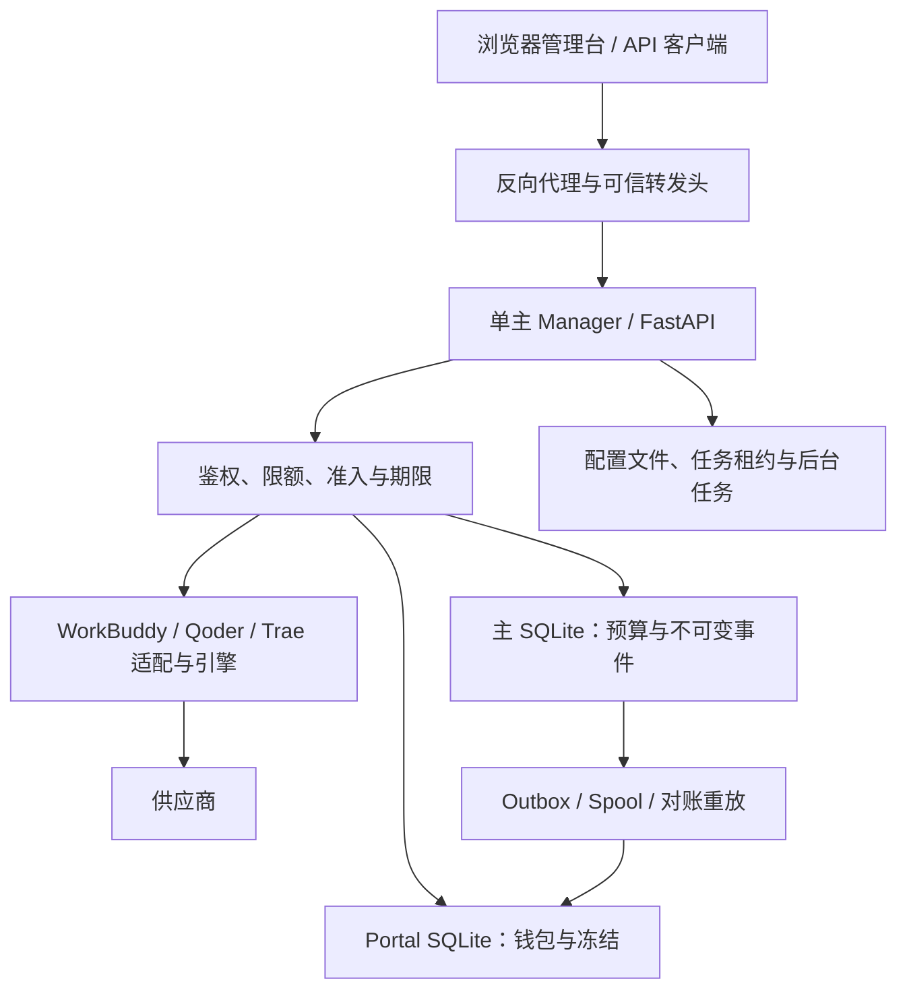

# 智惠网关 v0.0.7 严格审计与优化报告

审计日期：2026-11-05（UTC）。审计对象：[daniei-chen/zhihui-gateway](https://github.com/daniei-chen/zhihui-gateway)。

固定基线：`4c6b4cb8cb790698e0753909745dfe8a7c78dd9f`，`main` / `v0.0.7`，提交时间 `2026-11-04T23:49:26Z`。审计期间再次读取 GitHub 的 `main`，仍为该提交。修复分支：`audit/strict-review-20261105`。

代码与回归测试提交：[`431bb8e1`](https://github.com/daniei-chen/zhihui-gateway/commit/431bb8e16e5bd3a0e243957e6adca31611fb0929)。审计报告和原始证据单独提交，便于先查看代码差异。交付前最新主分支核对见 [latest-main.json](evidence/latest-main.json)。

## 1. 审计结论

本次交付包含实际修复、对照反例、完整后端回归、前端测试与构建、逐文件阅读记录和可重复的本机性能实验。重点是身份与账号池归属、财务证据一致性、并发准入、流式资源边界、取消与租约生命周期、发布签名、恢复和文件安全。

**候选代码可以进入审查，当前证据不足以批准生产发布。** GitHub 原生 Linux CI 已成功完成，关闭了本地环境中无法证明的三个进程用例；真实恢复、旧 Windows 更新来源和完整私有引擎仍有未关闭事项。代码审读、自动扫描与测试通过分别证明不同事情；不能将本报告解释为“所有文件均已人工逐行审过”“不存在任何漏洞”或“生产速率已经达到最大”。

本次未合并主分支、未发布版本、未部署、未触碰生产数据库或真实凭据、未向真实模型供应商发送计费请求。旧的用户工作区保持不变，修复与验证在独立 checkout 和隔离测试视图中进行。

### 证据入口

- [逐文件覆盖表](coverage.tsv)与[覆盖统计](coverage-summary.json)：每个公开路径的覆盖级别、基线 Git blob、基线/候选 SHA256、证据来源。
- [验证汇总](evidence/validation-summary.json)：最终运行编号、测试结果和明确未完成的门禁。
- [复现说明](REPRODUCE.md)：依赖、命令、性能场景和环境限制。
- `reviews/`：各范围的原始审读记录，包括后续修复前发现。若阶段性文字与最终状态不同，以本报告和验证汇总为准。
- `evidence/`：JUnit、测试视图摘要、依赖扫描、语法检查、安全反例、性能原始样本和环境证据。

## 2. 范围与覆盖：不混淆“全文阅读”和“扫描”

基线共有 **1,799 个 Git 跟踪路径**。最终候选的逐路径数量和分类由 `build_coverage.py` 从 Git 对象、审读清单及语法回执生成；本目录自身的报告、证据和辅助脚本不放入被审源代码分母。

<!-- COVERAGE_SUMMARY_START -->
最终候选共 **1,836 个源路径**（不含本审计目录），逐文件全文审读 **543 个 / 132,774 行**，重点审读 **22 个**，仅自动检查 **754 个**，仅清点 **517 个**。

| 核心范围 | 全文审读 | 范围限定 |
| --- | ---: | --- |
| Manager 生产 Python | 176 / 176 文件，63,977 行 | 不含测试；包含公开适配器与兼容控制面 |
| 前端源码与配置 | 190 / 190 文件 | 不含第三方依赖内部代码；组件测试单独计数 |
| 公开引擎补丁 | 27 / 27 文件 | 不构成私有完整 Go/Rust 引擎审计 |
| 其他工具与运行源码 | 79 个全文；91 个自动检查 | 自动检查项没有冒充全文审读 |

全文审读覆盖不是漏洞不存在的数学证明。每个路径的版本摘要、分类和审读证据均可在 [coverage.tsv](coverage.tsv) 核对。
<!-- COVERAGE_SUMMARY_END -->

Manager 的全部公开生产 Python 文件完成全文阅读，范围包含主入口、所有路由、三平台适配、账号授权与刷新、预算与双账本、数据库迁移、调度、日志和管家通知。前端 app/components/hooks/lib 的非测试 TS/TSX 以及本地 UI primitives 完成全文阅读。公开引擎补丁包括上下文、删除、新增和补丁测试，**只代表公开补丁全文，不代表完整私有 Go/Rust 引擎**。

覆盖表采用以下严格定义。这里的 `manual-full` / `manual-targeted` 指本次助手与并行审读完成的逐文件推理分析，用于区别自动扫描；不表示独立人类审计机构的签字或认证：

| 级别 | 实际含义 | 不能推出的结论 |
| --- | --- | --- |
| `manual-full` | 完整文件已经逐段阅读，并分析控制流、数据流或其文档合同 | 已穷尽线程交错、所有部署状态或供应商行为 |
| `manual-targeted` | 实际阅读了明确的关键路径或修改范围 | 该文件每行都已审过 |
| `automated-only` | 执行了语法、类型、测试、构建或已记录的文本检查 | 人工全文阅读或零缺陷 |
| `inventory-only` | 清点并记录路径和字节摘要 | 已证明运行正确或已检查第三方内部实现 |

大量测试、历史主页导出、压缩/vendor 资产、语言词条、设计文档和开发验证脚本保留为自动检查或清点。未把下载依赖目录算入本仓库全文覆盖，也未编造公开树中不存在的私有源文件。

## 3. 架构判断

### 3.1 单主进程是当前正确性的条件

`server/serve.py` 明确以 `workers=1` 启动。主库使用共享连接与进程内 RLock；SQLite 仍是单写者。会话/授权缓存、部分限流、准入计数、连接池和后台任务状态具有进程局部属性。给 Uvicorn 增加 workers 或多开全部 `BACKGROUND_JOBS`，会改变这些合同，不能直接等同于吞吐扩容。

现有 transition 部署确实会关闭后台任务标志；文件凭据 lease 也确实保护同时写入。它们不等于已经完成所有任务的全局唯一调度或分布式准入。本次把实例和任务的关键租约生命周期闭合，保留单主部署前提。

### 3.2 主账与钱包是两个数据库

主库事务可以原子提交 request log、usage evidence、预算状态和 key 累计。钱包在另一个 SQLite 中，依靠回执、outbox、幂等 apply 和重放收敛；不存在横跨两个库的普通 SQLite 原子事务。

本次重点修复了实时与重放对同一消费证据给出不同财务结论的问题。取消、异常、无效 token、未知 credit 或已经可能发送的请求，不能因“没有看到完整成功回执”被判为零费用。也没有把网络请求包进数据库长事务，或为了性能关闭 `FULL`、fsync、不可变触发器和审计。

### 3.3 Web 与兼容路由有不同保护位置

管理台是 Next 静态导出；真正鉴权在 Manager。控制面清单现在能够识别 FastAPI 延迟展开的路由、继承 `Depends`、处理器内 API key 校验以及 QTG rewrite middleware。

[控制面回执](evidence/control-plane.json)记录 291 条路由：281 条存在源码可见的鉴权机制，10 条为登录、健康、领取 capability 等明确公开入口，0 条未分类。这是机制清点，不能用“0 未分类”代替运行时授权证明。`/__qtg/` 的安全分析须把外层 Manager rewrite 一起纳入；独立运行兼容应用时的边界不自动相同。

## 4. 已修复：身份、账户归属与财务一致性

### AUTH-01 / P1：并发首次使用可以突破 max_ips

旧逻辑将检查与使用后的 IP 记录分开，并发请求可以同时看到未满额度。新增 `keysvc.claim_ip` 在同一 `BEGIN IMMEDIATE` 中重新读取 enabled、expiry、max_ips，检查已有绑定、计数并插入；实际 dispatch 前再次完整校验后才 claim。主键阻止重复绑定，不限 IP 的 key 不新增绑定。

最终校验、claim 与 `budget.forwarded` 放入有取消归属的 worker。claim 的主库事务先退出，才进入钱包/预算步骤，避免引入反向嵌套锁。取消可能留下保守的 forwarded/unknown 证据，但不会凭空产生可证明的零消费。

代码：`manager/server/keysvc.py`、`routers/gateway.py`；回归：`test_audit_ip_binding.py`、`test_audit_gateway_boundaries.py`。

### AUTH-02 / P1：登录、退出的同源检查不能以“已有 cookie”为前提

`security.check_same_origin` 增加显式策略；登录、退出即使没有现有 cookie，也拒绝明确跨站 Origin。保留无 Origin 的既有 CLI 合同，未将所有非浏览器请求误判。中间件会话读取/续期在线程中执行；公开数据路径、`/responses` 与尾斜杠、`/readyz` 的缓存控制按真实路由处理。

代码：`security.py`、`routers/auth.py`、`main.py`；回归：`test_audit_auth_origin.py`、`test_audit_middleware_boundaries.py`。

### AUTH-03 / P1：授权过程可能把凭据写到错误账号池

WorkBuddy 授权旧逻辑只验证 group 存在。转发组没有 auth_dir 时，最终写入会回退默认池；授权等待期间删除、改目录、改实例或重定向 symlink，也可能改变写入目标。

现在在开始前捕获已解析的 auth_dir、规范化 base URL 与 container；每个相关 HTTP 阶段、等待后及最终保存前重新核对 owner generation、realm/group 和目标绑定。最终小文件原子写在既有授权 guard 与数据库写事务保护内完成，绝不回退默认目录。默认 None 与 0 统一；只改组名不使合法授权失效。

8 个新回归在临时真实 SQLite 与合成凭据上验证上述条件；相关 213 项组合回归通过。最终保存包含 fsync，慢磁盘可能短暂占用数据库 writer，这是保持账号归属原子性的已知代价。

代码：`routers/accounts.py`；回归：`test_audit_account_scope.py`。

### AUTH-04 / P1/P2：旧异步结果污染新身份和新账号组

AuthProvider 增加身份代次、取消与 refresh single-flight；延迟 `/api/me` 不再覆盖新登录、因旧 401 清除新会话或复活已退出缓存。Playground 在切 realm、卸载和取消时先废弃所属代次；旧 usage/finally 不改新会话。

账号积分的自动读取、手动刷新和逐账号操作统一检查 group/admin/unmount 代次；重复点击合并，旧 bulk read 不覆盖较新的真实操作证据。这里修复的是界面身份与归属，未声称此前绕过了服务器授权。

代码：`lib/auth-context.tsx`、`lib/api.ts`、accounts/playground 页面；回归使用实际转译组件和 deferred promises，不是仅匹配源码字符串。

### BILL-01 / P1：非法或不完整 usage 被当成合法零消费；主账与钱包分歧

`metering.parse_usage`、`gateway._record`、`budget.settle`、spool/replay 与 `portalwallet.receipt` 统一使用完整、非 malformed 的原始证据。bool、负数、NaN/Inf、非整数浮点、非标量 credit 和超精确整数不构成可结清回执；有效的部分 token 保留，合法整数数值字符串仍兼容。

交叉审查用 `prompt_tokens=2**53, completion_tokens=0, credit=0` 发现主账 unknown、钱包实时却 settled 的遗漏；同一事实走重放又是 unknown。新增真实主库/钱包/outbox 回归先证明两种不一致，再验证修复；相关 88 项通过。合法字符串 token 也不再被错误永久冻结。

代码：`metering.py`、`budget.py`、`portalwallet.py`、`routers/gateway.py`；回归：`test_audit_usage_evidence.py`。

### BILL-02 / P2：额度显示、查询策略与批量撤销

- `/v1/key` 使用微单位计算小数 credit，避免 `0.3−0.2` 经 int 截断后显示无限额；`/v1/usage` 在统计前执行全局 IP 策略。
- 红包批量撤销改为同一事务，失败整体回滚，返回真实删除数量并保持幂等；拒绝 NaN/Inf/超界金额。
- 日志查询约束 SQLite 有符号 64 位边界，非法 realm、空 traffic class 明确返回 400，重复过滤值去重。
- 真实选中平台决定 WorkBuddy attempt receipt 合同；Qoder/Trae 不再错误继承 WB 的重试回执头。

回归：`test_audit_redpacket_atomicity.py`、`test_audit_log_filters.py`、`test_audit_gateway_boundaries.py`。

## 5. 已修复：延迟、内存与流式协议

### PERF-01：请求体准入和极端分片

GET/HEAD/OPTIONS 未声明 Content-Length 但实际携带正文时，现在在首个实际帧取得并发容量，不能绕过管理正文准入。真正没有正文的读取不受额外占位。逐帧列表加 join 改为 bytearray；立即就绪的帧循环定期让出事件循环，使 timeout 和取消能够调度。

极端单字节分片的 CPU 有明确代价，详见性能表；没有把资源安全改动包装成所有场景都更快。

### PERF-02：推理响应与解压在读取层累计限额

新增 `upstreambody.BoundedTransport`，显式用于三种生成协议、重试产生的客户端和管理 Playground。默认 `WB_GATEWAY_MAX_RESPONSE_MB=64`，schema 范围 1～512；同时限制 wire 和每层解码后的累计字节。

检查发生在 HTTPX 原始 transport 层，使用 zlib 增量限制每次输出，避免先分配巨型解压块再检查。支持明确的 identity/gzip/deflate 合同，压缩层数有界；拒绝不支持编码、截断和尾随输入。推理限额不误套到更新包下载。

**兼容性变化必须灰度验证**：64 MiB 是整个 SSE 响应累计值，超长流可能被终止；identity 协商增加带宽；不是所有 br/zstd 或串接 gzip member 都被接受。64 MiB 也不是进程 RSS 上限，JSON、字符串、翻译状态、并发及私有引擎缓冲仍会放大内存。

详见 [网关响应边界](../../gateway-response-limits.md)；回归：`test_audit_upstreambody.py`、`test_audit_protocol_limits.py`。

### PERF-03：SSE、Unicode 与协议状态不再重复扫描或无限扩展

- 后端 SSE 对完整超长行和未闭合行都限制；空 data 行也计入结构开销；合并大 chunk 用索引扫描，避免反复 split 剩余字符串。usage 只保留已知字段。
- Unicode 校验改用按深度展开的迭代器，避免为宽数组建立第二份节点/路径图；大 ASCII 用 surrogate 正则检查。
- Responses 片段列表一次 join，避免逐 token 重建完整文本；输出项上限 256，工具名冲突用计数器。超限明确失败，不静默丢工具。
- Anthropic 按原始工具 index 隔离交错参数；reasoning signature 只覆盖所属块；错误后不再追加表示成功的 end_turn/tool_use。
- 浏览器 SSE 按增量片段处理原始行 UTF-8 字节边界，覆盖 BOM/CRLF/碎片 Unicode；DONE、协议错误或溢出立即停止读取并 cancel/release reader，超长回答在交给 UI 前截断。

这些修改不代表 Responses/Messages 已获得所有供应商原生特性；它们仍是有明确支持范围的适配器。

### PERF-04：把已确认的阻塞与重复工作移出热路径

- 最终鉴权/claim/预算发送标记、durable 上游 dispatch header、实例心跳、任务 schedule/history 与 Portal 自动流程通过会等待完成的 worker 执行；取消不使工作失去归属。
- `stats.credit_reconcile` 改为一次分组聚合后 JOIN，替代三个相关索引聚合；旧版本已有 `(key_id,id)` 索引，不能误称“每个 key 全表扫描”。输出哈希和账本不变由基准核对。
- `/v1/usage` 使用两条统计聚合生成窗口和总计；`metering.reconcile` 先限定日志窗口，再批量取相关证据，避免把全部历史表搬入 Python。
- Portal schema 缓存绑定 pid、路径、device/inode 与 schema_version，正常读取不重复执行 DDL；替换库和 schema 变化失效。钱包读仍保留 `FULL`、外键和原 journal mode。
- Portal overview 按 owner 连接所需链接；spool 准入不读取全部历史 dispositions 日志。
- QTG 认证刷新在锁内检查 generation；同一代的 8 个并发 401 合并为一次刷新，不通过重放未知 POST 结果提升“成功率”。

剩余同步 JSON 转换、部分完成结算和 portal/control-plane 读取仍可能占用事件循环。已经移走的点有测试或基准依据；没有未经测量就把所有同步函数机械搬到线程。

### PERF-05：探针必须用有效推理证据判断成功

Tencent probe 不再把任意 HTTP 200 非空字节判为健康。重用 StreamAudit，限制事件 64 KiB、总正文 256 KiB（含错误正文），整个探针含 fallback 共享总 timeout；保持嵌套 provider code。心跳、HTML、DONE-only、role-only、残缺 JSON、无效字段均不构成成功。意外压缩在读取解码前拒绝。

15 个新回归、相关 126 项组合通过。首个有效内容成功只证明当时有效，不能承诺未读取的后续流永远不会失败。

## 6. 已修复：任务、租约、发布与恢复工具

| ID / 优先级 | 原问题 | 修改后的合同与证据 |
| --- | --- | --- |
| OPS-01 / P1 | 实例续租阻塞或失败时，继续依赖阻塞数据库判断是否可服务；过期任务租约可能被续活 | 保守 monotonic 到期可以独立进入 drain；join 续租后再释放；任务续约在取得 DB 锁后读时间，拒绝过期或错误 fence |
| OPS-02 / P1 | 子进程持续 stdout 或 EOF 后不退出绕过总期限；取消 kill 后未 wait 就释放 running | 总 lifetime timeout 覆盖输出和退出；准备/创建/终止/回收保持 owned；最多 2 秒排空继承 pipe 后关闭本端，再 reap/history/释放。证明直系 child，未声称完整后代树隔离 |
| OPS-03 / P1 | dailyplan 只等待排队就释放租约；续租 False 后实际任务继续 | 捕获具体 Task 并等待完成；正常持有期间续租，实际任务和清理结束前不主动释放；失租/异常/单调到期取消并等待收束，迟到 claim 与重复取消仍完成 fence 清理；关停 await scheduler。取消不能撤销已发生的远端副作用，也未证明所有后代进程均已停止 |
| OPS-04 / P1 | spool 不可读取被当零积压；目录 fsync 失败仍声称持久化 | 显式 no-follow scandir，未知/负值拒绝新准入；fsync 失败传播并保留不确定证据；热路径不扫描历史处置日志 |
| OPS-05 / P1，实验工具范围 | `tools/release_sign.py` 信任 bundle 自带公钥，权限/路径/闭包可绕过 | 必须独立外部 trusted key；严格规范路径、真实 mode、链接/硬链接、隐藏额外文件和完整闭包；输出 production_approval=false。这不是当前生产控制器漏洞的推断 |
| OPS-06 / P1 | 管理员签名器 dry-run 实际写 manifest/签名；失败先删旧签名 | 两种 dry-run 均不落盘；同目录临时签名用受信公钥验证后替换；错 key、OpenSSL 失败保留旧签名。manifest 与 signature 两文件仍非跨文件原子事务 |
| OPS-07 / P1 | 恢复保留工具跟随快照目录 symlink，可能删除根外明文 | no-follow/dir-fd 绑定检查和删除，拒绝异常分片、链接及损坏 marker；手工 apply 要求真实确认 token；合成外部 sentinel 修后保留 |
| OPS-08 / P1 | 凭据轮换备份保存的是改后数据，且 umask 022 下为 0644 | 逐字节保存原始数据到随机独占 0600 备份；新配置私密临时文件、fsync、原子替换，保留原 owner；失败保留原文件 |
| OPS-09 / P1 | 恢复归档 digest 不符仍输出 verified；最多抽查 3 个 SQLite 却称完整恢复 | 摘要不符返回失败；缺摘要为 unknown；正常报告 sampled、complete_restore_verified=false；未运行真实 age 解密或全量灾备 |
| OPS-10 / P2 | 运行完整性工具不读 candidate_sha256，漂移误报为空 | 支持明确摘要字段并校验路径/冲突/形状；退出 0 仅表示生成报告，不能当发布批准 |
| OPS-11 / P2 | 发布 whitelist 漏 4 份 v0.0.7 文档，嵌套 releases 路径丢失 | 补齐清单并保持相对目录；执行提取的真实组装 shell 块验证闭包和字节 |

十组签名、路径、权限、dry-run 和恢复对照反例见 [ops-security-experiments.json](evidence/ops-security-experiments.json)，可用 [reproduce_ops_security.py](reproduce_ops_security.py) 重现。dailyplan、keyimport、notify 的固定基线反例，以及当前候选 PG 恢复失败的真实 DDL 证据，见 [ops-extra-portable-experiments.json](evidence/ops-extra-portable-experiments.json) 和 [reproduce_extra_security.py](reproduce_extra_security.py)。后者明确区分基线函数与当前代码，不把修前反例当作修后失败。

<!-- LATE_FIXES_START -->
### OPS-12 / P2：本机密钥导入和通知配置的补充修复

`keyimport` 原有原子文本写在 umask 022 下会把 0600 凭据替换成 0644。本轮改为随机独占临时文件，POSIX 下通过目录 fd 绑定替换/清理，检查普通文件、单链接与目录身份，拒绝 symlink/重解析点，保留 owner，权限不超过原有 owner 读写权限。备份同样私密独占；原子替换提交前失败保留原文件。删除原来异常后无条件 copy-back，避免覆盖并发的新文件或跟随被交换的链接。rename 后目录 fsync 失败属于耐久性不确定，不能伪称旧文件完全没变。

这不是把任意恶意同 UID 并发目录修改变成完整隔离，也不是 Windows ACL 的原生证明；Windows portable 分支不调用不支持的 dir_fd/fchown。客户端进程终止方式未改。

`notify` 只接受对象配置和明确的 enabled=true；损坏编码、数组等安全禁用。HTTP socket timeout 规范为有限 0.1～3 秒；只读一次配置，避免 mode 与内容来自两次读取。该 timeout 不等于 DNS/重定向/全部阶段总 deadline，同步通知仍应由调用方移出事件循环。

新增 17 个回归（keyimport 11、notify 6），相关 106 项定向组为 104 通过、2 个原有平台 skip、0 失败。详见 `test_audit_local_import_files.py`、`test_audit_notify_config.py` 和 `evidence/local-import-notify/`。

### UI-08 / P2：补齐配置完整性、异步目标与错误呈现

补读全部业务页面后，再实际修复以下十组问题，未以发现清单代替能安全完成的代码工作：

1. 模型映射必须成功读取完整对象才能增删保存；读取失败保留明确错误与重试，避免把未知当空映射覆盖旧别名；同一界面内修改互斥。
2. 代理面板必须完成加载才允许写入；失败重试、后台刷新不覆盖未保存草稿，避免默认空表单清除现有代理。
3. 安全策略整份提交增加同步互斥、身份/卸载代次及正确返回值处理。此为同一界面的保护，不是跨管理员全局 revision CAS。
4. key 导出、自动检测、导入结果绑定目标/弹窗/凭据代次；本机导入仍保持单操作锁，切目标不谎称已经取消发出的服务器写操作。
5. 上游列表未成功加载时不能创建默认池 key，用户需成功重试绑定选项。
6. ConfirmDialog 成功关闭调用统一关闭回调，ResetPasswordDialog 清除敏感密码 state；同一时刻重复确认被拒绝。
7. PgSync 状态请求完成后再定时，具有单在途、AbortController、隐藏暂停和代次检查；旧轮询不得覆盖新任务。
8. 令牌/daily 计划加载失败呈现可重试错误，不把未知显示成默认关闭或永久 loading。
9. 红包分享包含 BASE_PATH；已领取的回看优先于领完/过期判断，最后一份领取者可以看回自己的结果。
10. 可空时长值统一归一，避免把 undefined/null 字面量写进表单。

本轮新增 33 项实际组件回归；最终统一 npm 测试共 226 项。完整最终类型、lint、构建及后端组合状态见下一节。回归使用真实转译组件的 hook harness，未声称执行过真实浏览器的全旅程。

### OPS-13 / 条件 P1：退役的企业补丁脚本拒绝执行

补读 `manager/docs/enterprise-support/apply.sh` 发现，历史逻辑会在 `docker rm -f` 后才读取原镜像，丢弃已读取的环境变量、端口与启动参数，也无法保留挂载只读属性；补齐其所需旧文件后，可能以旧产品的可移动 latest 镜像重建容器。当前公开目录缺少两个 Manager 成品文件，通常会在更早的复制阶段失败，因此没有声称当前公开包必然执行到删除。

两个 README 仍推荐直接运行该入口。候选现在在任何路径解析、凭据读取、复制或容器调用之前明确拒绝所有目标，执行返回 2，source 返回 2；历史实现保留为不可执行的阅读资料，双语说明指向当前受管理发布合同。未重建另一个临时部署器，也未运行真实容器命令。

新增拒绝合同使用私有目录和失败 shim 验证默认、all、upstream、manager、非法/help 与 source 调用，共 2 个测试方法、11 个子场景：返回 2、错误说明明确、零部署命令调用、临时文件树摘要不变。此收尾变更只涉及遗留脚本、双语说明和独立根测试；Manager/前端运行代码与最终完整回归时相同，文档打包与根工具另行复验。
<!-- LATE_FIXES_END -->

## 7. 性能结果：只报告测到的内容

所有数据来自本机、合成输入、固定基线与候选代码。Python 3.12.14、Node 24.22.1、SQLite 3.53.1。Python 组 before/after 交替执行 7 轮取中位数；浏览器解析算法在 Node 中每场景 5 次中位数。极短样本有调度噪声，多审阅进程共用主机。

| 场景 | 基线 | 修复 | 可以支持的结论 |
| --- | ---: | ---: | --- |
| 1,000 key / 100,000 日志的 credit reconcile | 158.28 ms | 73.77 ms | 本机统计查询约 2.15×；响应 SHA 一致，账本未变 |
| Portal 热 schema 后只读事务，100 次/批 | 0.494 ms/次 | 0.323 ms/次 | 本机约 1.53×；FULL/外键/DELETE 不变 |
| 浏览器 SSE 算法，512 KiB 合法单行，256 字符分片 | 1,667.11 ms | 4.52 ms | 本机解析约 368×，消除重复扫描；不是模型吞吐 |
| 后端 Unicode，100,000 节点宽数组 | 36.31 ms | 25.14 ms | CPU 约 1.44×；额外 Python 分配峰值 12,192,194→1,738 B，输入不在峰值计量内 |
| 后端 Unicode，1 MiB ASCII | 55.48 ms | 3.08 ms | CPU 约 18.03×；小额外分配 876→1,283 B |
| 合并一块的 4,096 个 SSE 事件 | 40.14 ms | 15.27 ms | CPU 约 2.63×；必要事件输出对象占用基本不变 |
| 128 KiB ASGI 正文，每帧 1 字节 | 36.01 ms | 63.35 ms | **CPU 慢约 76%**；额外分配峰值 11,766,574→274,732 B，降低 97.67%，同时提供调度公平性 |

原始数据：[SQL/Portal](evidence/root-hotpath-benchmarks.json)、[网关资源](evidence/gateway-resource-benchmark.json)、[前端修前](evidence/frontend-sse-before.json)、[前端修后](evidence/frontend-sse-after.json)。脚本位于 `tests/benchmarks/`；参数见复现说明。

没有测量生产 P95/P99、真实 WAN、供应商首 token 延迟、token/s、浏览器 LCP/INP/CLS、最大稳定并发或整机 RSS。完整导出 JS 总字节也不是某页面首屏下载量；缓存使二次 build 更快不证明用户交互更快。

## 8. 验证结果与失败解释

<!-- VALIDATION_SUMMARY_START -->
| 验证范围 | 实际结果 | 解释 |
| --- | --- | --- |
| 固定基线 Manager | 4,412 项：4,393 通过、10 失败、9 跳过 | pytest 9.2.0；原始回执保留 |
| **GitHub 原生 Linux 完整 Manager** | **4,600 项：4,591 通过、0 失败、9 跳过**；3,219 subtests 通过，389.19 秒 | 对候选 `a6664aee` 的实际 CI；三个进程用例均 PASS，9 个跳过 ID/原因与本地完全相同 |
| 本地冻结运行时代码的完整 Manager | **4,600 项：4,588 通过、3 失败、9 跳过**；3,219 subtests 通过，379.54 秒 | pytest 9.1.1 / pytest-asyncio 1.4.0；完整 hash 锁环境，未选测；3 个进程用例在本地失败，云端复验见上一行 |
| 前端统一测试 | **226 / 226 通过** | 包括实际转译组件与解析器测试；没有真实浏览器端到端执行 |
| 前端 typecheck / lint / build:export | 类型检查通过；lint 0 errors / 79 warnings；30 个页面静态导出成功 | 全导出体积不是首屏体积 |
| 最终根工具测试 | **75 / 75 通过** | 完整 hash 锁环境；包含末轮历史脚本拒绝的 2 个方法、11 个子场景 |
| 末轮部署文档打包复验 | **9 / 9 通过** | required-built-web 的 Manager 隔离入口 |
| 历史 site/home-source | check / build 失败 | 缺真实 public 输入文件，未伪造成功 |
| Python 三个 hash 锁依赖 | 37 项、0 已知公告、0 跳过 | 仅扫描当时公告，不证明未知漏洞不存在 |

本地完整 Manager run 为 `20261105-212828-13b0299c`，`scope=full`、`built_web_required=true`，测试前后视图 SHA256 均为 `f0e74e97e90e9e4387ccbb9ab6603abb13718a039d4cb8d3a4682c22ad960a6b`。统计、JUnit、逐例日志和视图文件位于 [final-manager/](evidence/final-manager/)。**本地退出码仍记为 1，没有因随后云端成功而改写。** 云端独立结果见 8.5 节。

该全量后只追加遗留企业脚本的执行拒绝、双语文档和独立根测试。两份隔离视图逐路径比较显示仅企业脚本与两个 README 改变，Manager 运行代码、Manager 测试和前端所有字节均相同；详见 [收尾变更边界与复验](evidence/post-full-legacy-refusal/change-boundary.json)。完整回执没有被改写成较晚视图的哈希。

先前一次 exact-lock 全量在约 82% 停顿后被中止，未生成完整回执，已单列 [aborted-exact-lock-run/](evidence/aborted-exact-lock-run/)。随后 67 项任务定向诊断和本次带逐例日志、60 秒线程栈诊断的完整运行均未复现。原因尚未确定，不能因为重跑完成就推断该现象不存在。
<!-- VALIDATION_SUMMARY_END -->

### 8.1 基线失败没有通过删断言“修好”

基线的 10 个失败中，7 个属于已修复的文档组装/假供应商契约问题：fake provider 未实现被测试的 echo/refusal，健康测试依赖固定 `127.0.0.1:7863`。补足真实 fake payload/403 refusal，把探针指向 harness 分配端口；保留原来的语义断言。

中间全量又检出 6 个旧 AST/结构测试夹具未适配 joined_thread、加锁 helper 与新的 Unicode generator。已让夹具注入真实 helper、读取实际承担逻辑的函数，并保留原有 auth/CSRF/allowlist/SSE 断言。没有移除断言或降低安全标准。

末轮另发现 Security 与 PgSync 共 4 个源码结构断言仍要求旧的 `if(await reload())`、`setInterval`、空依赖数组及已删除函数。测试改为验证实际的新安全合同，包括身份代次、完成后定时、在途互斥、AbortSignal 和取消清理；PgSync 的四项变异测试会拒绝删除这些保护。两文件组合为 31/31 通过、15 subtests；前端业务与静态导出未因此改动。

根工具 `test_config_capture` 原来要求 Manager 扩展生成器与可移植核心完全相同，基线也失败。测试现在核对实际共用函数 AST、QTG 可移植原文和明确的 IANA 分支差异；保留 Manager 既有扩展，不覆盖业务代码来制造字节相同。

### 8.2 本地进程失败与原生复验

三个测试涉及当前 PID 是否存活、zombie 是否已死及 SMTP 私有 worker 的 PDEATHSIG。独立实验发现本环境 `/proc/self/stat` 可读，而 `/proc/<os.getpid()>/stat` 为 ENOENT；已 terminate/wait 的自有 child，在数字 PID 视图中仍可能呈 S 且 start_ticks 不变。

[环境证据](evidence/ops-proc-evidence.json)支持“本地 runner 不能可靠证明这些原生合同”，不能仅据此断言生产正常或必坏。本次未新增 skip 或放宽原断言；不同本地运行中既有 zombie 条件 skip 可能使结果为 2 失败/10 跳过或 3 失败/9 跳过。随后 GitHub 原生 Linux 的真实 JUnit 已确认三个用例均通过，关闭的是本次原生 Linux 用例门禁，不是所有 OS、所有进程后代树或生产故障场景的普遍证明。

### 8.3 隔离回执本身也经审查

原 harness 把所有 socket 观察称为“非回环尝试”，且 attempt_count 取最多 300 条的样本长度；大量本机 transport 先填满样本后，后来的阻断目标无法在样本中定位。抓取 fake provider stats 又发生在计数与样本引用构建之间，可能产生内部不一致。

现在单独记录真实总计数、样本数/截断标志，以及独立的有界非回环样本和测试 ID；先获取 stats 再冻结回执列表。两个新反例修前失败、修后通过。网络保护语义未放宽。该保护依然是进程内 socket/file guard，不是内核沙箱；不能据此保证任意不受控子进程被同样隔离。最终原始回执完整保留。

最终回执记录 525 次网络调用、保留 300 条一般样本，独立记录全部 10 条非回环阻断。它们包括未替换的 DNS、更新检查和私网连接，**不是 10 个全部故意验证 guard 的测试**。7 次受保护写均是 QTG 默认 `audit.jsonl` 路径：harness 只重定向 WB 路径，没有重定向 QTG 审计路径；main lifespan 会捕获初始化失败，因此这些用例通过不证明 QTG 集成启动成功。6 条记录型越界写均为 `/dev/null`。这些夹具缺口保留为验证范围限制，没有把阻断计数改成零。

### 8.4 将验证接入仓库根 CI

原有 workflow 位于 `manager/.github/workflows/`，不能自动作为这个仓库的根 GitHub Actions 入口。本次增加 [根 CI](../../../.github/workflows/audit-checks.yml)，运行前端测试、fresh checkout 路由类型生成、类型检查、lint、静态导出，以及完整 Manager 隔离测试和根工具测试。三个 Python hash 锁共 37 个版本均核对官方 wheel 摘要并实际下载；Action 固定官方完整 commit。权限仅 `contents: read`，没有部署、发布、生产密钥或 `pull_request_target`。

本地 YAML、actionlint、十个 Bash 块和回执收集器的两个失败场景已验证。任何业务检查失败仍使 job 失败，回执保留完整统计、测试 ID 和视图摘要。详见 [CI.md](CI.md)；云端执行状态须看实际候选提交的运行结果，不能用工作流存在代替成功。

最终前端 lint 为 **0 errors / 79 warnings**。其中 4 个新增 `set-state-in-effect` 警告来自身份/目标变化时清除敏感或旧状态；没有用 disable 或无意义的延迟规避规则。后续以 keyed component 或按身份保存 state 重构时，应保留这些清除合同并重跑组件回归。当前通过 lint 的退出状态不等于零警告或真实浏览器端到端验证。

### 8.5 GitHub 原生 Linux CI 已实际成功

[Run 42030666659](https://github.com/daniei-chen/zhihui-gateway/actions/runs/42030666659) 的 attempt 1 已 `completed / success`，全部 19 个 job 步骤成功，包括回执收集和上传。它测试候选 head `a6664aeeb5567f9cbcb0ca10d45a381662622962`；实际 checkout 的 PR 合并提交是 `32ad580c1d455243d64672f424c9dbd8e8275c35`，父提交是基线与候选 head，Git tree 均为 `1076a402dda2e7322a9954d50d5313e44b94bf63`，已核对并非测试了其他代码。

云端环境是 Python **3.12.16**、Node **24.22.2**、npm **11.19.1**；三个 Python hash 锁 37 个版本逐一一致，pip check 成功。前端 **226/226**、类型检查、静态导出与根工具 **75/75** 均通过，lint 仍为 0 errors / 79 warnings。完整 Manager 为 **4,591 通过、0 失败、9 跳过**，另 3,219 subtests 通过。9 个跳过的 ID/原因与本地完全相同，三个进程用例没有转为 skip。

| 原生 JUnit 用例 | 结果 |
| --- | --- |
| `ClaimAndStateMachineTest.test_pid_alive_helpers` | PASS，0.091 秒 |
| `SMTPWorkerTests.test_linux_parent_death_stops_actual_private_smtp_worker` | PASS，0.103 秒 |
| `PidAlive.test_zombie_pid_reports_false_posix` | PASS，0.001 秒 |

原始 artifact **13416357861** 已实际下载；ZIP 为 356,598 bytes，SHA256 `1b1af6c41357a65edb58a93c9d4557ba19ea7f0518cdf25474a35b11d8d86c03` 与 GitHub digest 相同。完整 ZIP、可直接读取的 JUnit/stats/视图、隔离报告及 job 日志均归档于 [native-ci/](evidence/native-ci/)。云端视图前后 SHA256 为 `63f07a936099bc525cc4c89d32ac0c06c8c74e00e00bf4208b1f86460316361d`，测试期未变。

云端仍出现相同 10 次网络阻断、7 次 QTG 默认审计路径拒绝及 6 条 `/dev/null` 观察；CI 成功不消除 8.3 节的夹具与集成覆盖缺口，也不证明真实 PG/Windows/私有引擎和生产 SLO。本节与原始云回执作为后续 **docs/audits 目录内的补充提交**加入，没有改变已经通过 CI 的应用、前端、测试或 workflow 字节。

## 9. 依赖、静态扫描与源码库存

早期生产版本 lock 的 26 个依赖经 pip-audit 返回 0 个已知公告。最终又对三个实际安装的 hash 锁合并扫描：生产 hash 锁的 27 项（包含 tzdata）与两组 QA 依赖，合计 **37 项、0 个已知公告、0 个跳过**，见 [python-all-locks-audit.json](evidence/python-all-locks-audit.json)。前端 production npm audit 返回 0，独立 `site/home-source` lock 含 dev 返回 0。扫描时间和版本绑定在 JSON，不能理解为未来版本或未知漏洞保证。

前端全依赖扫描仍有 **8 条 moderate 依赖链记录，来自同一个 dev-only minimatch 公告** [GHSA-g3hv-75wg-m249](https://github.com/advisories/GHSA-g3hv-75wg-m249)。当前 10.2.6 在受影响范围，官方补丁 11.0.1 是跨主版本；实际 TypeScript ESLint 调用使用 `{dot:true}`，未见公告所需的 `optimizationLevel>=2` 或不可信运行时 glob 输入。没有强制跨主版本 override，也没有按 npm 建议将 Next 16 的 eslint 配套降到 15。应跟踪兼容升级，开发工具风险保留。

Bandit 在当时的 59,640 非注释行上产生 392 个候选（2 high、112 medium、278 low），没有解析错误；这是扫描候选数量，不是确认漏洞数量。动态 SQL 的常量标识符拼接、已有占位符、用于去重的 SHA1 均需逐处解释。旧 updater 的 extractall 也必须结合 managed-release 门禁、Python 3.12 `filter='data'` 和 fallback 条件判断。

最终语法检查与四类秘密模式检查见 [source-checks.json](evidence/source-checks.json)。模式只覆盖完整私钥 PEM、特定 GitHub token、AWS access ID 和较长 sk-token；没有命中不等于证明没有密码、短供应商 token、编码秘密或运行时组合秘密。

## 10. 尚未关闭的风险与发布门槛

| 优先级 / 范围 | 已确认事实或明确限制 | 必须完成的处理 |
| --- | --- | --- |
| **P1：PG 镜像恢复** | 当前导入先 VACUUM 活库到 staging，再 DELETE 表；已有 admin_events 会触发不可变账本禁止删除。合成 PG transport +真实导入/DDL 复现失败，原库未替换 | 定义受控恢复合同并做真实 PostgreSQL 往返；不能临时 DROP 审计触发器或用空库证明有数据实例可恢复 |
| **P1 条件项：旧 Windows 发行链** | update.ps1 固定旧 `ithtelab/workbuddy-manager` 来源；prepare/start/build 仍可达，缺同等 managed-release 拒绝门 | 若继续支持 Windows，应先阻断旧来源入口，统一当前产品/签名身份，在原生 Windows 验证安装、更新、回滚和进程身份 |
| **高风险运维条件：asset_lifecycle apply** | 精确打开路径检查不覆盖目录内打开文件；apply 不重读 current/不取发布锁；旧 v10.7.x 与 v0.0.x 混合排序可能误选回退保留点 | 在受控发布协议中绑定 current/inode/版本族与发布锁；审计只读完成，未执行删除实验或声称已发生损失 |
| **必须补验：完整恢复** | restore_drill 只证明抽查；真实 age 解密与离机全量恢复未验证 | 真实密钥解密、离机完整资产恢复、故障回滚与数据库完整性验收；不能以三个原生进程用例通过替代 |
| **必须补验：私有引擎** | 公开 Go patch 的 reasoning/tail 累积未见累计 cap；完整 refresh 调用链不全；Manager 限额不约束引擎内部未发出的缓冲 | 取得实际构建的完整源码与依赖、验证取消/刷新总期限、内存和发送预算；不能用 patch 阅读代替 |
| **P2：管理探针 SSRF** | Upstash 主机预检查 DNS 异常 fail-open，且预检查与 HTTP client 实际解析分离 | 将验证的地址集合与实际连接/SNI 绑定，定义私有 Redis 的独立允许策略；一次 hostname 检查不足以证明抗 rebinding |
| **P2：跨 UID 凭据读取政策** | Tencent 新 auth 文件仍可能为 0644，父目录可遍历时其他本机用户可读；现部署有 root Manager→uid10001 upstream | 设计共享组/ACL、目录 traversal 和容器 UID 权限；盲目设 0600 会破坏现有跨 UID 读取 |
| **P2：QTG 兼容控制面** | cooling 固定临时文件的 RMW 未复用 refresh 写协议；compat playground 有独立 client/错误正文/总期限边界；refresh 返回状态和串行统计有旧逻辑问题 | 分别接入一致的凭据 lease、资源限额和明确错误合同，补兼容端点专项回归；主网关的新限额不自动覆盖所有兼容入口 |
| **P2：历史日志分页与 realm** | accounts task/checkin 先分页/截取候选再按 realm 过滤，统计最多 2,000；默认 auth_dir 无法覆盖所有分组历史 | 在数据库查询前完成 realm 归属，定义历史 unknown；不要仅把候选上限调大掩盖逻辑错误 |
| **P2：并发和长期规模** | SQLite 单连接锁、某些 async 路径的同步读/转换、dashboard 按 group fan-out、通用旧请求未全面传播 AbortSignal | 用真实规模分解事件循环等待、DB 锁与网络等待，再确定只读连接/后台聚合/有界 fan-out；保留事务和取消归属 |
| **P2：熔断与诊断诚实性** | QTG breaker 冷却后未形成单探针 half-open；个别统计读取错误默认返回 0/ok，缺事件诊断可能推为 not_applicable | 为 half-open 设计具备取消归属的 probe lease；将诊断未知与成功/零值分开，不改变收费事实 |
| **P2/P3：维护与无障碍** | 超大 accounts/keys/settings 模块，既有 lint warnings；IME Enter、复制/轮播 timeout、reduced-motion 与未使用动画 primitives 存在局部欠账 | 按状态归属拆分并补交互验证，先测真实页面；未调用组件候选不升级为线上 P1 |
| **构建输入缺失** | `site/home-source` 的 public 输入缺失，check/build 实际失败 | 补齐真实源资产或明确停止交付该历史工程；不生成假 upgrade.js 伪造构建通过 |
| **历史工具输入缺失** | `tools/status_lint.py --quiet` 实际返回 1，因为仓库缺 `tasks/status.json` | 恢复真实状态源或明确该工具不再适用；未创建假状态文件让历史检查通过 |
| **P2：历史部署辅助工具** | env 示例可能输出带认证代理 URL；旧 runner 的隔离声明不足；prompt probe 存在凭据回退/请求失败仍 ok；freeze 生成器失败前覆写；资源池检查零工作量也可成功 | 这些工具不能作为当前生产发布批准；逐项修正脱敏、输入约束、提交顺序与证据合同，详见 `reviews/deployment-helpers-notes.md` |

PG 恢复失败是在 staging，原库保留；它是恢复能力不可用，不是已证明的静默清库。用户主动触发的破坏性恢复本就可能覆盖新写入，不能把文档已声明的回滚语义误报成匿名授权绕过。

旧 Windows、旧 Python updater、历史 install.sh、实验 authorization-worker 与 callback probe 的发现都按实际调用条件单独记录。实验 broker 仅允许 loopback fixture、`productionReady=false`；没有把实验能力或缺少完整 OS 出站隔离错误描述成已暴露的生产公网入口。

补读外层工具还发现历史 `k25_log_index_bench.py` 在不同变体间累积索引，不能把其输出当成独立索引方案对照；本轮性能表使用另外的固定数据、交替执行脚本。配置/容器审计工具和合成引擎 acceptance 的部分结论是文本启发式或固定声明，不能外推为真实部署加固、无外网调用或私有引擎全覆盖。详见 `reviews/outer-tools-notes.md`。

## 11. 达到生产性能目标的后续验收

“最高速率”需要明确硬件、账号数、供应商限额、模型、输入/输出长度、流式比例和目标 SLO。本地微基准无法替代这些信息。建议以候选固定提交进行以下实际验收，数据齐全后再调整上限：

1. **分别计时**：网关准入等待、数据库锁、上游连接/首字节、首 token、完整流、浏览器首次绘制；记录 p50/p95/p99 与错误、unknown 结算率，避免供应商速度掩盖网关问题。
2. **固定输入对照**：相同模型、账号集合、输出预算，改变并发和流式/非流式比例；请求到达率乘以平均在途时间只能估算所需并发，最终上限取决于稳定的尾延迟与内存。
3. **验证有界性**：大正文、压缩、极小分片、无换行 SSE、慢上游、客户端取消、连接耗尽、磁盘慢/满、SQLite writer 争用、租约失效、进程退出。记录 RSS、FD、任务/连接数与清理时间，不能只看平均 QPS。
4. **保持账本合同**：真实发送未知时不自动重试；同一 request 的 live/replay 一致；失败恢复不重复扣费/解冻；FULL/fsync 和不可变审计保持启用。
5. **按观察到的瓶颈优化**：读写连接分离需要先证明事务快照与 schema 迁移正确；跨 worker 扩容需要共享准入/任务归属；页面虚拟化先测真实大租户 DOM，而非按行数猜收益。

生产灰度的结束条件应包含功能与财务不变量、可解释的错误率、尾延迟、稳定内存和可执行恢复。任何一项未满足，都不应仅凭本报告中的局部提速倍数批准扩大流量。

## 12. 证据使用说明

测试集合有重叠，不能把不同 focused run 的通过数相加为独立用例总量；总体数字以最终 full run 为准。原始运行时间、视图哈希和 pytest 参数一并保存。早期基线与定向回归使用 pytest 9.2.0，而原 QA lock 为 9.1.1。最终完整验收前，已从官方摘要核对的 wheel 按三个 hash 锁重装全部 37 个依赖，版本逐项匹配，pip check 通过；最终环境使用 pytest 9.1.1 / pytest-asyncio 1.4.0。此前运行的版本差异仍保留，没有改写旧回执。

本报告中的 P1/P2 是本次审计的修复优先级及适用场景，不是自动生成的 CVSS 或对所有部署环境的统一严重度。正式发布前须以实际候选字节完成剩余门禁；后续源码、配置、依赖或私有引擎改变后，旧回执不能自动沿用。
