> Component history reference. See the [product README](../README.md) and [release contract](../docs/PRODUCT-RELEASE.md) for version 0.0.2. The inherited installer/update descriptions do not govern managed production. Screenshots use isolated synthetic fixtures, not production accounts.

<div align="center">

# Zhihui Gateway

**Unified WorkBuddy / Qoder / Trae LLM gateway and account-management console.**

**English** · [简体中文](README.md)

[Releases](https://github.com/daniei-chen/zhihui-gateway/releases) · [Changelog](CHANGELOG.md)

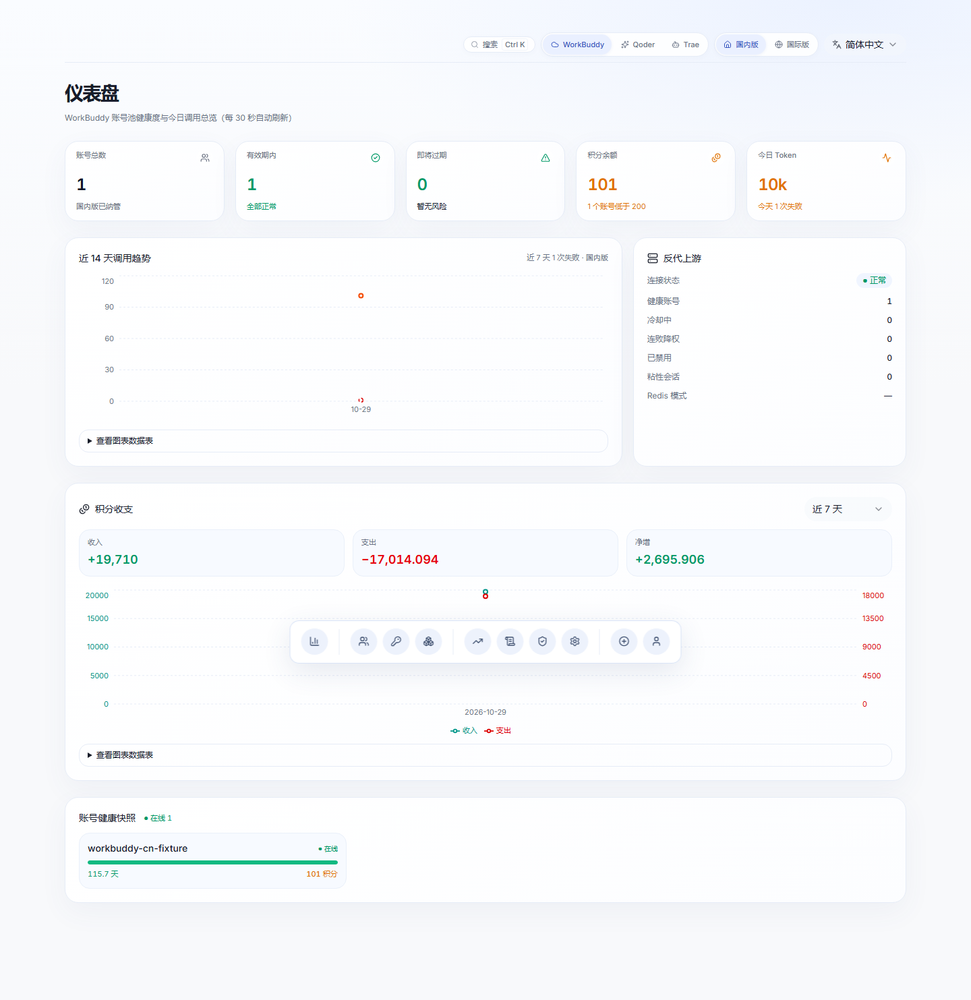

</div>

## What this is

Zhihui Gateway combines WorkBuddy, Qoder and Trae account-pool management with a shared LLM gateway. WorkBuddy provides account scheduling and provider access; the Manager adds account administration, downstream keys, budgets, IP rules and operational visibility. This fork also ships upstream compatibility patches in dev/upstream-patches. Report issues in the [gateway repository](https://github.com/daniei-chen/zhihui-gateway/issues).

| Original operation | In the console |
| --- | --- |
| Run login.sh on the server | Authorize and add an account with a QR code |
| Use curl /status | Inspect health, cooldown and expiry on the dashboard |
| Edit config.json manually | Use typed configuration fields and descriptions |
| Share a global downstream key | Issue independently restricted keys |
| Infer who used credits | Inspect request-level model, token, latency and IP metadata |
| No inbound IP controls | Apply global and per-key IP/CIDR policies |

## Features

User documentation: [Features](docs/features.md), [Usage](docs/usage.md),
[Screenshots](docs/screenshots.md), [Development and testing](docs/development.md),
and [Security configuration](docs/security-notes.md).

The following capabilities depend on the selected platform, account type and installed upstream version. Unsupported capabilities are reported explicitly.

### Account management

Add accounts with QR authorization; successful authorization saves credentials and reloads the account pool. Inspect expiry, last renewal, cooldown, per-model limits and pool membership. Manual refresh renews and saves the token; expired credentials require authorization again. Background renewal starts when fewer than three days remain.

Credits are queried from the provider and marked as fresh or cached. Grants have independent expiry times; inspect the nearest expiry and the complete grant list. A disabled account stops receiving conversations while supported check-in and keepalive tasks continue.

Groups bind a named upstream to its own account directory. Creating a group with the same upstream URL does not create an independent pool: deploy another upstream instance for actual separation. Groups without a local account directory support forwarding only. Moving an account preserves credential bytes and refuses to overwrite an existing destination.

The Tasks page combines check-ins, upstream logs, scheduled activity and credit changes, with time filters and bounded scrolling. Container logs are collected into the database so rebuilding a container does not discard collected history. “Already checked in” is an idempotent success, and collection limits are shown explicitly.

### Reverse-proxy gateway (`/v1`)

Use OpenAI-compatible streaming or ordinary requests. Downstream keys can restrict platforms, region, models, source IPs, expiry and token or credit budgets. Only key hashes are stored; save the plaintext when creating a key.

Keys bound to an unavailable upstream fail explicitly instead of falling back to another pool. Model aliases support migration. China and global accounts, models and records are separated; global accounts have different check-in and grant capabilities. The model catalogue uses provider metadata and labels fallback sources instead of inventing limits or prices.

The administrator Playground uses real accounts and consumes actual credits. Request logs include status, first-token latency, total latency, reported usage, billed credits and cache usage. Missing billing data remains unknown rather than being presented as a measured zero.

### Visual settings

Configure check-ins, travel, activity and keepalive independently, including their execution hours. Prompt mode supports the upstream configuration options, along with concurrency, routing and model aliases. Configuration edits merge partial fields and preserve unrelated settings. Outbound proxies can be assigned globally or per account when the upstream supports the corresponding routes.

Schedules use arrays of hours and duration strings, matching upstream types. Read the field descriptions before changing a value; saving a configuration can reload or restart the upstream when supported.

### Mobile use

Responsive navigation, compact tables and dialogs support phone-sized screens. The same authenticated console and APIs are used on desktop and mobile.

### Interface and interaction

Light and dark themes, consistent components, keyboard navigation, loading states, error feedback and confirmation for destructive actions apply throughout the console. The interface supports Simplified Chinese, Traditional Chinese, English, Japanese and Korean.

### Updates

The Settings page checks the configured Manager release repository. Downloaded release packages require signature verification. Offline packages are supported. Native Windows deployments require a manual code update and process restart. A package signature and a container image digest are separate verification mechanisms.

### PostgreSQL backup vault

An optional PostgreSQL destination can hold a copy of the local application database. Configure and test the connection, then export or restore manually or at the configured interval. Restore overwrites the local database and first creates a local recovery copy.

This feature copies database business data, including key hashes, settings and usage. It does not include .env, administrator files or provider account directories: carry those separately when migrating. Export and restore require an administrator session. The psycopg dependency is listed in server/requirements.txt.

### Changelog

Settings reads the deployed CHANGELOG.md, with a server-side fallback. It works offline, groups entries by version and marks the running version. Updating the Manager also refreshes the shipped documentation.

### Access control

Administrators sign in with a password and a signed HttpOnly cookie. Passwords use salted PBKDF2-SHA256; gateway keys authorize model calls and cannot log into the console. Password changes, role changes and deletion invalidate that user’s sessions without invalidating other users.

Administrators retain account, container, task and update capabilities. Viewer accounts support status inspection under the existing endpoint policy. Login attempts and user administration are audited. Scoped, expiring and revocable management API tokens are documented in [docs/api-tokens.md](docs/api-tokens.md); credential-bearing operations retain their session requirements.

For credential cleanup after an incident, deploy/purge_credentials.py backs up files before rotating the signing secret and revoking legacy sessions. Do not run it as part of a routine upgrade.

## Screenshots

Screenshots illustrate the available Manager views; data comes from the selected platform and account group.

### Dashboard

Account health, upstream connectivity, usage trends and credit expiry. Dark-mode views are included below.


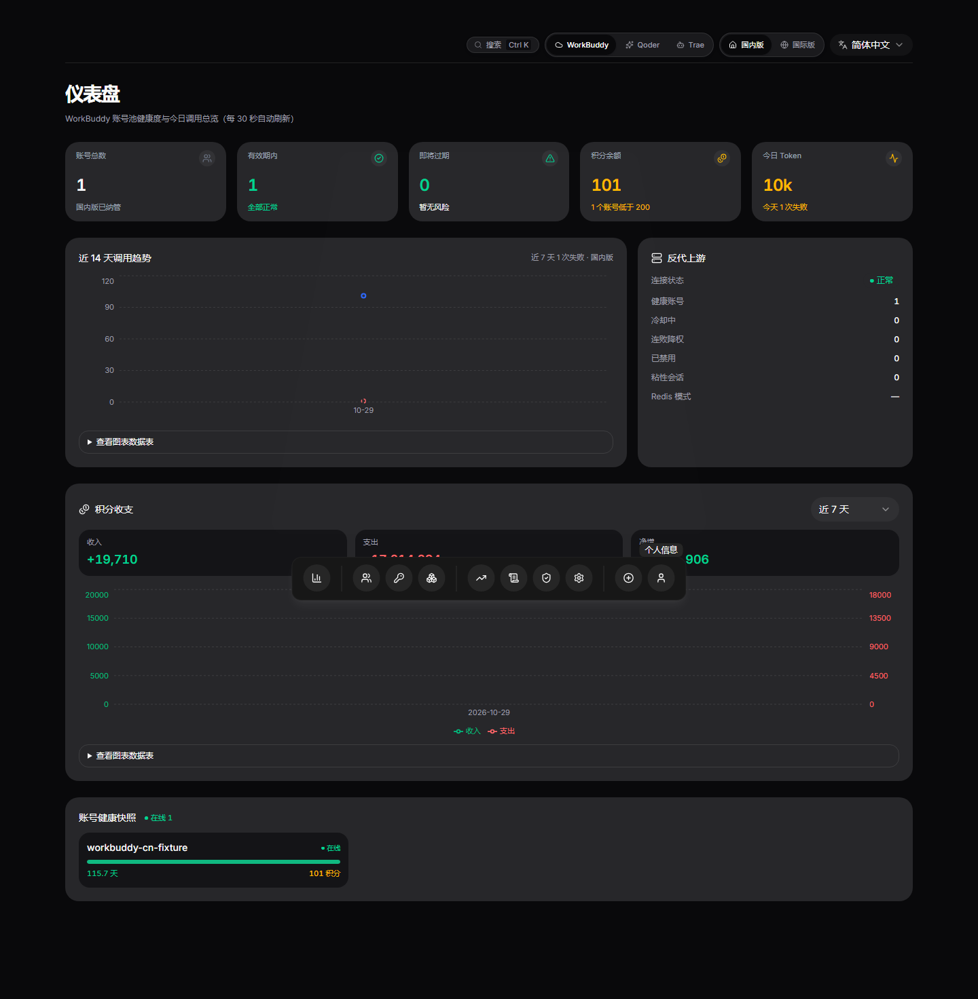

### Accounts

Account authorization, expiry, pool health, credits and group operations.

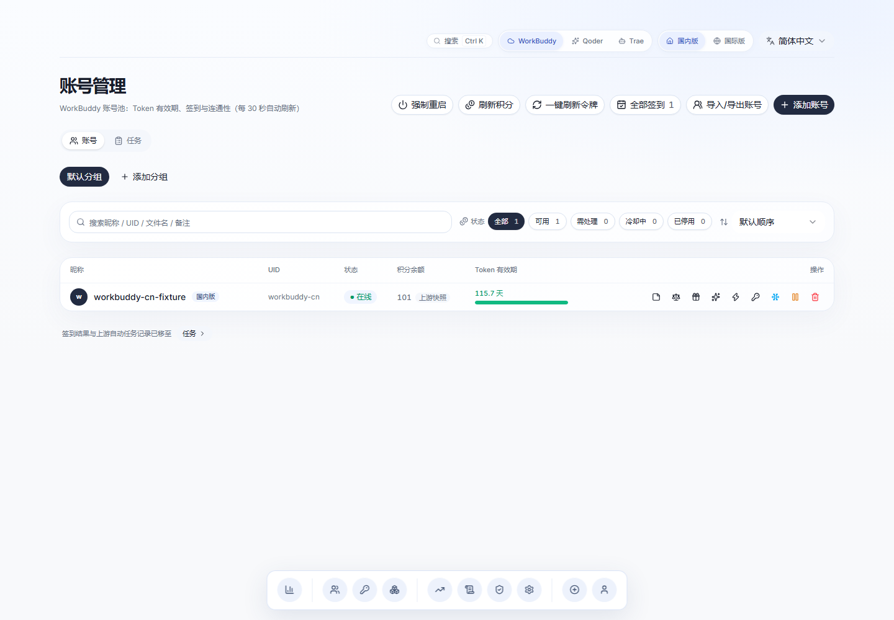


### Task history

Check-in results, scheduled tasks, captured upstream logs and credit changes.

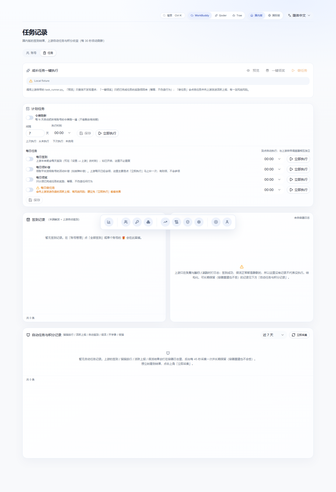

### API keys

Issue downstream keys and configure their independent restrictions and budgets.

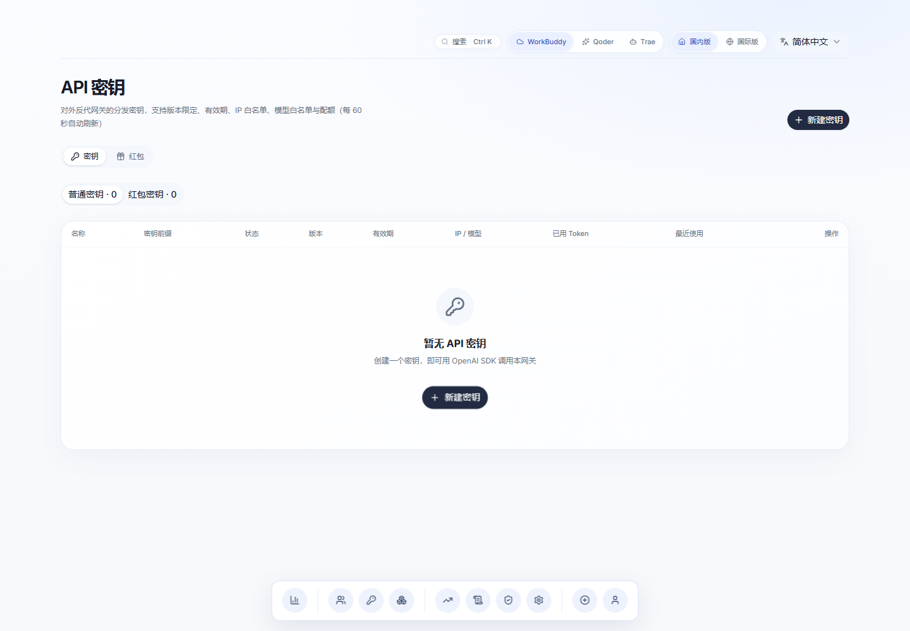

### Request logs

Filter requests by key, platform, region, model and result. Inspect first-token latency, total latency and reported usage; absent fields indicate unavailable upstream evidence.

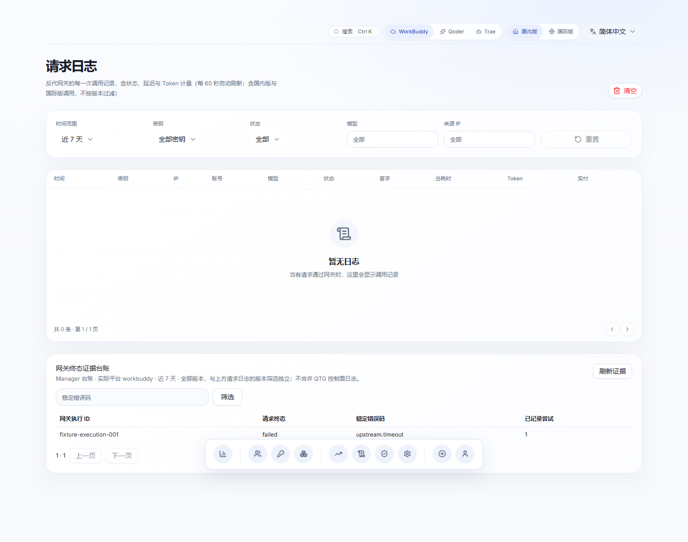

### Usage statistics

Explore scoped totals and time-series data. Short ranges use hourly buckets; longer ranges use daily buckets. Rebuild aggregates from request logs when repairing historical rollups.

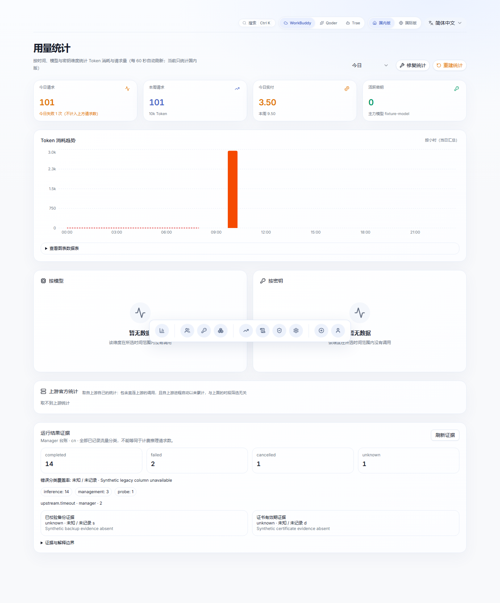

### Model catalogue

Real model names, context windows, output limits, reasoning settings, multimodal capabilities and credit factors. Provider metadata falls back to the upstream catalogue with its source identified.

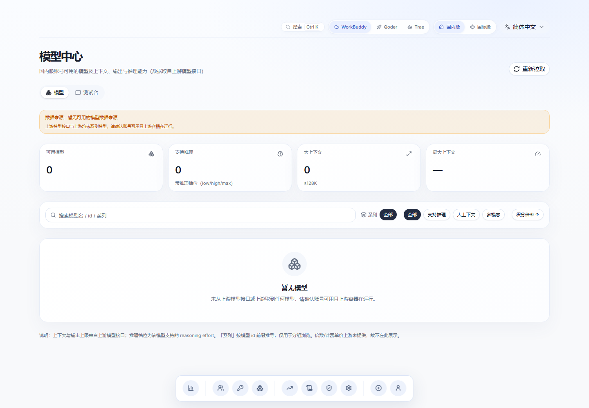

### Playground

Administrator model testing uses the same real account pool as downstream requests. It supports streaming, cancellation, reasoning settings and reported credit consumption.

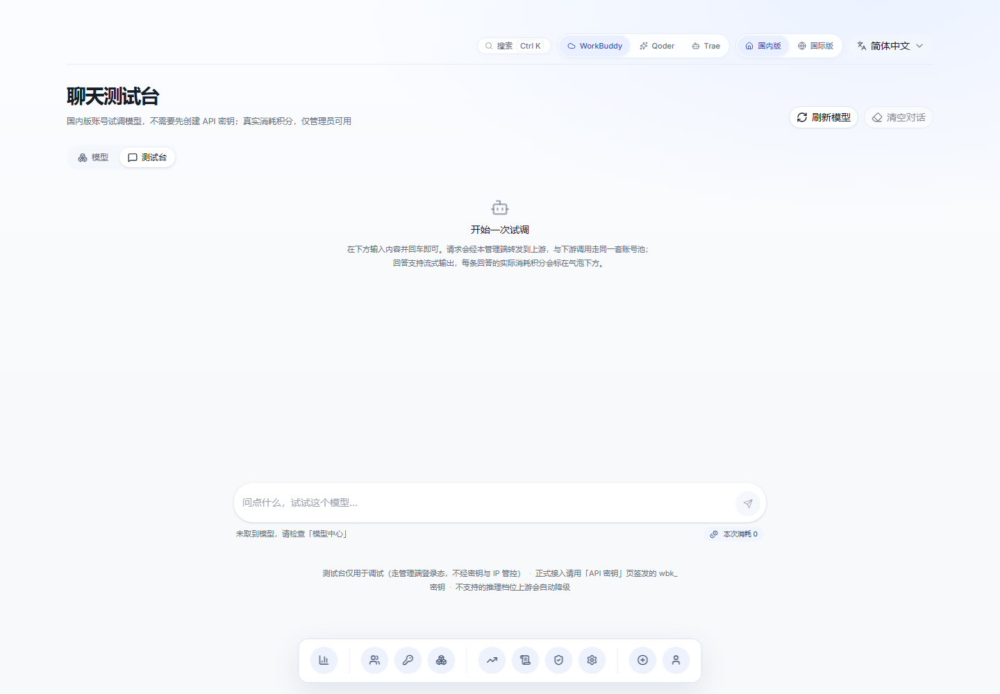

### Security and IP rules

Manage global allow/deny rules and inspect access decisions. Inference IP rules affect client traffic; the authenticated console remains available for correcting rules.

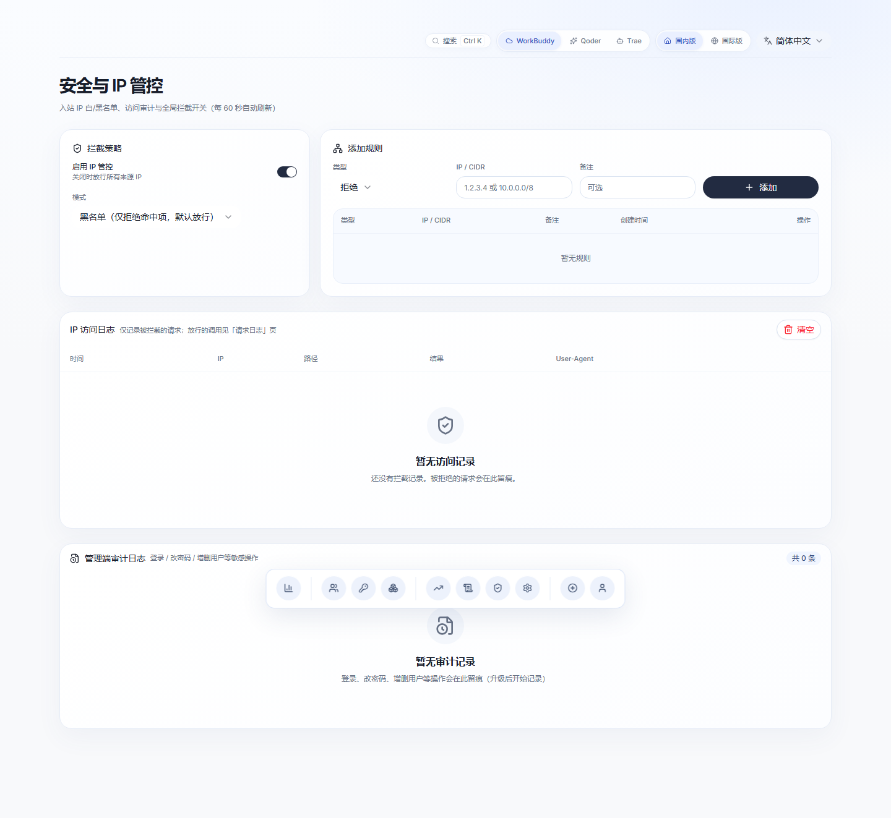

### Settings

Edit supported upstream configuration, connection groups, proxy routes, schedules, backups and updates.

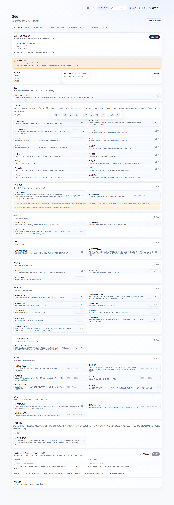

## Architecture

The Manager exposes the control API and compatible model endpoints on port 7864. WorkBuddy runs on 7863; the merged adapters also connect to Qoder and Trae. The statically exported Next.js interface is served by FastAPI or the deployment’s reverse proxy. The generic WorkBuddy arrangement is shown below.

```
   下游客户端 / sub2api（OpenAI SDK）
              │  Authorization: Bearer wbk_xxx
              ▼
   ┌──────────────────────────────────────────────┐
   │  智汇网关                     :7864 │
   │  ┌────────────────────────────────────────┐  │
   │  │ 反代网关  /v1  /v2  /healthz           │  │
   │  │  密钥鉴权 → IP 管控 → 模型映射          │  │
   │  │  → 流式转发 → 日志与用量落库(SQLite)    │  │
   │  ├────────────────────────────────────────┤  │
   │  │ 管理接口  /api/*                       │  │
   │  │  登录 / 账号 / 密钥 / 日志 / 用量        │  │
   │  │  / 安全 / 设置                          │  │
   │  ├────────────────────────────────────────┤  │
   │  │ Web 前端（Next.js 静态导出）            │  │
   │  └────────────────────────────────────────┘  │
   └───────────────┬──────────────────────────────┘
                   │ 复用 auths/*.json  调用 /status /v1/models
                   ▼
   ┌──────────────────────────────────────────────┐
   │  workbuddy2api（Go，不改动）            :7863 │
   │  账号轮询 · 并发调度 · 熔断 · 令牌刷新          │
   └───────────────┬──────────────────────────────┘
                   ▼
        腾讯 CodeBuddy / copilot.tencent.com
```

| Layer | Implementation |
| --- | --- |
| Frontend | Next.js 15 App Router, React 19, TypeScript, shadcn/ui, Tailwind CSS v4, motion, recharts, sonner |
| Backend | Python 3.11+, FastAPI, uvicorn, httpx and SQLite |
| Deployment | Configured process manager, reverse proxy and HTTPS |

## Quick start

These are generic installation instructions. Preserve the current managed server’s signed releases, deployment identities, Docker access and existing account state when upgrading an established installation.

### 1. Local development

Run the optional mock upstream when provider accounts are unavailable. Start the Python API and Next.js development server separately as shown below. Initial startup creates users.json and a random signing secret. If WB_ADMIN_PASSWORD is unset, a one-time generated password is written to the startup log.

Internal HTTP requests ignore environment proxy variables by default. Configure WB_HTTP_PROXY when needed, and ensure TUN-mode proxy software bypasses loopback traffic.

```bash
# 0) 可选：本机没有真实的 workbuddy2api 时，起一个模拟上游
#    自带模型列表与示例账号，便于查看完整界面
python dev/mock_upstream.py         # 监听 127.0.0.1:7863

# 1) 后端（终端 A）
python -m pip install -r server/requirements.txt
WB_ADMIN_PASSWORD=admin123 \
WB_DATA_DIR=./data \
WB_AUTH_DIR=/opt/workbuddy2api/auths \
WB2API_BASE=http://127.0.0.1:7863 \
python -m uvicorn server.main:app --reload --port 7864

# 2) 前端（终端 B）—— next dev 会把 /api、/v1 反代到 :7864
cd web
npm install
npm run dev                          # http://localhost:3000
```

#### Running tests

Use Python 3.11+ and Node 22+ for the complete suite. dev/run_isolated_tests.py supplies a temporary home, database and a real loopback provider; it does not require a production provider key. The configuration tests use temporary upstream files. Network-dependent integration options must be configured explicitly.

```bash
# 配置读写的回归测试：时刻数组 / 时长字符串 / 部分提交不覆盖同段其他键
python -m unittest discover -s server/tests -t . -v
```

### 2. Native Windows deployment

Run an upstream instance locally first. Copy .env.example and configure native mode, upstream paths, start/stop scripts and the log file. Forward slashes are recommended in Windows paths. Build the static UI and use service-tools.ps1 start, status, restart or stop.

Use the upstream’s own start/stop scripts when available. A start script must return promptly, and task logs must be written to WB2API_LOG_FILE. Older upstreams can use templates in [deploy/windows-native](deploy/windows-native/README.md). The web updater reports unsupported native operations explicitly; update code manually and restart the process.

```powershell
git clone https://github.com/daniei-chen/zhihui-gateway.git
cd zhihui-gateway
Copy-Item .env.example .env
```

```dotenv
WB_MANAGER_HOST=127.0.0.1
WB_SECURE_COOKIE=false
WB2API_MODE=native
WB_UPSTREAM_DIR=C:/path/to/workbuddy2api
WB_AUTH_DIR=C:/path/to/workbuddy2api/auths
WB_UPSTREAM_CONFIG=C:/path/to/workbuddy2api/config.json
WB2API_START_SCRIPT=C:/path/to/workbuddy2api/start-workbuddy2api.cmd
WB2API_STOP_SCRIPT=C:/path/to/workbuddy2api/stop-workbuddy2api.cmd
WB2API_LOG_FILE=C:/path/to/workbuddy2api/data/server.err.log
```

```powershell
py -3.11 -m venv .venv
.\.venv\Scripts\python.exe -m pip install -r server\requirements.txt
Set-Location web
npm ci
npm run build:export
Set-Location ..
powershell -ExecutionPolicy Bypass -File .\service-tools.ps1 start
```

### 3. Docker deployment

The supplied compose file builds the frontend if web/out is absent, or reuses shipped static assets. Adjust upstream addresses and mounted paths for your installation. A registry mirror can be passed with the NPM_REGISTRY build argument. Published images support amd64 and arm64; inspect and pin the image digest used for a release.

Fork builds use deploy/fork-image/build-image.yml and publish a separate -multiarch image name to avoid package ownership collisions. See [fork image instructions](deploy/fork-image/README.md).

The upstream source/configuration directory, durable data directory and Docker socket provide account administration, reload, logs and container updates. Docker access is an intentionally authorized management capability in this deployment and remains available. Match the socket group and mounted-directory ownership to the configured container identity. Generic compose defaults bind ports to loopback; publish through the configured HTTPS proxy.

```bash
git clone https://github.com/daniei-chen/zhihui-gateway.git
cd zhihui-gateway
# 按需改 compose 里的 WB2API_BASE 与卷路径（默认假设上游在 ../workbuddy2api）
docker compose up -d --build
docker compose logs zhihui-gateway | grep -A2 密码   # 首启随机密码
```

```bash
docker pull ghcr.io/daniei-chen/zhihui-gateway:latest
```

```bash
mkdir -p .github/workflows
cp deploy/fork-image/build-image.yml .github/workflows/
git add .github/workflows/build-image.yml && git commit -m "ci: 构建自己的镜像" && git push
```

```bash
docker pull ghcr.io/<你的用户名>/zhihui-gateway-multiarch:latest
```

| Mount | Purpose |
| --- | --- |
| Upstream directory | Read/write upstream configuration and auths; inspect compose and perform authorized updates |
| ./data | Persist the database, logs and update state |
| /var/run/docker.sock | Preserve authorized container reload, rebuild and log access |

### 4. Server installation

Release packages include the built frontend and bundled upstream sources. The installer checks prerequisites, installs or connects the upstream, creates random credentials for a new installation, installs the Manager and verifies readiness. Use --skip-upstream for an existing upstream without replacing its configuration or accounts.

Source-only installations need Node to build missing UI assets; release packages avoid that requirement. Configure an HTTPS reverse proxy, for example in 1Panel, targeting http://127.0.0.1:7864. Read [deploy/README.md](deploy/README.md) for installation options and effective environment variables. Existing managed installations should use their signed release workflow rather than rerunning bootstrap commands.

```bash
# 推荐：用 Release 包（内含已构建的前端，无需 Node.js）
wget https://github.com/daniei-chen/zhihui-gateway/releases/latest/download/zhihui-gateway-<版本>.tar.gz
tar xzf zhihui-gateway-*.tar.gz && cd zhihui-gateway-*

sudo bash deploy/install.sh
```

```bash
journalctl -u workbuddy-web | grep -A3 '初始管理员'
```

| Variable | Default | Description |
|---|---|---|
| `WB_MANAGER_PORT` | `7864` | Listen port |
| `WB2API_BASE` | `http://127.0.0.1:7863` | WorkBuddy upstream URL |
| `WB2API_KEY` | from config.json | Upstream API key |
| `WB2API_MODE` | `docker` | Upstream mode: docker or native |
| `WB2API_CONTAINER` | `workbuddy2api` | Container name for reload |
| `WB_AUTH_DIR` | `/opt/workbuddy2api/auths` | Provider account directory |
| `WB_UPSTREAM_CONFIG` | `/opt/workbuddy2api/config.json` | Upstream configuration file |
| `WB2API_START_SCRIPT` | .cmd in upstream directory | Native start script |
| `WB2API_STOP_SCRIPT` | .cmd in upstream directory | Native stop script |
| `WB2API_LOG_FILE` | `data/server.err.log` | Native upstream log file |
| `WB_DATA_DIR` | `./data` | Application data directory |
| `WB_STATIC_DIR` | `./web/out` | Static export directory |
| `WB_ADMIN_PASSWORD` | generated | Initial administrator password |
| `WB_SECURE_COOKIE` | `auto` | Secure-cookie policy: auto uses the validated request/proxy scheme; true and false override it |
| `WB_SESSION_DAYS` | `1` | Maximum session lifetime in days |
| `WB_SESSION_IDLE_HOURS` | `12` | Idle-session expiry window in hours |
| `WB_GATEWAY_RATE_PER_MIN` | `120` | Accepted requests per key per 60 seconds; zero disables this limit |
| `WB_GATEWAY_MAX_BODY_MB` | `32` | Per-request body limit in MiB |
| `WB_SYNC_DEPLOY` | `1` | Update deploy scripts with Manager unless set to zero |
| `WB_HTTP_PROXY` | empty | Explicit outbound proxy; empty means direct access |

## Usage

Select the platform and region before administering accounts, issuing keys or inspecting usage.

### 1. Add accounts

In Accounts, choose Add account and complete QR authorization. The selected group determines the credential directory and upstream; global accounts may also need region registration and trial activation.

### 2. Issue downstream keys

Create a key with the desired platform, region and upstream group. Configure expiry, source-IP restrictions, model allowlists and independent token/credit quotas. Either quota can reject further requests; zero disables that particular quota.

Use reported provider credit usage for credit accounting. Missing usage is unknown, not proof of a free request, and unresolved spend requires evidence-based reconciliation. Save the plaintext key immediately: it is shown once and only its hash is retained.

### 3. Connect clients

Use the gateway /v1 URL with a downstream key for OpenAI-compatible calls. The examples cover curl, SDK calls, Responses and Anthropic Messages. Use the exact supported model identifier from the model catalogue; region-specific model identifiers and key restrictions must agree.

For Qoder or Trae, use the corresponding platform entry point or an explicitly supported platform/model prefix. Gateway keys are distinct from management sessions and upstream credentials. Streaming clients must inspect error events and completion markers as well as the initial HTTP status. Avoid automatically replaying accepted requests after an ambiguous disconnect because the provider may already have billed them.

```bash
curl https://wb.example.com/v1/chat/completions \
  -H "Authorization: Bearer wbk_xxxxxxxx" \
  -H "Content-Type: application/json" \
  -d '{
    "model": "glm-5.2",
    "messages": [{"role": "user", "content": "你好"}],
    "stream": true
  }'
```

```python
from openai import OpenAI

client = OpenAI(
    base_url="https://wb.example.com/v1",
    api_key="wbk_xxxxxxxx",
)

resp = client.chat.completions.create(
    model="glm-5.2",
    messages=[{"role": "user", "content": "你好"}],
    stream=True,
)
for chunk in resp:
    print(chunk.choices[0].delta.content or "", end="")
```

```python
from openai import OpenAI

client = OpenAI(base_url="https://wb.example.com/v1", api_key="wbk_xxxxxxxx")

resp = client.responses.create(
    model="glm-5.2",
    instructions="你是一个简洁的助手",
    input="你好",
    stream=True,
)
for event in resp:
    if event.type == "response.output_text.delta":
        print(event.delta, end="")
```

```bash
export ANTHROPIC_BASE_URL=https://wb.example.com
export ANTHROPIC_AUTH_TOKEN=wbk_xxxxxxxx   # 也接受 x-api-key 头
export ANTHROPIC_MODEL=glm-5.2
```

## API reference

The tables below summarize the native public endpoints. Authentication and platform-specific behavior follow the actual route policy; administrative and credential-bearing operations retain their existing session requirements.

| Method | Path | Authentication | Description |
|---|---|---|---|
| `POST` | `/v1/chat/completions` | Gateway key | Chat Completions, streaming and non-streaming |
| `POST` | `/v2/chat/completions` | Gateway key | Chat Completions v2 path |
| `POST` | `/v1/responses` `/responses` | Gateway key | Responses compatibility, streaming and non-streaming |
| `POST` | `/v1/messages` | Gateway key | Anthropic Messages compatibility |
| `POST` | `/v1/messages/count_tokens` | Gateway key | Character-based approximate input token count |
| `GET` | `/v1/models` | Gateway key | Available models |
| `GET` | `/healthz` | None | Liveness and upstream connectivity |
| `GET` | `/api/me` | Session | Current authenticated user |
| `POST` | `/api/login` `/api/logout` | None | Login and logout |
| `GET` | `/api/accounts` | Session | Account list |
| `POST` | `/api/auth/start` `/api/auth/poll` | Administrator | QR authorization flow |
| `POST` | `/api/accounts/{file}/checkin` `/test` `/refresh` | Administrator | Check-in, connectivity test and refresh |
| `DELETE` | `/api/accounts/{file}` | Administrator | Delete an account |
| `GET/POST/PATCH/DELETE` | `/api/keys[/{id}]` | Session / administrator | Downstream model-access key management |
| `GET/POST/PATCH/DELETE` | `/api/upstreams[/{id}]` | Administrator session | Upstream account-pool groups; probe with POST /api/upstreams/{id}/probe |
| `GET/POST/PATCH/DELETE` | `/api/tokens[/{id}]` | Administrator session | Scoped management tokens; see docs/api-tokens.md |
| `GET` | `/api/logs` `/api/stats/*` | Session | Request logs and usage |
| `GET/POST/DELETE` | `/api/security/*` | Session / administrator | IP rules and audit |
| `GET/POST` | `/api/settings/*` | Session / administrator | Upstream settings and model aliases |
| `GET/POST` | `/api/settings/pg-sync*` | Administrator session | PostgreSQL backup configuration, connectivity, export and restore |

## Directory layout

Source files, build assets, operational scripts and persistent application data have separate roles. Provider credentials and runtime databases must not be committed to the source repository.

```
zhihui-gateway/
├─ server/                       # FastAPI 后端
│  ├─ main.py                    # 入口：路由注册 + 静态托管
│  ├─ config.py                  # 全部环境变量与 http_client 工厂
│  ├─ db.py                      # SQLite（密钥/日志/用量/IP/设置）
│  ├─ security.py                # PBKDF2 + 签名 Cookie + 防爆破
│  ├─ keysvc.py                  # 密钥生成、校验、限额判定
│  ├─ iputil.py                  # 真实 IP 解析 + CIDR 匹配
│  ├─ services/
│  │  ├─ tencent.py              # 腾讯登录 / 签到 / 探测协议
│  │  └─ wb2api.py               # workbuddy2api 交互（含配置写入校验）
│  ├─ tests/                     # 配置读写回归测试
│  └─ routers/                   # auth accounts keys logs stats security settings gateway
├─ web/                          # Next.js 15 前端
│  ├─ app/(main)/                # dashboard accounts keys logs stats security settings
│  ├─ app/(auth)/login/          # 登录页
│  ├─ components/ui/             # shadcn 原语（含 floating-dock）
│  └─ components/common/         # 浮动底栏、统计卡、各业务组件
├─ dev/mock_upstream.py          # 本地联用的模拟上游
├─ deploy/                       # systemd unit + 一键部署脚本
└─ docs/                         # 设计与实现文档 + 界面截图
```

## Security notes

Downstream key hashes, salted password hashes, signed HttpOnly cookies, session revocation, dual IP/user login lockout, path validation and security response headers form the existing controls. Trusted-proxy processing must match the effective reverse-proxy configuration; untrusted client forwarding headers must not determine identity.

Management API tokens have explicit scopes, expiry and revocation. Sensitive routes remain session-only. API documentation is disabled by default unless enabled explicitly. Request-body and per-key rate limits are configurable; inspect the effective settings instead of relying on historical defaults. Credential files, databases and runtime state are excluded from Git. See [the security audit](docs/SECURITY-AUDIT.md).

### Statistics conventions

Usage days follow the configured local timezone consistently. Older UTC/local-time rollups can be repaired by rebuilding statistics from request logs. Reported, absent and unresolved usage are separate states.

### Deployment configuration

Use the authorized administrator accounts and configured HTTPS entry points. Keep upstream listeners on their intended private interfaces and configure trusted proxies from the actual topology. Preserve the approved Manager Docker privileges and DSH sudo capability. Report security issues through the repository’s [private advisory channel](https://github.com/daniei-chen/zhihui-gateway/security/advisories/new).

## Known limitations

Per-account proxy routes require matching upstream support; see [account proxy routes](docs/account-proxy-routes.md). Request and response contents are not retained: logs contain metadata only. Historical records cannot supply missing usage details that were never recorded upstream. Backups of the business database alone do not restore all provider accounts or desktop DSH state.

## Releases and feedback

Read [CHANGELOG.md](CHANGELOG.md), download [releases](https://github.com/daniei-chen/zhihui-gateway/releases), or submit a [bug report](https://github.com/daniei-chen/zhihui-gateway/issues/new?template=bug_report.yml). Include the exact release and relevant diagnostic identifiers, with credentials removed. Bundled-upstream issues can be reported in the same repository.

### Release workflow

A version tag triggers the repository’s frontend build, source packaging and release notes. An established managed deployment additionally verifies its candidate signatures, file hashes, tests, runtime identity and readiness before switching traffic. Keep the previous release available for rollback.

```bash
git tag v1.0.1 && git push origin v1.0.1
```

## Sponsorship and advertising

The repository includes third-party advertising below. Hosting is independent of the gateway; no listed vendor is a code dependency.

### LoveVPS hosting advertisement

The original project lists [LoveVPS](https://lovevps.cn/) as an advertising partner. Refer to the vendor for current locations, terms and offers. This information is separate from the gateway installation and does not imply a technical dependency.

## Related projects

[sanguine886/workbuddy-sdk](https://github.com/sanguine886/workbuddy-sdk) is a community Go SDK for control and compatible generation APIs. It is maintained separately and is not a code dependency; report SDK issues in its repository.

## Acknowledgements

Thanks to [LINUX DO](https://linux.do), [linux-do/cdk](https://github.com/linux-do/cdk), [Sliverkiss/workbuddy2api](https://github.com/Sliverkiss/workbuddy2api) and [Antigravity-Manager](https://github.com/lbjlaq/Antigravity-Manager). Bundled upstream code retains its original MIT notices.

## License

[MIT](LICENSE)
