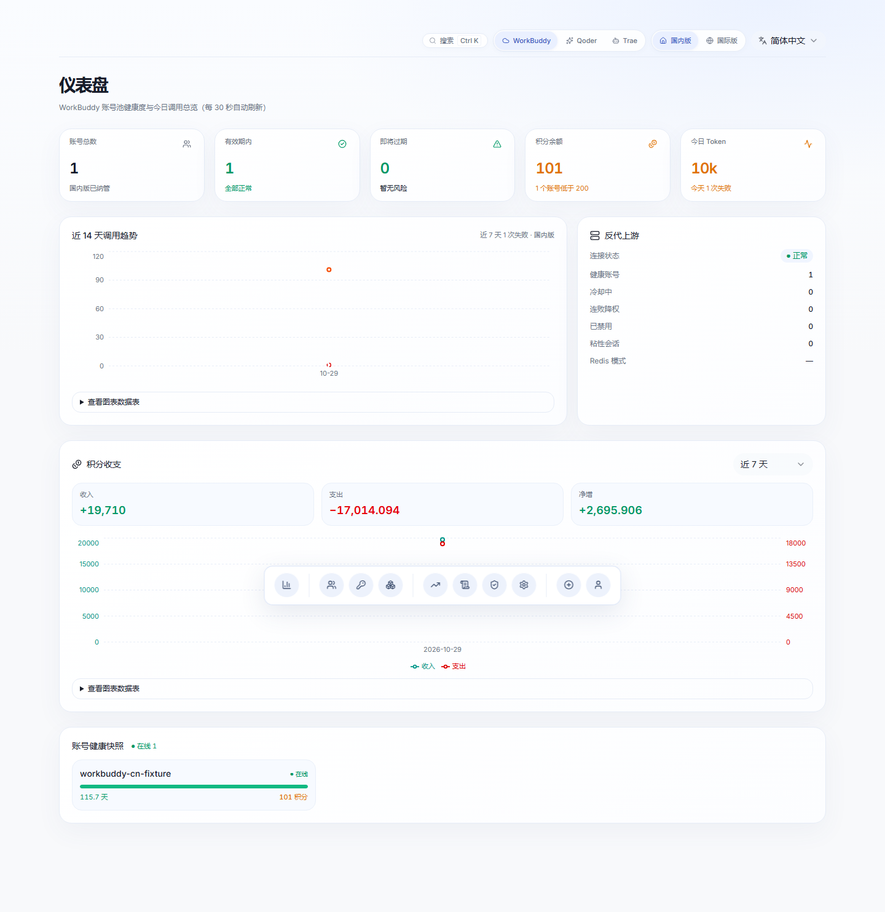

# 智汇网关 · Manager

**一个工作台，三条清晰的路径。**

[English](README.en.md) · **简体中文** · [产品概览](../README.md) · [变更日志](CHANGELOG.md)

> **0.0.7 是智汇自己的产品版本，不是继承组件的 v1.x / v2.x。**
> 仅通过可信发布器安装；实际生效版本以运行身份和发布验收回执为准。Linux 隔离门禁、签名、配对备份、排空及实际业务验收缺一不可，代码回滚不回退业务账本。

## 组件与边界

### 本地待验收候选：单默认密钥与邀请注册

0.0.9 / 0.0.10 为 2026-11-06 生产事件后的两轮受限稳定性补丁；是否切换以受控发布回执为准，不以本文替代上线批准。

- 首页分别提供“用户登录”和“管理员登录”；用户登录页支持邀请码注册。
- 工作台沿用一个现有默认密钥，不提供创建多个密钥。首次没有密钥时可启用一次；已有密钥的明文不可重读，也不会因此自动轮换。当前密钥标签与统计名称使用所属用户名，历史用量和账本不改写。
- 旧版已有的额外密钥保留有效，避免中断原客户端；工作台只显示默认项并禁止增发。
- 注册需要管理员生成的一次性邀请码、服务端签名的浏览器设备登记，以及持久化的 IP、网段、设备和全局限流。邀请码只保存哈希，明文只返回一次；注册不赠送调用额度。
- 设备登记约束同一浏览器，不能识别不可伪造的物理设备。清除 Cookie 或换浏览器仍受邀请码和限流约束。
- 公网反代必须覆盖客户端提供的 IP 身份头，并正确设置可信代理范围；配置示例仅供可信发布器审核合并，没有自动修改现网。

Manager 提供账号、模型、密钥、日志与管理界面，WorkBuddy 引擎负责账号池与上游请求。Qoder / Trae 保持既有独立适配与权限边界。

这是带本地适配的维护分支，不是“上游一行未改”的纯面板。源码、许可证、测试和构建身份随候选保留；历史安装指南仅作组件参考，不能代替当前受控发布合同。

## v0.0.10 重点

| 问题 | 本版本处理 |
|---|---|
| Anthropic 流式工具重复 id/name（call_1call_1 / BashBash） | 连续重复片段去重，单字符分片保持拼接语义（ZG-01） |
| 账号锁定被第三方滥用 | 锁定维度改为 来源 IP+用户名（ZP-001 收口） |
| rejected 终态占用 portal 钱包 | 挂起占用自动释放（`WB_PORTAL_AUTO_CLOSE_REJECTED`，默认关闭），未知成本另记不计 0（ZM-002 部分） |
| 控制台更新日志缺 0.0.9 条目 | `/api/system/changelog` 改读发布树 Manager 日志，版本列表完整呈现 |
| 限额密钥被一次中断锁死 15 分钟 | 并发/预算闸门 1→8（`WB_KEY_CONCURRENCY_QUOTA` / `WB_KEY_BUDGET_PENDING_QUOTA`） |
| 卡死请求长时间占用并发槽 | `WB_UPSTREAM_TIMEOUT` 600s→300s；MemoryHigh 1 GiB→1.5 GiB；swappiness 10 |

0.0.9 重点（流式缓冲 ZE-01/02、realm 裁剪 ZG-02、count_tokens 并发豁免、登录失败限速、audit_logs 补写）见 [0.0.9 说明](docs/RELEASE-0.0.9.md)；本版详见 [0.0.10 说明](docs/RELEASE-0.0.10.md)。

## v0.0.9 重点

| 问题 | 本版本处理 |
|---|---|
| Codex / Claude / DSH 提示词渠道拒绝 | 11 条版本化规则，仅处理 WorkBuddy system/developer；补齐 Claude 字面模板变体 |
| 11128 重试放大 | 两条候选路径均拒绝后结束，不重发同一路径，不因拒绝封禁账号 |
| 同账号并发续期 | Go / Python 去重、共享内核锁、身份与代次校验、原子保存 |
| 小预算默认高推理 | 无显式控制且预算 ≤1024 时不注入默认 thinking/high，不强制关闭原生推理 |
| 到期日志直接删除 | 后台有界归档、逐行与 SHA 校验后按匹配行删除，保留未决关联行 |
| 未决被误解为钱包冻结 | 只读核对队列，有界证据；unknown 不等于零用量或钱包冻结 |
| 模型目录过期与加载竞争 | 并发合并、区域隔离、失效代次与新鲜度元数据 |
| 首轮就绪采样竞态 | 启动完成前等待一次真实采样，保留失败关闭和排空约束 |
| 旧升级器品牌与历史混入当前状态 | 独立智汇发布中心、发行源与匹配回执；旧网页安装退役，旧展示文件可显式安全归档 |
| 重试在两层叠加 | 每个 Manager 执行共享最多 8 次供应商发送授权，跨账号、路径、gzip 与再次 dispatch 共用；缺少有效回执则禁用后续拒绝重试 |
| 打开账号页全量查积分 | 先读本地快照；自动仅刷新过期项、最多 64 个，失败退避；手动全量刷新保留，未知不当零 |
| 心跳重复替换全部数据 | 有界结构共享复用未变对象与账号行，不吞掉变化，不跨分组保留上一组数据 |
| 故障只有模糊 502 | 固定错误族指标与分层诊断；渠道拒绝、裸 11128、鉴权、超时、断流、取消分别表达 |
| 上游升级与协议能力不透明 | 39 项公开来源的离线漂移检查、能力合同及破坏性变更检查、版本化合成协议夹具与 SSE Fuzz |

保留 `.4` 的取消挂起计费、撤销旧密钥与配对备份修复。路由软下限和大请求分散默认关闭。完整范围及限制见 [0.0.7 说明](docs/releases/v0.0.7.md)。

### 提示词适配不是供应商授权

兼容规则幂等、可关闭，不修改用户、助手、工具消息正文、工具参数或图像，也不全局替换数字 `11128`。真实拒绝仍返回 `channel_check_rejected`；无法保证未来渠道校验永不变化。

Responses 是适配层，不提供持久会话、后台任务或 strict 工具 schema 保证。不支持的语义在消耗供应商配额前明确拒绝。

### 保留账务真实性

供应商用量未知与用户钱包挂起分别表达，不从截断日志重建终身消费，不重写不可变事件。核对页不提供清零按钮；代码回滚不恢复旧业务数据库。

## 接口速览

| 方法 | 路径 | 说明 |
|---|---|---|
| POST | `/v1/chat/completions` | Chat 兼容调用，使用下游密钥 |
| POST | `/v1/responses` | 有边界的 Responses 适配 |
| POST | `/v1/messages` | Messages 适配 |
| GET | `/v1/models` | 当前授权范围的模型列表 |
| GET | `/api/budgets/review` | 管理员只读分页核对 |
| GET | `/api/budgets/review/evidence` | 管理员有界凭证视图 |
| GET | `/api/logs/retention/status` | 归档最近采样状态 |
| GET | `/readyz` | 有界缓存的就绪结果，不发推理探测 |

## 文档导航

| 文档 | 内容 |
|---|---|
| [升级与回滚合同](docs/V007-OPERATIONS.md) | 默认配置、授权门禁、备份及失败恢复 |
| [上游借鉴](docs/UPSTREAM-ADOPTION-v007.md) | 固定来源、采用与不采用的行为 |
| [使用指南](docs/usage.md) | 日常使用与客户端连接 |
| [功能详解](docs/features.md) | 既有能力与限制 |
| [截图说明](docs/screenshots.md) | 页面和隔离示例 |
| [开发与测试](docs/development.md) | 组件开发参考 |
| [安全配置](docs/security-notes.md) | 管理面和网络边界 |
| [管理 API Token](docs/api-tokens.md) | 范围、有效期与会话要求 |
| [账号出口路由](docs/account-proxy-routes.md) | 代理设置与账号范围 |
| [历史安全审计](docs/SECURITY-AUDIT.md) | 组件审计记录，不代替本版验收 |
| [组件签名参考](docs/release-signing.md) | 不绕过已安装的受控信任链 |
| [部署参考](deploy/README.md) | 包括 Windows 原生模板；旧一键发布不适用于当前实例 |

## 发布与取舍

仅准备本地候选与回执，等待用户明确批准。获准后仍须隔离 Linux 全量测试、完整签名、配对备份、受控排空、版本和小流量验收，不强杀在途请求。

不新增售卖、费用运营、高级 Responses 状态、媒体、异地备份或 Rust 重构。弱口令及既有管理员策略按本次范围排除，不表示已经解决。保留各组件已有许可证与来源。
